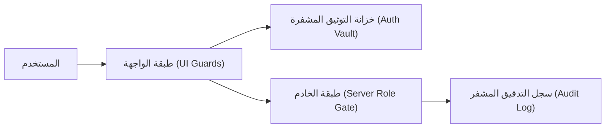

# microERP | وثيقة الاستكشاف والمعمارية الشاملة (Architectural Baseline Overview)

> **الإصدار:** 1.0.0 Enterprise Release  
> **التاريخ:** نوفمبر 2026  
> **طبيعة الوثيقة:** خريطة معمارية شاملة واستكشاف تدقيقي لنظام microERP (Baseline Documentation).  
> **قاعدة الاعتماد:** توثيق كل نقطة بالملف ورقم السطر الفعلي (`File:Line`) بنسبة تحقق 100% وبدون أي افتراضات.

---

## فهرس المحتويات
1. [خريطة التقنيات (Technology Stack Map)](#1-خريطة-التقنيات-technology-stack-map)
2. [هيكل المجلدات والملفات الموديولية (Folder & Module Architecture)](#2-هيكل-المجلدات-والملفات-الموديولية-folder--module-architecture)
3. [قاعدة البيانات وجداولها (Database Schemas & Storage Keys)](#3-قاعدة-البيانات-وجداولها-database-schemas--storage-keys)
4. [خريطة الـ API Endpoints وقنوات Electron IPC](#4-خريطة-الـ-api-endpoints-وقنوات-electron-ipc)
5. [خريطة الشاشات والوحدات (Navigation & Screens Map)](#5-خريطة-الشاشات-والوحدات-navigation--screens-map)
6. [نظام الأدوار والصلاحيات (RBAC & Authorization Matrix)](#6-نظام-الأدوار-والصلاحيات-rbac--authorization-matrix)
7. [أماكن ومعادلات الحسابات المالية (Financial Calculations Map)](#7-أماكن-ومعادلات-الحسابات-المالية-financial-calculations-map)
8. [مسارات إنشاء القيود المحاسبية (Accounting Journal Pathways)](#8-مسارات-إنشاء-القيود-المحاسبية-accounting-journal-pathways)
9. [الحالة الحالية للمشروع وسجل خط الأساس (Baseline Status)](#9-الحالة-الحالية-للمشروع-وسجل-خط-الأساس-baseline-status)

---

## 1. خريطة التقنيات (Technology Stack Map)

يعتمد نظام **microERP** على بنية هجينة تجمع بين بيئة سطح المكتب فائقة الأداء (Desktop Core) والتخزين السحابي عالي التوافر عبر خوادم Google Apps Script مع دعم العمل دون اتصال (Offline-First):

| التقنية / المكون | الدور الوظيفي في النظام | موقع الربط في الكود (File:Line) |
| :--- | :--- | :--- |
| **Electron (^33.2.1)** | بيئة تشغيل سطح المكتب لنظامي Windows و macOS، توفر نافذة آمنة مغلقة، إدارة الطابعات، والقفل الأحادي للتطبيق. | [package.json:76](file:///Users/M1/Desktop/microtech-app/package.json#L76), [main.js:7-25](file:///Users/M1/Desktop/microtech-app/main.js#L7-L25) |
| **Node.js Runtime** | تشغيل العمليات الأساسية للملف الرئيسي، وأداة الحزم والتجميع الذاتي بدون أي مكتبات خارجية (`build.js`). | [package.json:8](file:///Users/M1/Desktop/microtech-app/package.json#L8), [app-modular/build.js:1-162](file:///Users/M1/Desktop/microtech-app/app-modular/build.js#L1-L162) |
| **Preload Bridge** | طبقة عزل أمني وسيطة (`ContextBridge`) تمنع وصول كود الواجهة إلى كائنات النظام مباشرة مع تمرير وظائف الطباعة والنسخة. | [preload.js:1-17](file:///Users/M1/Desktop/microtech-app/preload.js#L1-L17), [main.js:50-56](file:///Users/M1/Desktop/microtech-app/main.js#L50-L56) |
| **Modular Vanilla JS** | بنية معمارية موديولية مقسمة إلى 11 موديول نواة (Core) و 32 موديول وظيفي (Modules) تعتمد JavaScript القياسي النقي (ES6+). | [app-modular/build.js:46-96](file:///Users/M1/Desktop/microtech-app/app-modular/build.js#L46-L96) |
| **Pure CSS3 & Design Tokens** | نظام تصميم متكامل يعتمد CSS Custom Properties لدعم 6 ثيمات (`light`, `dark`, `odoo`, `apple`, `glass`, `win11`) وتخطيطات متجاوبة. | [app-modular/css/01-variables.css:1-250](file:///Users/M1/Desktop/microtech-app/app-modular/css/01-variables.css#L1-L250), [app-modular/js/core/07-state.js:133-174](file:///Users/M1/Desktop/microtech-app/app-modular/js/core/07-state.js#L133-L174) |
| **Google Apps Script** | الواجهة الخلفية الخادمة (Serverless Backend) لمعالجة الطلبات، تطبيق حظر DoS، وإدارة التزامن عبر أقفال النصوص. | [files(11)/GoogleAppsScript_Backend.gs.txt:1-45](file:///Users/M1/Desktop/microtech-app/files%2811%29/GoogleAppsScript_Backend.gs.txt#L1-L45) |
| **Google Sheets Database** | قاعدة البيانات السحابية (19 ورقة أساسية + 13 ورقة مساعدة = 32 جدولاً) مع فحص صارم للأعمدة المسموحة لمنع تلويث المخطط. | [files(11)/GoogleAppsScript_Backend.gs.txt:47-81](file:///Users/M1/Desktop/microtech-app/files%2811%29/GoogleAppsScript_Backend.gs.txt#L47-L81), [2616-2648](file:///Users/M1/Desktop/microtech-app/files%2811%29/GoogleAppsScript_Backend.gs.txt#L2616-L2648) |
| **LocalStorage Caching & Offline Queue** | محرك التخزين المحلي، التخزين المؤقت للبيانات، طابور العمليات غير المتزامنة مع معرفات Idempotency فريدة، ومصفاة حماية المساحة. | [app-modular/js/core/02-api-sync.js:245-264](file:///Users/M1/Desktop/microtech-app/app-modular/js/core/02-api-sync.js#L245-L264), [523-604](file:///Users/M1/Desktop/microtech-app/app-modular/js/core/02-api-sync.js#L523-L604) |
| **JsBarcode Engine** | مكتبة توليد الباركود لطباعة ملصقات الباركود بمقاساتها الحرارية دون الحاجة لأي اتصال بالإنترنت. | [app-modular/build.js:20-26](file:///Users/M1/Desktop/microtech-app/app-modular/build.js#L20-L26), [app-modular/js/modules/18e-barcode-studio.js:1-100](file:///Users/M1/Desktop/microtech-app/app-modular/js/modules/18e-barcode-studio.js#L1-L100) |
| **Vitest (^5.0.3)** | إطار اختبارات الوحدة والتكامل السريع، يغطي النواة المالية، التزامن، والتحقق البنيوي. | [package.json:10, 80](file:///Users/M1/Desktop/microtech-app/package.json#L10), [tests/](file:///Users/M1/Desktop/microtech-app/tests/) |
| **ESLint (^10.12.0)** | فاحص جودة الكود وضبط المعايير التوافقية بدون أخطاء. | [package.json:9, 78](file:///Users/M1/Desktop/microtech-app/package.json#L9), [eslint.config.mjs:1-50](file:///Users/M1/Desktop/microtech-app/eslint.config.mjs#L1-L50) |

---

## 2. هيكل المجلدات والملفات الموديولية (Folder & Module Architecture)

يتكون المشروع من معمارية موديولية محكمة تجمع في ملف وحيد نهائي للإنتاج `dist/index.html` وتوزع على النحو التالي:

```
microtech-app/
├── package.json                          # تعريف المشروع، البرمجيات التابعة، وأوامر التشغيل والاختبار
├── main.js                              # المعالج الرئيسي لبيئة Electron وإدارة النوافذ والطباعة
├── preload.js                           # جسر الأمان الوسيط لـ Electron ContextBridge
├── eslint.config.mjs                    # إعدادات الفاحص اللغوي وقواعد التحقق
├── index.html                           # نسخة الإنتاج المنشورة المجمعة المتوافقة مع الويب
├── files(11)/
│   └── GoogleAppsScript_Backend.gs.txt  # الكود المصدري الكامل للباك إند وقواعد الأمان وقاعدة البيانات
├── tests/                               # 13 جناح اختبار Vitest (138 فحصاً ناجحاً)
└── app-modular/
    ├── build.js                         # أداة التجميع الفورية وإنتاج حزمة الإنتاج
    ├── css/                             # ملفات التنسيق الموديولية (5 ملفات)
    │   ├── 01-variables.css             # متغيرات الألوان، الخطوط، وأبعاد الثيمات
    │   ├── 02-base.css                  # القواعد العامة، إعادة التهيئة، ومصفوفة الخطوط
    │   ├── 03-components.css            # الأزرار، الكروت، الجداول، النوافذ المنبثقة، والشارات
    │   ├── 04-pos.css                   # تنسيقات كاشير نقطة البيع السريع والسلات المحفوظة
    │   └── 05-print.css                 # تنسيقات الطباعة الورقية والحرارية وملصقات الباركود
    └── js/
        ├── core/                        # وحدات النواة المشتركة (11 موديول)
        │   ├── 00-security-hardening.js # درع حماية النواة ومنع استدعاء eval() الخبيث
        │   ├── 01-digits.js             # محول ومعالج الأرقام الغربية والإنجليزية لجميع الحقول
        │   ├── 02-api-sync.js           # محرك المزامنة السحابية وطابور عدم الاتصال وإدارة الكاش
        │   ├── 03-utils-and-mappings.js # دوال المساعدة، تحويل السجلات، واستدعاءات الحفظ البعيدة
        │   ├── 04-chart-of-accounts.js  # شجرة الحسابات، قيود اليومية، ومعالج المطابقة التاريخية
        │   ├── 05-auth-and-audit.js     # نظام الدخول، خزانة كلمات المرور المحلية، وتصاريح الحذف
        │   ├── 06-config-defaults.js    # الإعدادات الافتراضية، الماركات، قوالب واتساب، والضمان
        │   ├── 07-state.js              # كائن الحالة المركزي (State)، المسودات، وترقيم المستندات
        │   ├── 08-public-tracking.js    # بوابة التتبع العامة للعملاء بالرمز أو رقم الإيصال
        │   ├── 09-finance-engine.js     # النواة الرياضية والمحاسبية المستقلة (ضرائب، أرباح، COGS)
        │   └── 10-whatsapp-engine.js    # محرك واتساب المجاني للتحقق من الأرقام ومنع التكرار
        └── modules/                     # وحدات الشاشات والأعمال (32 موديول)
            ├── 09-shell-and-router.js   # موجه الشاشات الرئيسي، شريط التنقل، وفحص RBAC للشاشات
            ├── 10a-intake-wizard.js     # معالج استلام أجهزة الصيانة، الفحص المبدئي، والمسودات
            ├── 10b-receipts-list.js     # قوائم إيصالات الصيانة النشطة والأرشيف والفلترة المتقدمة
            ├── 10c-receipt-actions.js   # إجراءات الإيصالات (تغيير الحالة، تسليم الأجهزة، الاسترداد)
            ├── 10d-receipt-detail.js    # درج تفاصيل الإيصال، كروت الأجهزة المتعددة، وسجل الحركات
            ├── 10e-printing-labels.js   # طباعة إيصالات الاستلام الورقية والحرارية وملصقات الأجهزة
            ├── 11a-customers-directory.js# دليل العملاء، كشف المديونيات، والبحث السريع
            ├── 11b-customer-history.js  # السجل الشامل للعميل (أجهزة، مشتريات، فواتير، رصيد)
            ├── 11c-whatsapp.js          # مراسلات واتساب الفورية وإرسال قوالب التحديث
            ├── 11d-ai-assistant.js      # مساعد الذكاء الاصطناعي (Gemini) لتشخيص الأعطال
            ├── 11e-customer-reports.js  # تقارير العملاء، تسوية الفواتير، ومطابقة الحسابات
            ├── 12-invoices-quotes.js    # الفواتير الضريبية، عروض الأسعار، وإدارة ورديات الكاشير
            ├── 13-treasury-expenses.js  # حركة الخزينة، تسجيل المصروفات التشغيلية، والنثريات
            ├── 14-inventory-warehouse.js# إدارة المخزون، التحويلات بين الفروع، وجلسات الجرد الدوري
            ├── 15-pos-retail.js         # كاشير نقطة البيع السريع، الدفع المجزأ، والمرتجعات
            ├── 16-suppliers-purchases.js# دليل الموردين، فواتير المشتريات، وتتبع الأرقام التسلسلية
            ├── 17a-chart-accounts.js    # واجهة شجرة الحسابات واستعراض الأرصدة
            ├── 17b-journal.js           # دفتر القيود اليومية العامة وإضافة القيود اليدوية المتوازنة
            ├── 17c-trial-balance.js     # ميزان المراجعة بالمجاميع والأرصدة والقيد الافتتاحي
            ├── 17d-income-statement.js  # قائمة الدخل، مجمل وصافي الأرباح، ومكافآت الفنيين
            ├── 17e-statements.js        # دفتر الأستاذ العام وكشوف الحسابات التحليلية
            ├── 17f-users-audit.js       # إدارة المستخدمين، مصفوفة الصلاحيات، وسجل الرقابة
            ├── 17g-employee-advances-hr.js # إدارة شؤون الموظفين، السلف، سقف الائتمان، ومسير الرواتب
            ├── 18a-appearance.js        # تخصيص الهوية، الشعار، الألوان، والثيمات
            ├── 18b-printers.js          # إعدادات الطابعات الحرارية وقياسات الورق وخيارات الطباعة
            ├── 18c-templates.js         # تعديل قوالب الرسائل، شروط العقود، وبنود الضمان
            ├── 18d-system-sync.js       # إعدادات رابط API السحابي ومراقبة طابور التزامن
            ├── 18e-barcode-studio.js    # استوديو تصميم وطباعة ملصقات الباركود بمقاساتها المختلفة
            ├── 18f-backup.js            # استخراج واستعادة النسخ الاحتياطية وإدارة مساحة التخزين
            ├── 19-login.js              # شاشة تسجيل الدخول والتحقق الآمن وخزانة الطوارئ
            ├── 20-app-boot.js           # تهيئة بدء تشغيل التطبيق، اختصارات لوحة المفاتيح
            └── 21-cctv-projects.js      # مشاريع كاميرات المراقبة، قنوات الأجهزة، والزيارات الميدانية
```

---

## 3. قاعدة البيانات وجداولها (Database Schemas & Storage Keys)

### أ. جداول Google Sheets السحابية
يحتوي الباك إند على نظام فحص صارم للأعمدة (`ALLOWED_HEADERS` في [files(11)/GoogleAppsScript_Backend.gs.txt:2616-2648](file:///Users/M1/Desktop/microtech-app/files%2811%29/GoogleAppsScript_Backend.gs.txt#L2616-L2648)). فيما يلي تفصيل الجداول الـ 19 الأساسية المذكورة في توثيق النظام، مع الجداول الإضافية المعتمدة:

| # | اسم الشيت (Sheet Name) | الأعمدة الدقيقة (Exact Column Schema) | السطر المصدري (File:Line) | الوظيفة المحاسبية / التشغيلية |
| :---: | :--- | :--- | :--- | :--- |
| **1** | `Users` | `ID`, `Name`, `Password`, `Salt`, `Role`, `Sections`, `Superuser`, `Notes` | [Backend:2639](file:///Users/M1/Desktop/microtech-app/files%2811%29/GoogleAppsScript_Backend.gs.txt#L2639) | حسابات الموظفين، تجزئة كلمات المرور بـ Salt، الصلاحيات، وراية Superuser. |
| **2** | `Receipts` | `ID`, `ReceiptNumber`, `TrackToken`, `Date`, `Time`, `ReceivedAt`, `CustomerTitle`, `CustomerName`, `CustomerPhone`, `CustomerEmail`, `Category`, `Brand`, `Model`, `Accessories`, `Password`, `Faults`, `FaultNotes`, `Technician`, `Cost`, `Deposit`, `Refunded`, `RefundMethod`, `RefundReason`, `PartsCost`, `PartsUsed`, `PartsJSON`, `InspectionFee`, `EstimateTime`, `Warranty`, `WarrantyMonths`, `WarrantyEnd`, `CustomerApprovalJSON`, `ServiceItems`, `Devices`, `Photos`, `OtherAccountDesc`, `OtherAccountAmount`, `DeliveryDate`, `Status`, `Paid`, `Bonus`, `CreatedBy`, `UpdatedBy`, `UpdatedAt`, `PreviousReceiptID`, `PreviousReceiptNumber`, `RootReceiptID`, `ReIntakeReason`, `ServiceCycle`, `NextReceiptID`, `NextReceiptNumber` | [Backend:2617](file:///Users/M1/Desktop/microtech-app/files%2811%29/GoogleAppsScript_Backend.gs.txt#L2617) | السجل الرئيسي لإيصالات الصيانة ودورة حياة الأجهزة والتكاليف والضمان. |
| **3** | `Customers` | `Name`, `Phone`, `Email`, `Address`, `TaxNumber`, `Debt`, `Notes` | [Backend:2618](file:///Users/M1/Desktop/microtech-app/files%2811%29/GoogleAppsScript_Backend.gs.txt#L2618) | قاعدة بيانات العملاء، أرقام الهواتف الموحدة، والمديونيات القائمة. |
| **4** | `Technicians` | `Name` | [Backend:2619](file:///Users/M1/Desktop/microtech-app/files%2811%29/GoogleAppsScript_Backend.gs.txt#L2619) | قائمة فنيي الصيانة لتوزيع المهام وحساب المكافآت. |
| **5** | `Settings` | `Key`, `Value` | [Backend:2620](file:///Users/M1/Desktop/microtech-app/files%2811%29/GoogleAppsScript_Backend.gs.txt#L2620) | إعدادات المحل، الهوية التجارية، بنود الضمان، وقوالب الرسائل. |
| **6** | `Payments` | `ID`, `ReceiptID`, `ClientRef`, `Date`, `Time`, `ShiftID`, `Amount`, `Note`, `By`, `PaymentMethod` | [Backend:2621](file:///Users/M1/Desktop/microtech-app/files%2811%29/GoogleAppsScript_Backend.gs.txt#L2621) | دفعات إيصالات الصيانة (مقدمات / سداد متبقي) وطريقة السداد وربط الوردية. |
| **7** | `Inventory` | `ID`, `Name`, `Category`, `SubCategory`, `SKU`, `Barcode`, `ShelfLocation`, `Quantity`, `MinStock`, `Unit`, `PurchasePrice`, `SellPrice`, `WholesalePrice`, `WarrantyMonths`, `CompatibleModels`, `ImageURL` | [Backend:2622](file:///Users/M1/Desktop/microtech-app/files%2811%29/GoogleAppsScript_Backend.gs.txt#L2622) | دليل الأصناف المخزنية، الأسعار، متوسط التكلفة المرجح، والحد الأدنى. |
| **8** | `Sales` | `ID`, `Date`, `Time`, `ShiftID`, `ItemsSummary`, `ItemsJSON`, `SplitsJSON`, `Total`, `TaxAmount`, `PaymentMethod`, `AmountPaid`, `ChangeDue`, `CustomerName`, `CustomerPhone`, `By`, `IsReturned`, `IsPartiallyReturned`, `ReturnDetails` | [Backend:2623](file:///Users/M1/Desktop/microtech-app/files%2811%29/GoogleAppsScript_Backend.gs.txt#L2623) | مبيعات الكاشير وPOS، الدفع المتعدد، الضريبة، وحالة الإرجاع. |
| **9** | `Returns` | `ID`, `SaleID`, `ClientRef`, `CreditNoteNumber`, `Date`, `ItemsSummary`, `RefundAmount`, `RefundMethod`, `By` | [Backend:2624](file:///Users/M1/Desktop/microtech-app/files%2811%29/GoogleAppsScript_Backend.gs.txt#L2624) | سجل مرتجعات المبيعات وتفاصيل رد المبالغ وأرقام الإشعارات الدائنة. |
| **10** | `Quotations` | `ID`, `Date`, `ClientName`, `ClientPhone`, `ItemsSummary`, `LaborCost`, `Total`, `Status`, `By` | [Backend:2625](file:///Users/M1/Desktop/microtech-app/files%2811%29/GoogleAppsScript_Backend.gs.txt#L2625) | عروض أسعار المشاريع والأنظمة وتكلفة المصنعية وحالة الاعتماد. |
| **11** | `Services` | `Name`, `DefaultPrice`, `Notes` | [Backend:2626](file:///Users/M1/Desktop/microtech-app/files%2811%29/GoogleAppsScript_Backend.gs.txt#L2626) | كتالوج الخدمات الثابتة (تركيب كاميرات، شبكات، صيانة برمجية). |
| **12** | `Purchases` | `ID`, `Date`, `Supplier`, `SupplierID`, `ItemsSummary`, `Total`, `TaxAmount`, `AmountPaid`, `PaymentMethod`, `WarrantyMonths`, `By` | [Backend:2627](file:///Users/M1/Desktop/microtech-app/files%2811%29/GoogleAppsScript_Backend.gs.txt#L2627) | فواتير المشتريات من الموردين، الضريبة المدخلة، والمدفوع والآجل. |
| **13** | `Invoices` | `ID`, `InvoiceNumber`, `Type`, `Date`, `DueDate`, `CustomerName`, `CustomerPhone`, `CustomerTaxNumber`, `CustomerAddress`, `ItemsSummary`, `ItemsJSON`, `Subtotal`, `TaxPercent`, `TaxAmount`, `IsTaxInclusive`, `Discount`, `Total`, `AmountPaid`, `Remaining`, `Status`, `PaymentMethod`, `ReferenceType`, `ReferenceID`, `Notes`, `By` | [Backend:2638](file:///Users/M1/Desktop/microtech-app/files%2811%29/GoogleAppsScript_Backend.gs.txt#L2638) | الفواتير الضريبية الرسمية والإشعارات الدائنة وتفاصيل التحصيل. |
| **14** | `Sites` | `ID`, `CustomerName`, `CustomerPhone`, `SiteName`, `Address`, `City`, `Coordinates`, `SiteContact`, `Notes`, `CreatedBy`, `CreatedAt` | [Backend:2641](file:///Users/M1/Desktop/microtech-app/files%2811%29/GoogleAppsScript_Backend.gs.txt#L2641) | مواقع ومنشآت العملاء الخاصة بمشاريع المراقبة والشبكات. |
| **15** | `Projects` | `ID`, `SiteID`, `Title`, `Type`, `Status`, `StartDate`, `TargetDate`, `DeliveredDate`, `ContractValue`, `PaymentTerms`, `Engineer`, `Notes`, `QuotationID`, `InvoiceID` | [Backend:2642](file:///Users/M1/Desktop/microtech-app/files%2811%29/GoogleAppsScript_Backend.gs.txt#L2642) | مشاريع الأنظمة الأمنية والكاميرات، قيم العقود، ومراحل التنفيذ. |
| **16** | `ProjectDevices` | `ID`, `ProjectID`, `Category`, `ItemID`, `Serial`, `Brand`, `Model`, `Channel`, `Location`, `LensType`, `Resolution`, `InstallDate`, `WarrantyMonths`, `WarrantyEnd`, `Status` | [Backend:2643](file:///Users/M1/Desktop/microtech-app/files%2811%29/GoogleAppsScript_Backend.gs.txt#L2643) | الأجهزة والكاميرات المركبة بالمواقع وتوزيع القنوات وفترات الضمان. |
| **17** | `ServiceVisits` | `ID`, `ProjectID`, `SiteID`, `ScheduledDate`, `VisitType`, `Technician`, `Status`, `CheckInAt`, `CheckOutAt`, `Findings`, `ActionsTaken`, `PartsUsed`, `NextVisitDate`, `CustomerSignature`, `PhotosJSON` | [Backend:2644](file:///Users/M1/Desktop/microtech-app/files%2811%29/GoogleAppsScript_Backend.gs.txt#L2644) | زيارات التركيب والصيانة الدورية وتوقيع العميل الإلكتروني وقطع الغيار. |
| **18** | `MaintenanceContracts` | `ID`, `SiteID`, `ProjectID`, `StartDate`, `EndDate`, `VisitFrequency`, `AnnualValue`, `VisitsIncluded`, `VisitsUsed`, `Status`, `AutoRenew` | [Backend:2645](file:///Users/M1/Desktop/microtech-app/files%2811%29/GoogleAppsScript_Backend.gs.txt#L2645) | عقود الصيانة السنوية الدورية، عدد الزيارات، والقيمة التعاقدية. |
| **19** | `ProjectMilestones` | `ID`, `ProjectID`, `Title`, `Percent`, `Amount`, `DueCondition`, `InvoiceID`, `Status` | [Backend:2646](file:///Users/M1/Desktop/microtech-app/files%2811%29/GoogleAppsScript_Backend.gs.txt#L2646) | دفعات ومراحل الإنجاز لمشاريع الكاميرات وربطها بالفواتير. |

#### الجداول المالية والتنظيمية المكملة في الباك إند:
* **`Expenses`:** أعمدة `['ID','Date','Time','ShiftID','Category','Title','Amount','Type','PaymentMethod','Supplier','Reference','AccountCode','Notes','By']` ([Backend:2635](file:///Users/M1/Desktop/microtech-app/files%2811%29/GoogleAppsScript_Backend.gs.txt#L2635))
* **`Accounts`:** أعمدة `['Code','Name','Type','ParentCode','Nature','Description','Balance']` ([Backend:2636](file:///Users/M1/Desktop/microtech-app/files%2811%29/GoogleAppsScript_Backend.gs.txt#L2636))
* **`JournalEntries`:** أعمدة `['ID','EntryNumber','Date','Description','ReferenceType','ReferenceID','LinesJSON','TotalDebit','TotalCredit','By']` ([Backend:2637](file:///Users/M1/Desktop/microtech-app/files%2811%29/GoogleAppsScript_Backend.gs.txt#L2637))
* **`Suppliers`:** أعمدة `['ID','Name','Phone','Notes','Debt']` ([Backend:2629](file:///Users/M1/Desktop/microtech-app/files%2811%29/GoogleAppsScript_Backend.gs.txt#L2629))
* **`SupplierPayments`:** أعمدة `['ID','SupplierID','PurchaseID','Date','Amount','Note','By']` ([Backend:2634](file:///Users/M1/Desktop/microtech-app/files%2811%29/GoogleAppsScript_Backend.gs.txt#L2634))
* **`PurchaseReturns`:** أعمدة `['ID','ReturnNumber','PurchaseID','SupplierID','SupplierName','Date','ItemsSummary','ItemsJSON','Total','TaxAmount','RefundMethod','By','Notes']` ([Backend:2628](file:///Users/M1/Desktop/microtech-app/files%2811%29/GoogleAppsScript_Backend.gs.txt#L2628))
* **`Serials`:** أعمدة `['ID','ItemID','ItemName','Serial','PurchaseID','SupplierID','WarrantyMonths','WarrantyEnd','Status','SoldRef','SoldDate','ProjectID','Notes']` ([Backend:2630](file:///Users/M1/Desktop/microtech-app/files%2811%29/GoogleAppsScript_Backend.gs.txt#L2630))
* **`BundleItems`:** أعمدة `['ID','BundleItemID','ComponentItemID','ComponentName','Quantity','Notes']` ([Backend:2631](file:///Users/M1/Desktop/microtech-app/files%2811%29/GoogleAppsScript_Backend.gs.txt#L2631))
* **`StocktakeSessions`:** أعمدة `['ID','SessionNumber','Date','Title','Status','TotalDiscrepancyCost','NetDifferenceQty','CreatedBy','CommittedBy','Notes']` ([Backend:2632](file:///Users/M1/Desktop/microtech-app/files%2811%29/GoogleAppsScript_Backend.gs.txt#L2632))
* **`StocktakeLines`:** أعمدة `['ID','SessionID','ItemID','ItemName','ExpectedQty','CountedQty','DifferenceQty','UnitCost','TotalDifferenceCost','Notes']` ([Backend:2633](file:///Users/M1/Desktop/microtech-app/files%2811%29/GoogleAppsScript_Backend.gs.txt#L2633))
* **`Warehouse_Transfers`:** أعمدة `['ID','Date','ItemID','ItemName','Barcode','FromWarehouse','ToWarehouse','Qty','User','Notes','Timestamp']` ([Backend:2581](file:///Users/M1/Desktop/microtech-app/files%2811%29/GoogleAppsScript_Backend.gs.txt#L2581))
* **`AuditLog`:** أعمدة `['Timestamp','User','Action','ReceiptID','RefType','Details','RowHash']` مع تجزئة متسلسلة مشفرة لمنع التلاعب ([Backend:2640](file:///Users/M1/Desktop/microtech-app/files%2811%29/GoogleAppsScript_Backend.gs.txt#L2640), [2748-2752](file:///Users/M1/Desktop/microtech-app/files%2811%29/GoogleAppsScript_Backend.gs.txt#L2748-L2752))
* **`Idempotency`:** أعمدة `['Key','Action','CreatedAt','User','Details']` لمنع تكرار العمليات ([Backend:2647](file:///Users/M1/Desktop/microtech-app/files%2811%29/GoogleAppsScript_Backend.gs.txt#L2647), [3014-3030](file:///Users/M1/Desktop/microtech-app/files%2811%29/GoogleAppsScript_Backend.gs.txt#L3014-L3030))

---

### ب. مفاتيح التخزين المحلي (LocalStorage Keys Map)
تنقسم مفاتيح التخزين في المتصفح إلى فئتين:

#### 1. المفاتيح المحمية من المسح التلقائي (`PROTECTED_STORAGE_KEYS`)
معرفة في الكود [app-modular/js/core/02-api-sync.js:245-264](file:///Users/M1/Desktop/microtech-app/app-modular/js/core/02-api-sync.js#L245-L264):
* `microerp_sync_queue`: طابور العمليات غير المتزامنة بانتظار الرفع للسحابة.
* `microerp_api_url`: الرابط السحابي المخصص لـ Google Apps Script.
* `microerp_auth_vault`: خزانة التوثيق المشفرة محلياً للتحقق دون اتصال.
* `microerp_users_permanent`: قائمة المستخدمين المحفوظة محلياً والمجردة من كلمات المرور.
* `microerp_auth_requests`: سجل طلبات تصاريح الحذف المعلقة والمحسومة.
* `microerp_printers_settings`: إعدادات الطابعات الحرارية والافتراضية.
* `microerp_known_printers`: كاش قائمة الطابعات المكتشفة بالنظام.
* `microerp_theme`: الثيم العام للتطبيق (`light` أو `dark`).
* `microerp_sidebar_collapsed`: حالة القائمة الجانبية (مطوية أو ممتدة).
* `microerp_maint_view_mode`: وضع عرض الصيانة (`table` أو `cards`).
* `mterp_held_carts`: السلات المعلقة في نقطة البيع POS.
* `microerp_barcode_studio`: إعدادات وتفضيلات استوديو الباركود المخصصة.
* `microerp_draft_autosave` & `microerp_intake_draft`: مسودة استلام أجهزة الصيانة قيد الإدخال لمنع فقدان البيانات.
* `microerp_wa_log`: سجل إشعارات ورسائل واتساب لمنع تكرار الإرسال.
* `microerp_cache_employee_advances`: كاش سلف الموظفين القائمة.
* `microerp_cache_employee_advance_repayments`: كاش دفعات سداد السلف والمشتريات.
* `microerp_cache_payroll_runs`: كاش مسيرات الرواتب الشهرية المعتمدة.

#### 2. مفاتيح البيانات المخزنة مؤقتاً (`microerp_cache_*`)
تدار عبر دالتي `getCache` و `setCache` ([02-api-sync.js:524-542](file:///Users/M1/Desktop/microtech-app/app-modular/js/core/02-api-sync.js#L524-L542)):
* `microerp_cache_receipts`, `microerp_cache_customers`, `microerp_cache_inventory`, `microerp_cache_sales`, `microerp_cache_invoices`, `microerp_cache_purchases`, `microerp_cache_suppliers`, `microerp_cache_expenses`, `microerp_cache_accounts`, `microerp_cache_journal`, `microerp_cache_payments`, `microerp_cache_technicians`, `microerp_cache_users`, `microerp_cache_settings`, `microerp_cache_shifts`, `microerp_cache_activeShift`, `microerp_cache_quotations`, `microerp_cache_returns`, `microerp_cache_purchase_returns`, `microerp_cache_serials`, `microerp_cache_bundle_items`, `microerp_cache_stocktake_sessions`, `microerp_cache_stocktake_lines`, `microerp_cache_warehouses`, `microerp_cache_warehouse_transfers`, `microerp_cache_cctv_sites`, `microerp_cache_cctv_projects`, `microerp_cache_cctv_devices`, `microerp_cache_cctv_visits`, `microerp_cache_cctv_contracts`, `microerp_cache_cctv_milestones`, `microerp_cache_audit_logs`.

---

### ج. بنية كائن الحالة العام (Global State Object)
معرّف في [app-modular/js/core/07-state.js:2-120](file:///Users/M1/Desktop/microtech-app/app-modular/js/core/07-state.js#L2-L120):
* `user`: المستخدم الحالي المسجل (`Name`, `Role`, `Superuser`, `Sections`).
* `sessionToken`: التوكن الأمني الصادر من الخادم للجلسة الحالية.
* `currentSection`: القسم الفعّال حالياً بالواجهة (`maintenance`, `pos`, `invoices`, `finance`, ... إلخ).
* `tab`, `settingsTab`, `posTab`, `hrTab`, `invHubTab`, `cctvTab`, `barcodeTab`, `auditTab`: التبويبات النشطة داخل كل قسم.
* `posState`: حالة الكاشير الحالية (التصنيف، طريقة الدفع، الخصم، بيانات العميل، النقد المدفوع).
* `cart` & `quoCart`: سلة مشتريات الكاشير وسلة بنود عرض السعر.
* `draft`: كائن مسودة استلام أجهزة الصيانة ([07-state.js:193-273](file:///Users/M1/Desktop/microtech-app/app-modular/js/core/07-state.js#L193-L273)).
* `activeShift`: الوردية المفتوحة حالياً للكاشير بالخزينة.
* الجداول والبيانات: مصفوفات مباشرة متزامنة مع الكاش المحلي لجميع الجداول.

---

## 4. خريطة الـ API Endpoints وقنوات Electron IPC

### أ. واجهة Google Apps Script الخلفية
يتعامل الباك إند مع الطلبات عبر مدخلين رئيسيين:

#### 1. دالة `doGet(e)` ([GoogleAppsScript_Backend.gs.txt:750-782](file:///Users/M1/Desktop/microtech-app/files%2811%29/GoogleAppsScript_Backend.gs.txt#L750-L782))
* **بدون باراميتر `action`:** عرض واجهة التطبيق المضمنة عبر `renderAppHtml()`.
* **فحص معدل الطلبات (Anti-DoS Rate Limiter):** بحد أقصى 90 طلب/دقيقة للعميل و 800 طلب/دقيقة عالمياً ([Backend:757-760](file:///Users/M1/Desktop/microtech-app/files%2811%29/GoogleAppsScript_Backend.gs.txt#L757-L760)).
* **نقطة الوصول العامة (Public):**
  * `action=trackReceipt`: تتبع الإيصال للعميل دون الحاجة لأي توكن جلسة، مع حجب الأسماء وتكاليف قطع الغيار الداخلية ([Backend:764-767](file:///Users/M1/Desktop/microtech-app/files%2811%29/GoogleAppsScript_Backend.gs.txt#L764-L767), [670-748](file:///Users/M1/Desktop/microtech-app/files%2811%29/GoogleAppsScript_Backend.gs.txt#L670-L748)).
* **نقاط الوصول المحمية:** تتطلب تمرير `sessionToken` صالح ومطابق، ثم تحويل الطلب إلى `executeReadAction` ([Backend:770-776](file:///Users/M1/Desktop/microtech-app/files%2811%29/GoogleAppsScript_Backend.gs.txt#L770-L776)).

#### 2. دالة `doPost(e)` ([GoogleAppsScript_Backend.gs.txt:784-950](file:///Users/M1/Desktop/microtech-app/files%2811%29/GoogleAppsScript_Backend.gs.txt#L784-L950))
* **فحص DoS:** بحد أقصى 90 عملية/دقيقة للمستخدم و 500 عملية للكتابة الإجمالية ([Backend:793-796](file:///Users/M1/Desktop/microtech-app/files%2811%29/GoogleAppsScript_Backend.gs.txt#L793-L796)).
* **قفل التزامن البرمجي:** `LockService.getScriptLock().waitLock(15000)` لمنع تعارض الكتابة المتزامنة ([Backend:798-804](file:///Users/M1/Desktop/microtech-app/files%2811%29/GoogleAppsScript_Backend.gs.txt#L798-L804)).
* **العمليات العامة المفتوحة (Public Endpoints):**
  * `login`: تسجيل الدخول، فحص التجزئة المشفرة، وترقية التشفير القديم إلى PBKDF2 Iterated SHA-256 + Salt، وإصدار توكن الجلسة ([Backend:816-900](file:///Users/M1/Desktop/microtech-app/files%2811%29/GoogleAppsScript_Backend.gs.txt#L816-L900)).
  * `logout`: إبطال وحذف توكن الجلسة من الكاش وخواص السكربت ([Backend:903-906](file:///Users/M1/Desktop/microtech-app/files%2811%29/GoogleAppsScript_Backend.gs.txt#L903-L906)).
  * `ping`: فحص الاتصال وتوقيت الخادم ([Backend:909-911](file:///Users/M1/Desktop/microtech-app/files%2811%29/GoogleAppsScript_Backend.gs.txt#L909-L911)).
  * `trackReceipt`: تتبع الإيصال عبر POST ([Backend:810-813](file:///Users/M1/Desktop/microtech-app/files%2811%29/GoogleAppsScript_Backend.gs.txt#L810-L813)).
* **فحص الجلسة والصلاحية (Session & RBAC Gate):**
  * التحقق من التوكن عبر `getSession(body.sessionToken)` ([Backend:918-921](file:///Users/M1/Desktop/microtech-app/files%2811%29/GoogleAppsScript_Backend.gs.txt#L918-L921)).
  * تثبيت هوية المستخدم من الجلسة الخادمة لمنع انتحال الشخصيات `body.user = session.name` ([Backend:928-929](file:///Users/M1/Desktop/microtech-app/files%2811%29/GoogleAppsScript_Backend.gs.txt#L928-L929)).
  * تطبيق فحص الصلاحية عبر `requireActionRole(action, session)` ([Backend:932-935](file:///Users/M1/Desktop/microtech-app/files%2811%29/GoogleAppsScript_Backend.gs.txt#L932-L935)).

#### 3. جدول عمليات القراءة (`executeReadAction` - [Backend:473-664](file:///Users/M1/Desktop/microtech-app/files%2811%29/GoogleAppsScript_Backend.gs.txt#L473-L664))
* `getBootstrapData`: جلب الحزمة الشاملة لجميع الجداول دفعة واحدة عند بدء التشغيل مع حجب مفاتيح Gemini السرية عن غير المديرين ([Backend:510-588](file:///Users/M1/Desktop/microtech-app/files%2811%29/GoogleAppsScript_Backend.gs.txt#L510-L588)).
* `nextDocumentNumber`: توليد الرقم التسلسلي القادم للمستندات رسمياً من الخادم لمنع التضارب ([Backend:476-481](file:///Users/M1/Desktop/microtech-app/files%2811%29/GoogleAppsScript_Backend.gs.txt#L476-L481)).
* `getMe`: جلب بيانات المستخدم المسجل الفعلي وتفاصيل صلاحياته ([Backend:483-491](file:///Users/M1/Desktop/microtech-app/files%2811%29/GoogleAppsScript_Backend.gs.txt#L483-L491)).
* `getAuditLog`: متاح حصرياً للمدير العام لجلب سجل الرقابة ([Backend:493-508](file:///Users/M1/Desktop/microtech-app/files%2811%29/GoogleAppsScript_Backend.gs.txt#L493-L508)).
* `getUsers`: متاح حصرياً للمدير العام لجلب قائمة المستخدمين ([Backend:590-600](file:///Users/M1/Desktop/microtech-app/files%2811%29/GoogleAppsScript_Backend.gs.txt#L590-L600)).
* دوال القراءة الفردية للجداول: `getReceipts`, `getCustomers`, `getTechnicians`, `getPayments`, `getInventory`, `getSales`, `getReturns`, `getQuotations`, `getServices`, `getPurchases`, `getSuppliers`, `getExpenses`, `getAccounts`, `getJournalEntries`, `getInvoices`, `getSites`, `getProjects`, `getProjectDevices`, `getServiceVisits`, `getMaintenanceContracts`, `getProjectMilestones`, `getSerials`, `getPurchaseReturns`, `getBundleItems`, `getStocktakeSessions`, `getStocktakeLines`, `getSupplierPayments` ([Backend:616-655](file:///Users/M1/Desktop/microtech-app/files%2811%29/GoogleAppsScript_Backend.gs.txt#L616-L655)).
* `exportBackup`: تصدير نسخة احتياطية مشفرة ببيانات النظام الكاملة ([Backend:657-661](file:///Users/M1/Desktop/microtech-app/files%2811%29/GoogleAppsScript_Backend.gs.txt#L657-L661)).

#### 4. جدول عمليات الكتابة والتعديل والحذف المنفذة في الباك إند
| الإجراء (Action) | الباراميترات الرئيسية المستلمة | الدور المطلوب (ACTION_ROLES) | السطر المصدري (File:Line) |
| :--- | :--- | :--- | :--- |
| `verifySupervisorPin` | `pin` / `password` | الكل (للتحقق من صلاحية مشرف) | [Backend:938-955](file:///Users/M1/Desktop/microtech-app/files%2811%29/GoogleAppsScript_Backend.gs.txt#L938-L955) |
| `uploadPhoto` | `base64`, `name`, `type` | admin, tech, cashier | [Backend:965-995](file:///Users/M1/Desktop/microtech-app/files%2811%29/GoogleAppsScript_Backend.gs.txt#L965-L995) |
| `saveReceipt` | `data` (كائن الإيصال والأجهزة), `clientRef` | admin, tech, cashier | [Backend:997-1106](file:///Users/M1/Desktop/microtech-app/files%2811%29/GoogleAppsScript_Backend.gs.txt#L997-L1106) |
| `deleteReceipt` | `id`, `receiptNumber`, `reason`, `authorizedBy` | admin حصراً | [Backend:1108-1158](file:///Users/M1/Desktop/microtech-app/files%2811%29/GoogleAppsScript_Backend.gs.txt#L1108-L1158) |
| `savePayment` | `receiptId`, `amount`, `paymentMethod`, `clientRef` | admin, cashier, accountant | [Backend:1203-1262](file:///Users/M1/Desktop/microtech-app/files%2811%29/GoogleAppsScript_Backend.gs.txt#L1203-L1262) |
| `deletePayment` | `id`, `receiptId`, `amount` | admin حصراً | [Backend:1264-1288](file:///Users/M1/Desktop/microtech-app/files%2811%29/GoogleAppsScript_Backend.gs.txt#L1264-L1288) |
| `saveSale` | `itemsSummary`, `itemsJson`, `total`, `splits` | admin, cashier | [Backend:1465-1546](file:///Users/M1/Desktop/microtech-app/files%2811%29/GoogleAppsScript_Backend.gs.txt#L1465-L1546) |
| `settleSaleDebt` | `saleId`, `amountPaid`, `paymentMethod` | admin, cashier, accountant | [Backend:1548-1618](file:///Users/M1/Desktop/microtech-app/files%2811%29/GoogleAppsScript_Backend.gs.txt#L1548-L1618) |
| `saveReturn` | `saleId`, `returnedItems`, `refundAmount` | admin, cashier, accountant | [Backend:1620-1777](file:///Users/M1/Desktop/microtech-app/files%2811%29/GoogleAppsScript_Backend.gs.txt#L1620-L1777) |
| `saveInventoryItem` | `item` (بيانات الصنف والأسعار والباركود) | admin, accountant, tech | [Backend:1290-1311](file:///Users/M1/Desktop/microtech-app/files%2811%29/GoogleAppsScript_Backend.gs.txt#L1290-L1311) |
| `deleteInventoryItem` | `id` | admin حصراً | [Backend:1313-1317](file:///Users/M1/Desktop/microtech-app/files%2811%29/GoogleAppsScript_Backend.gs.txt#L1313-L1317) |
| `transferWarehouseStock` | `itemId`, `fromWarehouse`, `toWarehouse`, `qty` | admin, accountant | [Backend:1336-1463](file:///Users/M1/Desktop/microtech-app/files%2811%29/GoogleAppsScript_Backend.gs.txt#L1336-L1463) |
| `savePurchase` | `id`, `supplier`, `total`, `itemsSummary` | admin, accountant | [Backend:1793-1856](file:///Users/M1/Desktop/microtech-app/files%2811%29/GoogleAppsScript_Backend.gs.txt#L1793-L1856) |
| `savePurchaseReturn` | `returnNumber`, `purchaseId`, `total` | admin, accountant | [Backend:1891-1977](file:///Users/M1/Desktop/microtech-app/files%2811%29/GoogleAppsScript_Backend.gs.txt#L1891-L1977) |
| `commitStocktakeSession`| `sessionNumber`, `lines`, `totalDiscrepancy` | admin, accountant | [Backend:2036-2115](file:///Users/M1/Desktop/microtech-app/files%2811%29/GoogleAppsScript_Backend.gs.txt#L2036-L2115) |
| `saveExpense` | `data` (كائن المصروف، التصنيف، الحساب) | admin, accountant | [Backend:2136-2166](file:///Users/M1/Desktop/microtech-app/files%2811%29/GoogleAppsScript_Backend.gs.txt#L2136-L2166) |
| `deleteExpense` | `id` | admin حصراً | [Backend:2168-2172](file:///Users/M1/Desktop/microtech-app/files%2811%29/GoogleAppsScript_Backend.gs.txt#L2168-L2172) |
| `saveAccount` | `data` (كود الحساب، الاسم، الطبيعة، الأب) | admin حصراً | [Backend:2174-2187](file:///Users/M1/Desktop/microtech-app/files%2811%29/GoogleAppsScript_Backend.gs.txt#L2174-L2187) |
| `deleteAccount` | `code` | admin حصراً | [Backend:2189-2193](file:///Users/M1/Desktop/microtech-app/files%2811%29/GoogleAppsScript_Backend.gs.txt#L2189-L2193) |
| `saveJournalEntry` | `data` (القيد، السطور المتوازنة، المرجع) | admin, accountant | [Backend:2195-2236](file:///Users/M1/Desktop/microtech-app/files%2811%29/GoogleAppsScript_Backend.gs.txt#L2195-L2236) |
| `deleteJournalEntry` | `id` | admin حصراً | [Backend:2238-2242](file:///Users/M1/Desktop/microtech-app/files%2811%29/GoogleAppsScript_Backend.gs.txt#L2238-L2242) |
| `saveInvoice` | `data` (الفاتورة، البنود، الضريبة، القيد) | admin, cashier, accountant | [Backend:2244-2373](file:///Users/M1/Desktop/microtech-app/files%2811%29/GoogleAppsScript_Backend.gs.txt#L2244-L2373) |
| `deleteInvoice` | `id` | admin حصراً | [Backend:2375-2405](file:///Users/M1/Desktop/microtech-app/files%2811%29/GoogleAppsScript_Backend.gs.txt#L2375-L2405) |
| `saveUser` | `data` (الاسم، كلمة المرور، الدور، الشاشات) | admin حصراً | [Backend:2407-2441](file:///Users/M1/Desktop/microtech-app/files%2811%29/GoogleAppsScript_Backend.gs.txt#L2407-L2441) |
| `deleteUser` | `id` | admin حصراً | [Backend:2443-2458](file:///Users/M1/Desktop/microtech-app/files%2811%29/GoogleAppsScript_Backend.gs.txt#L2443-L2458) |
| `saveAuditLog` | `data` (النشاط، القسم، التفاصيل، الهاش) | admin, accountant, cashier, tech | [Backend:2460-2470](file:///Users/M1/Desktop/microtech-app/files%2811%29/GoogleAppsScript_Backend.gs.txt#L2460-L2470) |
| `importBackup` | `backup` (بيانات الجداول المسترجعة) | admin حصراً | [Backend:2550-2555](file:///Users/M1/Desktop/microtech-app/files%2811%29/GoogleAppsScript_Backend.gs.txt#L2550-L2555) |

---

### ب. قنوات Electron IPC لسطح المكتب
معرفة في المعالج الرئيسي [main.js:154-216](file:///Users/M1/Desktop/microtech-app/main.js#L154-L216) وممررة عبر [preload.js:8-16](file:///Users/M1/Desktop/microtech-app/preload.js#L8-L16):

1. **`get-app-version`** (`ipcMain.handle` - [main.js:213-215](file:///Users/M1/Desktop/microtech-app/main.js#L213-L215)): جلب رقم إصدار التطبيق المجمع في `package.json`.
2. **`get-printers`** (`ipcMain.handle` - [main.js:157-165](file:///Users/M1/Desktop/microtech-app/main.js#L157-L165)): استدعاء `webContents.getPrintersAsync()` لاكتشاف طابعات النظام.
3. **`print-silent`** (`ipcMain.handle` - [main.js:168-182](file:///Users/M1/Desktop/microtech-app/main.js#L168-L182)): الطباعة الصامتة المباشرة للطابعات الحرارية بدون فتح نافذة حوار النظام.
4. **`print-dialog`** (`ipcMain.handle` - [main.js:185-196](file:///Users/M1/Desktop/microtech-app/main.js#L185-L196)): فتح نافذة الطباعة الرسمية لنظام التشغيل لاختيار الطابعة وخياراتها يدوياً.
5. **`open-external`** (`ipcMain.handle` - [main.js:199-210](file:///Users/M1/Desktop/microtech-app/main.js#L199-L210)): فتح الروابط الخارجية (واتساب، هواتف، مواقع) مع فحص أمني صارم للبروتوكولات الآمنة (`https:`, `http:`, `tel:`, `mailto:` عبر [main.js:27-35](file:///Users/M1/Desktop/microtech-app/main.js#L27-L35)).

---

## 5. خريطة الشاشات والوحدات (Navigation & Screens Map)

يتحكم موديول التوجيه المركزي `09-shell-and-router.js` في تدفق الشاشات وفحص أذونات الدخول لكل شاشة ([app-modular/js/modules/09-shell-and-router.js:197-234](file:///Users/M1/Desktop/microtech-app/app-modular/js/modules/09-shell-and-router.js#L197-L234)). يتم تجميع الشاشات في 5 وحدات رئيسية (`MASTER_MODULES` في [09-shell-and-router.js:262-320](file:///Users/M1/Desktop/microtech-app/app-modular/js/modules/09-shell-and-router.js#L262-L320)):

```mermaid
flowchart TD
    Login["شاشة الدخول (Module 19)"] --> Router{"الموجه العام (09-shell-and-router.js)"}
    Router --> Ops["1. العمليات التشغيلية (Operations)"]
    Router --> Fin["2. المالية والخزينة (Finance)"]
    Router --> Inv["3. المخازن والمشتريات (Inventory)"]
    Router --> Mgmt["4. الإدارة والرقابة (Management)"]
    Router --> Sys["5. النظام والإعدادات (Settings)"]

    Ops --> Maint["مركز الصيانة (Modules 10a-10e)"]
    Ops --> POS["نقطة البيع POS (Module 15)"]
    Ops --> Invoices["الفواتير وعروض الأسعار (Module 12)"]
    Ops --> CCTV["كاميرات المراقبة (Module 21)"]

    Fin --> CashDrawer["حركة الخزينة والورديات (Module 12 & 13)"]
    Fin --> DailyJournal["دفتر اليومية العامة (Module 13 & 17b)"]
    Fin --> AccountsHub["شجرة الحسابات والقوائم (Modules 17a-17e)"]
    Fin --> HRHub["الموارد البشرية والسلف (Module 17g)"]

    Inv --> Stock["المخزن العام والمخازن (Module 14)"]
    Inv --> Barcode["استوديو الباركود (Module 18e)"]
    Inv --> Suppliers["الموردين والمشتريات (Module 16)"]

    Mgmt --> AuditBox["الرقابة وتصاريح الحذف (Modules 05 & 17f)"]
    Mgmt --> UsersRBAC["المستخدمين والصلاحيات (Modules 05 & 17f)"]

    Sys --> Appearance["المظهر والهوية (Module 18a)"]
    Sys --> Printers["إعدادات الطباعة (Module 18b)"]
    Sys --> Templates["قوالب الرسائل والضمان (Module 18c)"]
    Sys --> SyncAdmin["المزامنة السحابية (Module 18d)"]
    Sys --> BackupAdmin["النسخ الاحتياطي (Module 18f)"]
```



### تفصيل شاشات ووحدات النظام (Modules 10 to 21):

| رقم الموديول | اسم الملف المصدري | الشاشة والوظيفة الرئيسية | التبويبات والمكونات الداخلية |
| :--- | :--- | :--- | :--- |
| **Module 10a** | `10a-intake-wizard.js` | معالج استلام الصيانة الجديد المتعدد الأجهزة | استلام جهاز/عدة أجهزة، مسودات الاسترجاع، بيانات العميل والرمز السري والأعطال ومقدم الدفع. |
| **Module 10b** | `10b-receipts-list.js` | قائمة إيصالات الصيانة والأرشيف والبحث | عرض الجداول، عرض الكروت، تصفية الحالات، البحث برقم الإيصال والعميل والماركة. |
| **Module 10c** | `10c-receipt-actions.js` | محرك إجراءات وعمليات الإيصال | تسليم الأجهزة، اعتماد المقايسة، تغيير الحالة الفنية، استرداد المبالغ، وتصاريح المشرفين. |
| **Module 10d** | `10d-receipt-detail.js` | نافذة التفاصيل الشاملة للإيصال | استعراض الأجهزة، كروت القطع المستخدمة، الدفعات المسددة، وسجل الحركات والطباعة. |
| **Module 10e** | `10e-printing-labels.js` | مركز طباعة إيصالات الصيانة وملصقات الورشة | طباعة حرارية (80mm/58mm)، طباعة رسمية A4/A5، وطباعة ملصق الباركود لجسم الجهاز. |
| **Module 11a** | `11a-customers-directory.js`| دليل وسجل العملاء الشامل | استعراض العملاء، تصحيح وتوحيد أرقام الهواتف، إجمالي مديونيات العملاء، وسجل الملاحظات. |
| **Module 11b** | `11b-customer-history.js` | الملف التاريخي والمالي للعميل | خط زمني لأجهزة الصيانة السابقة للعميل، فواتير المبيعات، عروض الأسعار، وصافي الحساب. |
| **Module 11c** | `11c-whatsapp.js` | مركز رسائل واتساب للعملاء | إرسال تحديثات الحالة، روابط التتبع المباشر، ومقايسات التكلفة بدون رسوم عبر `wa.me`. |
| **Module 11d** | `11d-ai-assistant.js` | مساعد الصيانة الذكي (Gemini AI) | تحليل الأعطال المعقدة، اقتراح مسارات الإصلاح، وتوليد رسائل مقايسة التكلفة للعملاء. |
| **Module 11e** | `11e-customer-reports.js` | تقارير كشوف حسابات العملاء | كشف حساب تفصيلي، تسوية فواتير المبيعات، وإجراء تعديلات الفواتير المعتمدة. |
| **Module 12** | `12-invoices-quotes.js` | الفواتير الضريبية وعروض الأسعار والورديات | إصدار فواتير المبيعات، عروض الأسعار، إشعارات دائنة، وفتح وإغلاق ورديات الكاشير (Z-Report). |
| **Module 13** | `13-treasury-expenses.js` | إدارة الخزينة والمصروفات اليومية | تسجيل المصروفات التشغيلية، الإيرادات المتنوعة، حركة النقدية، ومطابقة الدرج. |
| **Module 14** | `14-inventory-warehouse.js` | إدارة المخزون والمستودعات والجرد | كتالوج المنتجات، الأطقم المجمعة (Bundles)، الفروع والمخازن، التحويلات، وجلسات الجرد الدوري. |
| **Module 15** | `15-pos-retail.js` | نقطة البيع السريعة (POS) | واجهة الكاشير، مسح الباركود، الدفع المجزأ، بيع آجل للموظفين، والمرتجع الجزئي والكلي. |
| **Module 16** | `16-suppliers-purchases.js` | المشتريات والموردين والسيريالات | فواتير الشراء، حسابات الموردين، مرتجع الشراء، تتبع الأرقام التسلسلية، والتكلفة المرجحة (WAC). |
| **Module 17a** | `17a-chart-accounts.js` | شجرة الحسابات (Chart of Accounts) | استعراض الدليل المحاسبي الشجري، الأصول والخصوم وحقوق الملكية، وإضافة حسابات فرعية. |
| **Module 17b** | `17b-journal.js` | دفتر القيود اليومية (General Journal) | استعراض القيود التلقائية واليدوية، وإضافة قيود يومية متوازنة مع فحص المدين والدائن لحظياً. |
| **Module 17c** | `17c-trial-balance.js` | ميزان المراجعة والأرصدة الافتتاحية | ميزان المراجعة بالمجاميع والأرصدة، واعتماد وترحيل القيد الافتتاحي المتوازن. |
| **Module 17d** | `17d-income-statement.js` | قائمة الدخل والأرباح ومكافآت الفنيين | الإيرادات وتكلفة المبيعات ومجمل الأرباح والمصروفات التشغيلية وصافي الدخل ومكافآت الصيانة. |
| **Module 17e** | `17e-statements.js` | الأستاذ العام وكشوف الحسابات | كشف حركة أي حساب مالي تحليلياً بالتواريخ ورصيد الإقفال المرحل. |
| **Module 17f** | `17f-users-audit.js` | إدارة المستخدمين والرقابة وتصاريح الحذف | تخصيص صلاحيات الشاشات، تفعيل Superuser، صندوق طلبات الحذف، وسجل العمليات الكامل. |
| **Module 17g** | `17g-employee-advances-hr.js`| شؤون العاملين والسلف ومسير الرواتب | صرف السلف، سداد السلف والمشتريات الآجلة، فحص سقف الائتمان، ومسير الرواتب الشهري المجمع. |
| **Module 18a** | `18a-appearance.js` | تخصيص مظهر وهوية النظام | تغيير الشعار، اسم المحل، الألوان الأساسية، أحجام الخطوط، وتبديل الثيمات الجاهزة. |
| **Module 18b** | `18b-printers.js` | استوديو وإعدادات الطابعات | اختيار طابعة الفواتير وطابعة الباركود، ضبط الهوامش، واختبار الطباعة الصامتة. |
| **Module 18c** | `18c-templates.js` | محرر قوالب الرسائل والشروط | تخصيص قوالب واتساب، بنود الضمان، شروط عروض الأسعار، والشروط العامة للإيصال. |
| **Module 18d** | `18d-system-sync.js` | مراقبة المزامنة والاتصال السحابي | اختبار استجابة الخادم، تجديد توكن الجلسة، ومراقبة ومعالجة طابور العمليات المعلقة. |
| **Module 18e** | `18e-barcode-studio.js` | استوديو تصميم وطباعة ملصقات الباركود | مصمم ملصقات الأصناف والأجهزة بمقاسات حرارية متعددة (40x20، 50x30، 38x25 مم). |
| **Module 18f** | `18f-backup.js` | النسخ الاحتياطي وإدارة الذاكرة | تصدير واستيراد النسخ الاحتياطية JSON، تفريغ كاش المتصفح بأمان، وأخذ لقطات Drive. |
| **Module 19** | `19-login.js` | شاشة تسجيل الدخول الموحدة | تسجيل الدخول، فحص الصلاحيات، خزانة الطوارئ المحلية، والحماية من التخمين المتكرر. |
| **Module 20** | `20-app-boot.js` | محرك إقلاع وتشغيل النظام | ربط اختصارات لوحة المفاتيح (F1-F12)، شريط الحالة السحابي، وبدء معالجة الطابور. |
| **Module 21** | `21-cctv-projects.js` | مشاريع كاميرات المراقبة والأنظمة الأمنية | المواقع، المشاريع، خريطة الكاميرات والقنوات، زيارات التركيب والصيانة، وعقود الضمان. |

---

## 6. نظام الأدوار والصلاحيات (RBAC & Authorization Matrix)

يطبق نظام **microERP** نموذجاً ثلاثي الطبقات للأمان والتحقق من الصلاحيات:



### أ. الأدوار المعتمدة في النظام
معرفة في [app-modular/js/core/05-auth-and-audit.js:4-9](file:///Users/M1/Desktop/microtech-app/app-modular/js/core/05-auth-and-audit.js#L4-L9) و [app-modular/js/modules/17f-users-audit.js:94-101](file:///Users/M1/Desktop/microtech-app/app-modular/js/modules/17f-users-audit.js#L94-L101):
1. **مدير عام (`admin`):** يمتلك حق الوصول المطلق لجميع أقسام وشاشات وإعدادات النظام بدون أي قيود، وهو الوحيد المخول بدخول قسم الإعدادات وتخصيص النظام وإدارة المستخدمين وتصدير واستيراد النسخ الاحتياطية.
2. **كاشير ومبيعات (`cashier`):** مخصص لشاشات نقطة البيع (POS)، حركة الخزينة والدرج، الفواتير، وتحصيل الإيصالات، مع منعه من حذف الفواتير أو الوصول للإعدادات والحسابات العامة.
3. **فني صيانة واستلام (`technician`):** مخصص لمركز الصيانة، فحص الأجهزة، تسجيل الأعطال وقطع الغيار، والزيارات الميدانية لمشاريع الكاميرات.
4. **محاسب مالي وإداري (`accountant`):** مخصص لدفتر اليومية العامة، الخزينة، المخازن والمشتريات، شجرة الحسابات، قيود اليومية، وميزان المراجعة.
5. **أمين مخزن ومشتريات (`storekeeper`):** مخصص لحركات الأصناف المخزنية، التحويلات بين الفروع، فواتير الشراء، وطباعة ملصقات الباركود.
6. **مستخدم مخصص (`custom`):** يتيح للمدير العام تحديد الشاشات والأقسام المصرح له بها يدوياً شاشة بشاشة.

### ب. صلاحية الحذف والتعديل المباشر (`Superuser Authorization`)
خاصية محورية مفصلة في [app-modular/js/modules/17f-users-audit.js:128-156](file:///Users/M1/Desktop/microtech-app/app-modular/js/modules/17f-users-audit.js#L128-L156):
* **إذا كانت مفعلة للمستخدم (`Superuser = true`):** يمتلك المستخدم صلاحية الحذف والتعديل المباشر للعمليات المسموحة لدوره دون الحاجة لموافقة مسبقة.
* **إذا كانت غير مفعلة (`Superuser = false`):** عند محاولة المستخدم حذف أي إيصال، فاتورة، صنف، أو حركة مالية، يعترض النظام العملية ويفتح نافذة تطلب إدخال سبب الحذف الإداري، ويتم إرسال طلب تصريح فوري إلى صندوق تصاريح الإدارة (`state.authRequests`) مع إطلاق نغمة تنبيه وبانر إداري عائم على شاشات المشرفين للموافقة أو الرفض ([05-auth-and-audit.js:347-397](file:///Users/M1/Desktop/microtech-app/app-modular/js/core/05-auth-and-audit.js#L347-L397), [760-850](file:///Users/M1/Desktop/microtech-app/app-modular/js/core/05-auth-and-audit.js#L760-L850)).

### ج. فحص الصلاحيات بالواجهة والباك إند

#### 1. فحص الواجهة (`canUserAccessSection` & `checkUserSectionAccess`)
* في [app-modular/js/modules/09-shell-and-router.js:167-178](file:///Users/M1/Desktop/microtech-app/app-modular/js/modules/09-shell-and-router.js#L167-L178):
  * قسم الإعدادات `settings` محمي حصراً للمدير العام (`user.role === 'admin'`). لا يمكن لأي مستخدم آخر حتى لو كان Superuser الوصول إليه.
  * قسما المستخدمين `users` والرقابة `audit` متاحان للمدير العام أو من يحمل راية `Superuser`.
  * باقي الأقسام تخضع لمصفوفة `user.sections`.
* في [app-modular/js/core/09-finance-engine.js:438-456](file:///Users/M1/Desktop/microtech-app/app-modular/js/core/09-finance-engine.js#L438-L456): فحص أذونات العمليات الحساسة عبر دالة `checkActionAuthorization(userOrRole, action)`.

#### 2. فحص الخادم (`requireActionRole` بالباك إند)
معرف في [files(11)/GoogleAppsScript_Backend.gs.txt:252-316](file:///Users/M1/Desktop/microtech-app/files%2811%29/GoogleAppsScript_Backend.gs.txt#L252-L316):
* يعتمد مصفوفة صارمة لا يمكن تجاوزها (`fail-closed`): إذا لم يكن الإجراء مسجلاً أو لم يمتلك الدور المطلوب يرفض الخادم العملية فوراً ويعيد كود `403 Forbidden` ويسجل محاولة اختراق في جدول الرقابة `AuditLog`.

---

## 7. أماكن ومعادلات الحسابات المالية (Financial Calculations Map)

تتمركز جميع المعادلات الحسابية والمالية بدقة داخل الموديول المستقل [app-modular/js/core/09-finance-engine.js](file:///Users/M1/Desktop/microtech-app/app-modular/js/core/09-finance-engine.js):

| الحساب المالي / المعادلة | الدالة البرمجية | موقع الكود (File:Line) | المعادلة الرياضية والقواعد المطبقة |
| :--- | :--- | :--- | :--- |
| **تحويل الأرقام المشرقية** | `toEngDigits(str)` | [09-finance-engine.js:28-42](file:///Users/M1/Desktop/microtech-app/app-modular/js/core/09-finance-engine.js#L28-L42), [01-digits.js:2-16](file:///Users/M1/Desktop/microtech-app/app-modular/js/core/01-digits.js#L2-L16) | تحويل `[٠-٩]` و `[۰-۹]` إلى `[0-9]` والفاصلة العربية `٫` إلى نقطة عشرية `.` لمنع أخطاء `NaN`. |
| **التقريب المالي الدقيق** | `round2(num)` | [09-finance-engine.js:64-68](file:///Users/M1/Desktop/microtech-app/app-modular/js/core/09-finance-engine.js#L64-L68) | `Math.round((num + Number.EPSILON) * 100) / 100` لمعالجة فروق الفاصلة العائمة (مثل `0.1 + 0.2`). |
| **ضريبة القيمة المضافة غير الشاملة** | `calculateExclusiveVAT(netAmount, rate)` | [09-finance-engine.js:98-104](file:///Users/M1/Desktop/microtech-app/app-modular/js/core/09-finance-engine.js#L98-L104) | معدل الضريبة القياسي 14% (`DEFAULT_VAT_RATE = 0.14`). <br> `vatAmount = round2(net * rate)` <br> `gross = round2(net + vatAmount)` |
| **استخلاص الضريبة من السعر الشامل** | `extractInclusiveVAT(grossAmount, rate)` | [09-finance-engine.js:110-117](file:///Users/M1/Desktop/microtech-app/app-modular/js/core/09-finance-engine.js#L110-L117) | `net = round2(gross / (1 + rate))` <br> `vatAmount = round2(gross - net)` |
| **إجمالي الفاتورة والخصومات** | `calculateInvoiceTotals(items, options)` | [09-finance-engine.js:122-147](file:///Users/M1/Desktop/microtech-app/app-modular/js/core/09-finance-engine.js#L122-L147) | `subtotal = Σ(qty * price)` <br> `discountedSubtotal = max(0, subtotal - discount)` <br> `vatAmount = round2(discountedSubtotal * taxRate)` <br> `grandTotal = round2(discountedSubtotal + vatAmount + shipping)` |
| **الإقرار الضريبي الفصلي** | `calculateVATReturn(outputVAT, inputVAT)` | [09-finance-engine.js:153-163](file:///Users/M1/Desktop/microtech-app/app-modular/js/core/09-finance-engine.js#L153-L163) | `netPayable = round2(outputVAT - inputVAT)` <br> (إذا كان موجباً: مستحق للسداد لمصلحة الضرائب، وإذا كان سالباً: رصيد دائن للمنشأة). |
| **مجمل الربح وهامش الربح** | `calculateGrossProfit(revenue, cogs)` | [09-finance-engine.js:172-178](file:///Users/M1/Desktop/microtech-app/app-modular/js/core/09-finance-engine.js#L172-L178) | `grossProfit = round2(revenue - cogs)` <br> `grossMargin% = round2((grossProfit / revenue) * 100)` |
| **صافي الربح التشغيلي** | `calculateNetProfit(revenue, cogs, expenses)` | [09-finance-engine.js:183-197](file:///Users/M1/Desktop/microtech-app/app-modular/js/core/09-finance-engine.js#L183-L197) | `netProfit = round2(grossProfit - expenses)` <br> `netMargin% = round2((netProfit / revenue) * 100)` |
| **تقييم المخزون الإجمالي** | `calculateInventoryValuation(items)` | [09-finance-engine.js:202-225](file:///Users/M1/Desktop/microtech-app/app-modular/js/core/09-finance-engine.js#L202-L225) | `totalCost = Σ(qty * costPrice)` <br> `totalRetailValue = Σ(qty * sellPrice)` <br> `potentialProfit = totalRetailValue - totalCost` |
| **المتوسط المرجح للتكلفة (WAC)** | خوارزمية شراء المخزون | [app-modular/js/core/03-utils-and-mappings.js:2319-2322](file:///Users/M1/Desktop/microtech-app/app-modular/js/core/03-utils-and-mappings.js#L2319-L2322) | `newPurchasePrice = round4(((oldQty * oldCost) + (newQty * newCost)) / (oldQty + newQty))` |
| **توازن القيد المزدوج** | `isBalancedEntry(lines, epsilon)` | [09-finance-engine.js:235-244](file:///Users/M1/Desktop/microtech-app/app-modular/js/core/09-finance-engine.js#L235-L244) | فحص `|ΣDebit - ΣCredit| <= 0.005` لضمان صحة القيد المحاسبي. |
| **طبيعة الحساب ورصيد الإقفال** | `computeAccountNetBalance(nature, debit, credit)` | [09-finance-engine.js:300-305](file:///Users/M1/Desktop/microtech-app/app-modular/js/core/09-finance-engine.js#L300-L305) | إذا كان مدين (أصول 1، مصروفات 5): `Net = Debit - Credit` <br> إذا كان دائن (خصوم 2، حقوق ملكية 3، إيرادات 4): `Net = Credit - Debit`. |
| **ميزان المراجعة الشامل** | `computeTrialBalance(accounts, journalEntries)` | [09-finance-engine.js:310-373](file:///Users/M1/Desktop/microtech-app/app-modular/js/core/09-finance-engine.js#L310-L373) | تجميع كافة الحركات من سطور القيود اليومية وحساب إجمالي المدين والدائن وفحص التوازن العام. |
| **سقف ائتمان الموظف المتاح** | `checkEmployeeCreditLimit(employee, amount, state)`| [09-finance-engine.js:719-762](file:///Users/M1/Desktop/microtech-app/app-modular/js/core/09-finance-engine.js#L719-L762) | `purchasesBalance = Σ(POS Credit Sales) - Σ(Repayments)` <br> `availableCredit = max(0, creditLimit - purchasesBalance)` <br> حظر عملية البيع بالآجل إذا تجاوزت المتاح دون إذن مشرف. |
| **صافي مسير الرواتب الشهري** | `buildPayrollJournalLines(options)` | [09-finance-engine.js:869-934](file:///Users/M1/Desktop/microtech-app/app-modular/js/core/09-finance-engine.js#L869-L934) | `totalNetPaid = totalGross - (advancesDeducted + purchasesDeducted + penalties)` |

---

## 8. مسارات إنشاء القيود المحاسبية (Accounting Journal Pathways)

يطبق نظام microERP معياراً محاسبياً صارماً: **دفتر اليومية العامة (`JournalEntries`) هو المصدر الأوحد للحقيقة المالية (Single Source of Truth)**. جميع العمليات التي ينشأ عنها أثر مالي تولد قيوداً مزدوجة متوازنة تلقائياً.

فيما يلي خريطة المسارات الـ 20 الموثقة بدقة:

```mermaid
flowchart TD
    subgraph POS ["1. مبيعات ومرتجعات POS"]
        P1["بيع كاشير (Sale)"] --> |"Dr 1101/1102/1107/1103 - Cr 4102 & 2104\nDr 5102 - Cr 1104"| JE
        P2["مرتجع مبيعات (POS_Return)"] --> |"Dr 4102 - Cr 1101/1102/1103\nDr 1104 - Cr 5102"| JE
    end

    subgraph Maint ["2. الصيانة والإيصالات"]
        M1["دفعة مقدمة (Receipt_Payment)"] --> |"Dr 1101/1102 - Cr 2102"| JE
        M2["تسليم الجهاز (Receipt_Delivery)"] --> |"Dr 2102 & Dr 1103 - Cr 4101"| JE
        M3["سداد متبقي (Receipt_Payment)"] --> |"Dr 1101/1102 - Cr 1103"| JE
        M4["استرداد صيانة (Receipt_Void)"] --> |"Dr 4101 - Cr 1101/1102"| JE
    end

    subgraph Purchases ["3. المشتريات والموردين"]
        S1["فاتورة شراء (Purchase)"] --> |"Dr 1104 & Dr 1105 - Cr 1101/1102 & Cr 2101"| JE
        S2["سداد مورد (SupplierPayment)"] --> |"Dr 2101 - Cr 1101/1102"| JE
        S3["مرتجع شراء (Purchase_Return)"] --> |"Dr 1101/1102/2101 - Cr 1104"| JE
    end

    subgraph Treasury ["4. الخزينة والورديات"]
        T1["فتح وردية (Shift_Open)"] --> |"Dr 1101 - Cr 2105"| JE
        T2["إغلاق وردية (Shift_Close)"] --> |"Dr 2105 - Cr 1101"| JE
        T3["عجز درج (Shift_Variance)"] --> |"Dr 5208 - Cr 1101"| JE
        T4["فائض درج (Shift_Variance)"] --> |"Dr 1101 - Cr 42"| JE
        T5["مصروف تشغيلي (Expense)"] --> |"Dr 52xx - Cr 1101/1102"| JE
        T6["مسحوبات شركاء (CashOut)"] --> |"Dr 3103 - Cr 1101/1102"| JE
    end

    subgraph HR ["5. الموارد البشرية والسلف"]
        H1["صرف سلفة (Employee_Advance)"] --> |"Dr 1106 - Cr 1101/1102"| JE
        H2["سداد سلفة (Advance_Repayment)"] --> |"Dr 1101/1102 - Cr 1106"| JE
        H3["سداد مشتريات (Emp_Purchase_Repay)"] --> |"Dr 1101/1102 - Cr 1107"| JE
        H4["مسير رواتب (Payroll_Run)"] --> |"Dr 5203 - Cr 1106, 1107, 4201, 1101/1102"| JE
    end

    subgraph Stocktake ["6. الجرد والأرصدة"]
        ST1["عجز جرد (Stocktake_Adj)"] --> |"Dr 5209 - Cr 1104"| JE
        ST2["فائض جرد (Stocktake_Adj)"] --> |"Dr 1104 - Cr 4201"| JE
        OB["قيد افتتاحي (Opening_Balance)"] --> |"Dr الأصول - Cr الخصوم والملكية & 3104"| JE
    end

    JE[("دفتر القيود اليومية العام\nJournalEntries")]
```



### التفصيل الدقيق لجميع مسارات القيود المحاسبية (20 مساراً):

| # | المعاملة / المسار | نوع المرجع (`ReferenceType`) | الحساب المدين (Debit) | الحساب الدائن (Credit) | الملف والسطر في الواجهة | الملف والسطر في الباك إند |
| :---: | :--- | :--- | :--- | :--- | :--- | :--- |
| **1** | **مبيعات POS الفورية (نقدية / بنكية)** | `Sale` أو `POS_Sale` | `1101` (الخزينة) أو `1102` (البنك) | `4102` (إيرادات مبيعات بضائع) <br> `2104` (ضريبة مخرجات إن وجدت) | [04-chart-of-accounts.js:237-259](file:///Users/M1/Desktop/microtech-app/app-modular/js/core/04-chart-of-accounts.js#L237-L259) | [Backend:1530-1544](file:///Users/M1/Desktop/microtech-app/files%2811%29/GoogleAppsScript_Backend.gs.txt#L1530-L1544) |
| **2** | **مبيعات POS الآجلة للعملاء** | `Sale` | `1103` (العملاء والمدينون) | `4102` (إيرادات مبيعات بضائع) <br> `2104` (ضريبة مخرجات إن وجدت) | [04-chart-of-accounts.js:240-259](file:///Users/M1/Desktop/microtech-app/app-modular/js/core/04-chart-of-accounts.js#L240-L259) | [Backend:1530-1544](file:///Users/M1/Desktop/microtech-app/files%2811%29/GoogleAppsScript_Backend.gs.txt#L1530-L1544) |
| **3** | **مبيعات POS بالآجل للموظفين** | `Sale` | `1107` (مشتريات الموظفين بالآجل) | `4102` (إيرادات مبيعات بضائع) | [04-chart-of-accounts.js:217-250](file:///Users/M1/Desktop/microtech-app/app-modular/js/core/04-chart-of-accounts.js#L217-L250) | [Backend:1530-1544](file:///Users/M1/Desktop/microtech-app/files%2811%29/GoogleAppsScript_Backend.gs.txt#L1530-L1544) |
| **4** | **إثبات تكلفة البضاعة المباعة (COGS)** | جزء من قيد `Sale` | `5102` (تكلفة البضاعة المباعة POS) | `1104` (مخزون البضائع وقطع الغيار) | [04-chart-of-accounts.js:276-281](file:///Users/M1/Desktop/microtech-app/app-modular/js/core/04-chart-of-accounts.js#L276-L281) | [Backend:1535-1541](file:///Users/M1/Desktop/microtech-app/files%2811%29/GoogleAppsScript_Backend.gs.txt#L1535-L1541) |
| **5** | **مرتجع مبيعات POS (كلي / جزئي)** | `POS_Return` | `4102` (مردودات مبيعات) <br> `1104` (مخزون البضائع - عكس التكلفة) | `1101` / `1102` / `1103` (رد المبلغ) <br> `5102` (عكس تكلفة البضاعة) | [15-pos-retail.js:2621-2637](file:///Users/M1/Desktop/microtech-app/app-modular/js/modules/15-pos-retail.js#L2621-L2637) | [Backend:1765-1775](file:///Users/M1/Desktop/microtech-app/files%2811%29/GoogleAppsScript_Backend.gs.txt#L1765-L1775) |
| **6** | **تحصيل دفعة مقدمة لإيصال صيانة** | `Receipt_Payment` | `1101` (الخزينة) أو `1102` (البنك) | `2102` (أمانات ومقدمات عملاء الصيانة) | [03-utils-and-mappings.js:1648-1656](file:///Users/M1/Desktop/microtech-app/app-modular/js/core/03-utils-and-mappings.js#L1648-L1656) | [Backend:1255-1262](file:///Users/M1/Desktop/microtech-app/files%2811%29/GoogleAppsScript_Backend.gs.txt#L1255-L1262) |
| **7** | **إثبات إيراد تسليم جهاز الصيانة** | `Receipt_Delivery` | `2102` (تسوية المقدم المسدد) <br> `1103` (المدينون - في حال وجود متبقي) | `4101` (إيرادات خدمات صيانة وتصليح) | [04-chart-of-accounts.js:383-420](file:///Users/M1/Desktop/microtech-app/app-modular/js/core/04-chart-of-accounts.js#L383-L420) | [Backend:1095-1106](file:///Users/M1/Desktop/microtech-app/files%2811%29/GoogleAppsScript_Backend.gs.txt#L1095-L1106) |
| **8** | **تحصيل مديونية صيانة بعد التسليم** | `Receipt_Payment` | `1101` (الخزينة) أو `1102` (البنك) | `1103` (العملاء والمدينون - سداد مديونية) | [03-utils-and-mappings.js:1640-1656](file:///Users/M1/Desktop/microtech-app/app-modular/js/core/03-utils-and-mappings.js#L1640-L1656) | [Backend:1255-1262](file:///Users/M1/Desktop/microtech-app/files%2811%29/GoogleAppsScript_Backend.gs.txt#L1255-L1262) |
| **9** | **استرداد مبالغ صيانة للعميل** | `Receipt_Void` | `4101` (مردودات خدمات صيانة وتصليح) | `1101` (الخزينة) أو `1102` (البنك) | [10c-receipt-actions.js:310-332](file:///Users/M1/Desktop/microtech-app/app-modular/js/modules/10c-receipt-actions.js#L310-L332) | [Backend:1145-1156](file:///Users/M1/Desktop/microtech-app/files%2811%29/GoogleAppsScript_Backend.gs.txt#L1145-L1156) |
| **10** | **فواتير شراء مخزون من الموردين** | `Purchase` | `1104` (مخزون البضائع - الصافي) <br> `1105` (ضريبة مدخلات قابلة للخصم) | `1101` / `1102` (المسدد نقداً/بنك) <br> `2101` (الموردون والدائنون - المتبقي) | [03-utils-and-mappings.js:2336-2374](file:///Users/M1/Desktop/microtech-app/app-modular/js/core/03-utils-and-mappings.js#L2336-L2374) | [Backend:1845-1855](file:///Users/M1/Desktop/microtech-app/files%2811%29/GoogleAppsScript_Backend.gs.txt#L1845-L1855) |
| **11** | **سند صرف وسداد مورد** | `SupplierPayment` | `2101` (الموردون والدائنون) | `1101` (الخزينة) أو `1102` (البنك) | [16-suppliers-purchases.js:230-238](file:///Users/M1/Desktop/microtech-app/app-modular/js/modules/16-suppliers-purchases.js#L230-L238) | [Backend:1877-1885](file:///Users/M1/Desktop/microtech-app/files%2811%29/GoogleAppsScript_Backend.gs.txt#L1877-L1885) |
| **12** | **مرتجع مشتريات إلى المورد** | `Purchase_Return` | `1101` / `1102` (استرداد نقدية) أو `2101` (خصم من رصيد المورد) | `1104` (مخزون البضائع وقطع الغيار) | [03-utils-and-mappings.js:2966-2976](file:///Users/M1/Desktop/microtech-app/app-modular/js/core/03-utils-and-mappings.js#L2966-L2976) | [Backend:1960-1975](file:///Users/M1/Desktop/microtech-app/files%2811%29/GoogleAppsScript_Backend.gs.txt#L1960-L1975) |
| **13** | **المصروفات التشغيلية والنثريات** | `Expense` | `5201` إلى `5208` (حسب التصنيف) | `1101` (الخزينة) أو `1102` (البنك) | [03-utils-and-mappings.js:2258-2272](file:///Users/M1/Desktop/microtech-app/app-modular/js/core/03-utils-and-mappings.js#L2258-L2272) | [Backend:2157-2165](file:///Users/M1/Desktop/microtech-app/files%2811%29/GoogleAppsScript_Backend.gs.txt#L2157-L2165) |
| **14** | **مسحوبات الشركاء النقدية** | `CashOut` | `3103` (جاري الشركاء والمسحوبات) | `1101` (الخزينة) أو `1102` (البنك) | [03-utils-and-mappings.js:2248-2256](file:///Users/M1/Desktop/microtech-app/app-modular/js/core/03-utils-and-mappings.js#L2248-L2256) | [Backend:2157-2165](file:///Users/M1/Desktop/microtech-app/files%2811%29/GoogleAppsScript_Backend.gs.txt#L2157-L2165) |
| **15** | **فتح الوردية وعهدة الكاشير** | `Shift_Open` | `1101` (الخزينة الرئيسية - النقدية) | `2105` (عهدة وأمانات مسؤولي الورديات) | [12-invoices-quotes.js:736-745](file:///Users/M1/Desktop/microtech-app/app-modular/js/modules/12-invoices-quotes.js#L736-L745) | [Backend:324](file:///Users/M1/Desktop/microtech-app/files%2811%29/GoogleAppsScript_Backend.gs.txt#L324) |
| **16** | **إغلاق الوردية وفروق الدرج** | `Shift_Close` / `Shift_Variance` | تسوية العهدة: `2105` <br> عجز الدرج: `5208` (مصروف فروق الدرج) <br> فائض الدرج: `1101` (الخزينة) | تسوية العهدة: `1101` <br> عجز الدرج: `1101` (الخزينة) <br> فائض الدرج: `42` (إيرادات أخرى) | [12-invoices-quotes.js:1007-1044](file:///Users/M1/Desktop/microtech-app/app-modular/js/modules/12-invoices-quotes.js#L1007-L1044) | [Backend:324](file:///Users/M1/Desktop/microtech-app/files%2811%29/GoogleAppsScript_Backend.gs.txt#L324) |
| **17** | **تسوية فروق وعجز/فائض الجرد** | `Stocktake_Adjustment` | عجز: `5209` (عجز جرد مخزني) <br> فائض: `1104` (مخزون البضائع) | عجز: `1104` (تخفيض المخزون) <br> فائض: `4201` (أرباح وزيادة الجرد) | [03-utils-and-mappings.js:2851-2893](file:///Users/M1/Desktop/microtech-app/app-modular/js/core/03-utils-and-mappings.js#L2851-L2893) | [Backend:2090-2112](file:///Users/M1/Desktop/microtech-app/files%2811%29/GoogleAppsScript_Backend.gs.txt#L2090-L2112) |
| **18** | **صرف سلفة موظف (HR)** | `Employee_Advance` | `1106` (سلف وعهد الموظفين) | `1101` (الخزينة) أو `1102` (البنك) | [17g-employee-advances-hr.js:120-130](file:///Users/M1/Desktop/microtech-app/app-modular/js/modules/17g-employee-advances-hr.js#L120-L130) | [09-finance-engine.js:766-795](file:///Users/M1/Desktop/microtech-app/app-modular/js/core/09-finance-engine.js#L766-L795) |
| **19** | **سداد سلفة / مشتريات موظف نقداً** | `Advance_Repayment` أو `Employee_Purchase_Repayment`| `1101` (الخزينة) أو `1102` (البنك) | `1106` (سلف وعهد الموظفين) أو `1107` (مشتريات الموظفين بالآجل) | [17g-employee-advances-hr.js:220-228, 286-294](file:///Users/M1/Desktop/microtech-app/app-modular/js/modules/17g-employee-advances-hr.js#L220-L228) | [09-finance-engine.js:798-858](file:///Users/M1/Desktop/microtech-app/app-modular/js/core/09-finance-engine.js#L798-L858) |
| **20** | **مسير وصرف الرواتب الشهرية المركب** | `Payroll_Run` | `5203` (رواتب ومكافآت - إجمالي الاستحقاق) | `1106` (استقطاع السلف) <br> `1107` (استقطاع المشتريات) <br> `4201` (تسوية الجزاءات) <br> `1101`/`1102` (صافي المنصرف) | [17g-employee-advances-hr.js:462-464](file:///Users/M1/Desktop/microtech-app/app-modular/js/modules/17g-employee-advances-hr.js#L462-L464) | [09-finance-engine.js:862-934](file:///Users/M1/Desktop/microtech-app/app-modular/js/core/09-finance-engine.js#L862-L934) |

---

## 9. الحالة الحالية للمشروع وسجل خط الأساس (Baseline Status)

تم إجراء اختبارات التحقق الشاملة على الكود الحالي للمشروع دون إجراء أي تعديل على كود المشروع:

### أ. نتيجة اختبارات الوحدة والتكامل (`npm test`)
* **أداة التشغيل:** Vitest v5.0.3
* **النتيجة العامة:** 13 ملف اختبار نجحت بنسبة 100% (138 اختباراً ناجحاً، 0 إخفاق).
* **مدة التنفيذ:** 353 ميلي ثانية.

```
 RUN  v5.0.3 /Users/M1/Desktop/microtech-app

 ✓ tests/receipt-sync.test.js (12 tests) 9ms
 ✓ tests/money.test.js (13 tests) 4ms
 ✓ tests/journal.test.js (13 tests) 7ms
 ✓ tests/whatsapp.test.js (25 tests) 14ms
 ✓ tests/boot-integrity.test.js (5 tests) 40ms
 ✓ tests/reconciliation.test.js (7 tests) 19ms
 ✓ tests/auth.test.js (9 tests) 81ms
 ✓ tests/hr-advances.test.js (9 tests) 4ms
 ✓ tests/vat.test.js (11 tests) 3ms
 ✓ tests/multi-device-intake.test.js (7 tests) 4ms
 ✓ tests/cogs.test.js (8 tests) 3ms
 ✓ tests/numbers.test.js (7 tests) 2ms
 ✓ tests/permissions.test.js (12 tests) 3ms

 Test Files  13 passed (13)
      Tests  138 passed (138)
```

### ب. نتيجة فحص الجودة والتنسيق (`npm run lint`)
* **أداة التشغيل:** ESLint v10.12.0 (`eslint .`)
* **النتيجة:** انتهى بكود خروج `0` مع خلو الكود من أي أخطاء syntax أو تحذيرات معطلة.

### ج. نتيجة فحص وبناء الحزمة المجمعة (`npm run verify`)
* **أداة التشغيل:** `node app-modular/build.js`
* **النتيجة:** 
  * فحص سلامة بناء JavaScript وحمايتها من الأخطاء: `PASSED (100% Error-Free)`.
  * حزم 5 ملفات CSS موديولية + 43 موديول JavaScript موديولي.
  * حجم ملف الإنتاج الناتج `app-modular/dist/index.html`: **2.59 ميجابايت (2,717,128 بايت)**.
  * وقت الإنجاز: **73 ميلي ثانية**.

---

## الخلاصة المعمارية (Architectural Summary)
نظام **microERP** يتميز بمعمارية فائقة النضج والتكامل تجمع بين قوة واجهات سطح المكتب لبيئة نقاط البيع وإدارة الصيانة، مع نظام محاسبي مزدوج القيد يحقق الاستقلالية التامة ومقاومة فقدان البيانات أثناء انقطاع الاتصال (`Offline-First Architecture`). يمثل هذا التوثيق خط الأساس الفني الرسمي (Baseline) المعتمد للمشروع للانطلاق في أي تطويرات أو تدقيقات إضافية.
