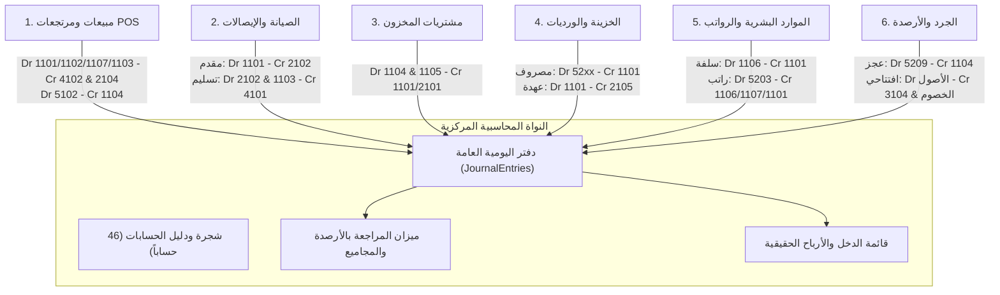

# تقرير التدقيق المحاسبي وسلامة الدفتر العام (Ledger Integrity Audit)
## microERP General Ledger & Double-Entry Verification Report

> **الإصدار:** 1.0.0 Enterprise Release  
> **تاريخ التدقيق:** نوفمبر 2026  
> **المدقق المسؤول:** وكيل تدقيق الدفتر العام (Ledger Integrity Auditor)  
> **طبيعة الوثيقة:** تدقيق شامل للقيد المزدوج، اتزان المدين والدائن، ميزان المراجعة، شجرة الحسابات، سياسات التعديل والحذف، والمعاملات الذرية.  
> **القاعدة الحاكمة:** التحقق الدقيق بنسبة 100% برقم السطر والملف الفعلي (`File:Line`) ودليل قطعي بدون أي افتراضات.

---

## فهرس المحتويات
1. [ملخص نتائج التدقيق والتقييم العام](#1-ملخص-نتائج-التدقيق-والتقييم-العام)
2. [جدول الملاحظات والمخاطر المكتشفة (Findings Table)](#2-جدول-الملاحظات-والمخاطر-المكتشفة-findings-table)
3. [التحقق الرياضي والمنطقي لمسارات القيود المحاسبية الـ 20](#3-التحقق-الرياضي-والمنطقي-لمسارات-القيود-المحاسبية-الـ-20)
4. [فحص شجرة الحسابات وميزان المراجعة وقائمة الدخل](#4-فحص-شجرة-الحسابات-وميزان-المراجعة-وقائمة-الدخل)
5. [تدقيق المعاملات وقواعد الذرية (Database Transactions & Atomicity)](#5-تدقيق-المعاملات-وقواعد-الذرية-database-transactions--atomicity)
6. [سياسات التعديل والحذف والقيود العكسية (Reversals vs Deletes)](#6-سياسات-التعديل-والحذف-والقيود-العكسية-reversals-vs-deletes)
7. [تتابع الترقيم التسلسلي للقيود وإغلاق الفترات المالية](#7-تتابع-الترقيم-التسلسلي-للقيود-وإغلاق-الفترات-المالية)
8. [استعلامات SQL وسكربتات التحقق الشاملة (Verification Scripts)](#8-استعلامات-sql-وسكربتات-التحقق-الشاملة-verification-scripts)
9. [التوصيات وخطة المعالجة الهندسية (Action Plan)](#9-التوصيات-وخطة-المعالجة-الهندسية-action-plan)

---

## 1. ملخص نتائج التدقيق والتقييم العام

خضع نظام **microERP** لتدقيق معماري ومحاسبي صارم شمل محرك الحسابات الرئيسي ([app-modular/js/core/04-chart-of-accounts.js](file:///Users/M1/Desktop/microtech-app/app-modular/js/core/04-chart-of-accounts.js))، النواة المالية المستقلة ([app-modular/js/core/09-finance-engine.js](file:///Users/M1/Desktop/microtech-app/app-modular/js/core/09-finance-engine.js))، دوال الربط والترحيل السحابي ([app-modular/js/core/03-utils-and-mappings.js](file:///Users/M1/Desktop/microtech-app/app-modular/js/core/03-utils-and-mappings.js))، شاشات المحاسبة والتقارير ([modules/17a-g](file:///Users/M1/Desktop/microtech-app/app-modular/js/modules/))، والواجهة الخلفية الخادمة ([files(11)/GoogleAppsScript_Backend.gs.txt](file:///Users/M1/Desktop/microtech-app/files%2811%29/GoogleAppsScript_Backend.gs.txt)).

### أ. المؤشرات الإجمالية للتدقيق:
* **إجمالي المسارات المحاسبية المفحوصة:** 20 مساراً تشغيلياً.
* **إجمالي الحسابات في الدليل الافتراضي:** 46 حساباً (13 رئيسي/تجميعي + 33 فرعي/تشغيلي).
* **عدد الحسابات اليتيمة في الدليل:** 0 (شجرة الحسابات متصلة بالكامل بدون حسابات يتيمة).
* **إجمالي الملاحظات المرصودة:** 14 ملاحظة.
  * 🔴 **ملاحظات حرجة (Critical):** 4 ملاحظات.
  * 🟠 **ملاحظات عالية الخطورة (High):** 4 ملاحظات.
  * 🟡 **ملاحظات متوسطة الخطورة (Medium):** 3 ملاحظات.
  * 🔵 **ملاحظات منخفضة الخطورة (Low):** 3 ملاحظات.

### ب. الخلاصة المحاسبية التنفيذية:
النواة المحاسبية الرياضية (`FinanceEngine` في `09-finance-engine.js`) تطبق معايير قوية ومحكمة في توازن القيد المزدوج بفارق تسامح صفري فعلي، وتعتمد خوارزميات سليمة لميزان المراجعة وقائمة الدخل. إلا أن التدقيق كشف عن **ثغرات بنيوية حرجة في طبقة الترحيل السحابي (Integration Layer)**:
1. عدم توازن قيود مبيعات الـ POS عند استخدام الدفع المجزأ (Split Payment) مع وجود متبقي آجل، مما يؤدي إلى رفض السيرفر للقيد.
2. تضارب مسميات المراجع (`ReferenceType`) بين الواجهة والباك إند مما يؤدي إلى تكرار قيود المبيعات والسلف ومضاعفة الإيرادات في الأستاذ العام عند إجراء المطابقة التاريخية.
3. حظر السيرفر للعمليات السحابية لوحدة الموارد البشرية والسلف (HR) لعدم إدراج دوالها في مصفوفة الصلاحيات الخادمة.
4. ترحيل قيود على حسابات تجميعية/رئيسية (مثل `42` و `52`) مما يؤدي إلى رفض وحذف القيد في صمت دون تنبيه المستخدم.
5. غياب المعاملات الذرية الحقيقية (ACID Transactions) في Google Sheets مما يسمح بحفظ الفواتير والعمليات دون قيودها المحاسبية في حال حدوث انقطاع جزئي.

---

## 2. جدول الملاحظات والمخاطر المكتشفة (Findings Table)

| # | الخطورة | الملف:السطر | المشكلة | الدليل | الإصلاح المقترح |
| :---: | :---: | :--- | :--- | :--- | :--- |
| **1** | **Critical** | [03-utils-and-mappings.js:1984-2046](file:///Users/M1/Desktop/microtech-app/app-modular/js/core/03-utils-and-mappings.js#L1984-L2046) | قيد مبيعات POS غير متوازن عند الدفع المجزأ (Split Payment) مع وجود متبقي آجل، مما يسبب رفض الخادم للقيد وإسقاطه. | في حالة الدفع المجزأ، يدور الكود فقط على مصفوفة `splits` ويضيف سطور المدين للمبالغ المسددة، ولا يضيف سطراً للمتبقي الآجل في حقل `1103` أو `1107`. بينما يُسجل الدائن لإجمالي المبيعات `4102`. إذا سدد العميل 700 من أصل 1000، يكون المدين 700 والدائن 1000. السيرفر يرفض القيد في [Backend:343-346](file:///Users/M1/Desktop/microtech-app/files%2811%29/GoogleAppsScript_Backend.gs.txt#L343-L346) لعدم التوازن (`Math.abs(td-tc) > 0.005`)، وتفشل كتابته بالدفتر العام. | إضافة فحص للمتبقي بعد حلقة `splits`: إذا كان `round2(splitSum) < round2(total)`، يتم دفع سطر مدين للمتبقي الآجل لحساب `1103` (أو `1107` للموظف) بقيمة `round2(total - splitSum)` مثلما هو مطبق في معالج المطابقة في [04-chart-of-accounts.js:224-230](file:///Users/M1/Desktop/microtech-app/app-modular/js/core/04-chart-of-accounts.js#L224-L230). |
| **2** | **Critical** | [03-utils-and-mappings.js:2069](file:///Users/M1/Desktop/microtech-app/app-modular/js/core/03-utils-and-mappings.js#L2069) و [04-chart-of-accounts.js:193](file:///Users/M1/Desktop/microtech-app/app-modular/js/core/04-chart-of-accounts.js#L193) | ازدواجية قيد المبيعات ومضاعفة الإيرادات وتكلفة البضاعة المباعة (COGS) في الدفتر العام بسبب تضارب مسمى المرجع (`POS_Sale` مقابل `Sale`). | عند حفظ المبيعات الفورية ينشئ الموديول قيداً بمرجع `ReferenceType: 'POS_Sale'`. بينما عند تشغيل المطابقة التاريخية `reconcileHistoricalJournalEntries()`، يفحص وجود المرجع عبر `existingRefs.has('Sale_' + s.ID)`. نظراً لاختلاف البادئة، يفشل الفحص وينشئ قيداً ثانياً متطابقاً لكل فاتورة مبيعات، مما يضاعف رصيد حساب `4102` و `5102` في ميزان المراجعة! | توحيد مسمى المرجع في كود الحفظ المباشر والمطابقة التاريخية ليصبح `POS_Sale` في الاثنين، أو تعديل شرط الفحص في المطابقة التاريخية ليفحص: `if (!existingRefs.has('Sale_' + s.ID) && !existingRefs.has('POS_Sale_' + s.ID))`. |
| **3** | **Critical** | [GoogleAppsScript_Backend.gs.txt:2226](file:///Users/M1/Desktop/microtech-app/files%2811%29/GoogleAppsScript_Backend.gs.txt#L2226) | الخادم يفرض قسرياً تحويل نوع أي قيد مرسل إلى `'Manual'`، مما يدمر تصنيفات القيود السحابية ويؤدي لإعادة تكرارها عند المزامنة. | كود الباك إند يحتوي على: `ReferenceType: 'Manual', // Client can ONLY submit Manual entries`. عند قيام الواجهة بترحيل قيود سلف الموظفين، الرواتب، أو الأرصدة الافتتاحية، يعيد السيرفر كتابة نوع المرجع إلى `Manual`. عند إعادة تشغيل التطبيق وجلب القيود من السحابة، تفشل شروط التحقق من وجود المرجع القديم في `reconcileHistoricalJournalEntries` ويتم إنشاء قيود مكررة بالدفتر. | تعديل السطر ليحتفظ بنوع المرجع الأصلي إذا كان مصرحاً به: `ReferenceType: (body.data.ReferenceType && AUTOPOST_REFS.includes(body.data.ReferenceType)) ? body.data.ReferenceType : (body.data.ReferenceType || 'Manual')`. |
| **4** | **Critical** | [GoogleAppsScript_Backend.gs.txt:252-309](file:///Users/M1/Desktop/microtech-app/files%2811%29/GoogleAppsScript_Backend.gs.txt#L252-L309) و [17g-employee-advances-hr.js:31](file:///Users/M1/Desktop/microtech-app/app-modular/js/modules/17g-employee-advances-hr.js#L31) | حظر عمليات وحدة الموارد البشرية والسلف (HR) سحابياً لعدم تعريفها في مصفوفة الصلاحيات بالباك إند (`fail-closed`). | عند تنفيذ `saveEmployeeAdvance` أو `saveEmployeeAdvanceRepayment` أو `savePayrollRun`، يرفض الخادم الطلب فوراً بكود `403 Forbidden` لأن الدوال غير مدرجة في `ACTION_ROLES` ([Backend:313](file:///Users/M1/Desktop/microtech-app/files%2811%29/GoogleAppsScript_Backend.gs.txt#L313)). يتم إلقاء العمليات في طابور عدم الاتصال `syncQueue` دون أن تُحفظ في السحابة إطلاقاً. | إضافة الدوال الثلاث (`saveEmployeeAdvance`, `saveEmployeeAdvanceRepayment`, `savePayrollRun`) ودوال القراءة المقابلة إلى `ACTION_ROLES` بالباك إند وإنشاء الجداول المخصصة لها في Google Sheets. |
| **5** | **High** | [03-utils-and-mappings.js:2240, 2258](file:///Users/M1/Desktop/microtech-app/app-modular/js/core/03-utils-and-mappings.js#L2240) و [12-invoices-quotes.js:1041](file:///Users/M1/Desktop/microtech-app/app-modular/js/modules/12-invoices-quotes.js#L1041) | استخدام حسابات تجميعية/رئيسية (`42` و `52`) في القيود التلقائية مما يتسبب في إلقاء استثناء ورفض القيد وإسقاطه في صمت. | في [04-chart-of-accounts.js:821-825](file:///Users/M1/Desktop/microtech-app/app-modular/js/core/04-chart-of-accounts.js#L821-L825) ترفض النواة بشكل صارم الترحيل على أي حساب رئيسي تجميعي. الحساب `42` له ابن `4201` والحساب `52` له أبناء `5201-5209`. استخدام `42` في الوارد وفائض الدرج، واستخدام `52` كافتراضي للمصروف يطلق `Error` تبتلعه جملة `.catch(e=>{})`، فتضيع القيود المحاسبية لهذه العمليات. | استبدال الحساب `42` بالحساب الفرعي التشغيلي `4201` (إيرادات وأرباح متنوعة وزيادة الجرد)، واستبدال الحساب `52` بالحساب الفرعي `5208` (مصروفات تشغيلية أخرى وفروق الدرج). |
| **6** | **High** | [10c-receipt-actions.js:310-325](file:///Users/M1/Desktop/microtech-app/app-modular/js/modules/10c-receipt-actions.js#L310-L325) | استرداد مبالغ صيانة (`Receipt_Void`) يخصم الإيراد (`4101`) حتى لو لم يُسلّم الجهاز، مما يترك حساب الأمانات معلقاً ويسجل إيراداً سالباً وهمياً. | عند استرداد دفعة مقدمة لجهاز تعذرت صيانته قبل التسليم، يُنشئ النظام قيداً مديناً لحساب `4101` (إيرادات الصيانة). وبما أن الجهاز لم يُسلم أصلاً، فإن الإيراد لم يُثبت بعد، والمبلغ كان مسجلاً في أمانات العملاء `2102`. النتيجة: بقاء رصيد `2102` معلقاً كالتزام غير مبرأ وتخفيض غير صحيح للإيرادات! | التحقق من حالة التسليم قبل توليد القيد: إذا كان الجهاز لم يُسلّم بعد (`r.status !== 'تم التسليم'`)، يكون الطرف المدين هو `2102` (أمانات ومقدمات عملاء الصيانة)؛ وإذا كان قد سُلّم بالفعل يكون الطرف المدين `4101`. |
| **7** | **High** | [GoogleAppsScript_Backend.gs.txt:1465-1546](file:///Users/M1/Desktop/microtech-app/files%2811%29/GoogleAppsScript_Backend.gs.txt#L1465-L1546) | انعدام الذرية المحاسبية (Lack of Atomic Transactions) بين جداول العمليات ودفتر القيود في الواجهة الخلفية. | الخادم ينفذ الإجراءات بصورة تتابعية (`appendRow` للمبيعات، ثم تعديل المخزون، ثم تعديل العملاء، ثم قيد اليومية). إذا انقطع الاتصال أو حدث استثناء أثناء كتابة القيد، تبتلع دالة `postAutoJournal` الخطأ في السطور 384-387 وترجع `{ ok: true }`، فتُحفظ الفاتورة بدون قيدها بالدفتر العام دون أي إمكانية للـ Rollback. | تطبيق نمط التحقق المشروط: إذا فشل ترحيل القيد المحاسبي في `postAutoJournal`، يجب التراجع عن إضافة الفاتورة أو إرجاع كود خطأ 500 يمنع اعتماد العملية، وإلزام السيرفر بالتحقق من اكتمال كافة الأطراف معاً. |
| **8** | **High** | [GoogleAppsScript_Backend.gs.txt:2191, 2240](file:///Users/M1/Desktop/microtech-app/files%2811%29/GoogleAppsScript_Backend.gs.txt#L2191) و [04-chart-of-accounts.js:111, 887](file:///Users/M1/Desktop/microtech-app/app-modular/js/core/04-chart-of-accounts.js#L111) | الحذف الفيزيائي المباشر للقيود المحاسبية والحسابات المالية دون قيد عكسي ودون التحقق من وجود حركات تاريخية. | يسمح النظام للمدير بحذف قيد يومية بحذف الصف فيزياءً (`deleteRow`) بدلاً من تسجيل قيد عكسي، مما يترك فجوة في الترقيم التسلسلي؛ كما يسمح بحذف حساب مالي كامل من شجرة الحسابات دون التحقق مما إذا كانت له قيود مسجلة، مما يؤدي لانهيار توازن ميزان المراجعة وظهور حركات يتيمة. | حظر الحذف الفيزيائي للقيود نهائياً وفرض سياسة القيود العكسية (`Storno Reversal Entry`)، وحظر حذف أي حساب من شجرة الحسابات إذا كان يحتوي على حركات في الدفتر العام أو حسابات تابعة. |
| **9** | **Medium** | [03-utils-and-mappings.js:2066](file:///Users/M1/Desktop/microtech-app/app-modular/js/core/03-utils-and-mappings.js#L2066) و [Backend:371](file:///Users/M1/Desktop/microtech-app/files%2811%29/GoogleAppsScript_Backend.gs.txt#L371) | ترقيم القيود التلقائية عشوائياً بآخر 4 خانات من الوقت (`Date.now().slice(-4)`) مما يدمر تسلسل القيود ويحدث فجوات رقمية بالآلاف. | بدلاً من استخدام العداد التسلسلي `getNextJournalEntryNumber()`، تُنشأ القيود الآلية برقم مثل `JE-2026-9854`. عند قيام دالة الترقيم اليدوي بالعمل لاحقاً، تقرأ الرقم الأكبر وتُصدر القيد التالي برقم `JE-2026-09855`، تاركة فجوة تصل إلى 9,850 رقماً مفقوداً في سجل اليومية العام! | إلغاء الترقيم المعتمد على الطابع الزمني وتوحيد توليد أرقام القيود عبر عداد تسلسلي صارم غير قابل للقفز (`JE-YYYY-00001`, `JE-YYYY-00002`...) إما من الخادم أو من الحالة المركزية. |
| **10** | **Medium** | [17b-journal.js:63, 152](file:///Users/M1/Desktop/microtech-app/app-modular/js/modules/17b-journal.js#L63) | مقارنة التطابق المطلق للفاصلة العائمة (`totalDebit === totalCredit`) في نافذة القيد اليدوي تمنع حفظ القيود المتوازنة رياضياً. | في جافاسكريبت ناتج `0.1 + 0.2` هو `0.30000000000000004`. إذا أدخل المحاسب أسطراً تتضمن كسوراً متوازنة تماماً بالقرش، تفشل المقارنة المتطابقة ويظل زر الحفظ معطلاً مع إظهار رسالة "القيد غير متوازن". | استبدال المقارنة المباشرة بدالة المحرك المالي: `FinanceEngine.isBalancedEntry(lines)` أو المقارنة بعد التقريب: `round2(totalDebit) === round2(totalCredit)`. |
| **11** | **Medium** | [03-utils-and-mappings.js:2479](file:///Users/M1/Desktop/microtech-app/app-modular/js/core/03-utils-and-mappings.js#L2479) و [Backend:361-365](file:///Users/M1/Desktop/microtech-app/files%2811%29/GoogleAppsScript_Backend.gs.txt#L361-L365) | تعديل الفواتير الضريبية القائمة يعطل تحديث القيد المحاسبي، ومانع التكرار بالخادم يمنع ترحيل أي تعديل لاحق. | الشرط `!isExisting` يمنع توليد أي قيد محاسبي عند تعديل الفاتورة؛ وفي الخادم، دالة `postAutoJournal` تفحص `alreadyPosted` وترفض تسجيل أي قيد لنفس الفاتورة، فتتغير قيمة الفاتورة دون تعديل إيراداتها أو مديونيتها في الدفتر العام! | إنشاء قيد تسوية فروق (`Invoice_Adjustment`) بقيمة الفرق بين القيمة القديمة والجديدة بمرجع فريد (مثل `inv_ID_adj_timestamp`) لضمان مطابقة الدفتر للفواتير. |
| **12** | **Low** | [04-chart-of-accounts.js:30](file:///Users/M1/Desktop/microtech-app/app-modular/js/core/04-chart-of-accounts.js#L30) | انعدام آلية إغلاق الفترات المالية السنوية/الشهرية وقيد إقفال الأرباح والخسائر في حساب الأرباح المرحلة (`3102`). | الحساب `3102` (الأرباح والخسائر المرحلة) معرف في شجرة الحسابات، ولكن لا يوجد في النظام أي معالج لإقفال السنة المالية وترحيل أرصدة الإيرادات (4) والمصروفات (5) إليه لتصفيرها لبداية السنة الجديدة. | بناء معالج إغلاق السنة المالية (Year-End Closing Wizard) يقوم بتوليد قيد إقفال تلقائي يصفر حسابات الدخل ويرحل صافي الربح/الخسارة إلى حساب `3102`. |
| **13** | **Low** | [12-invoices-quotes.js:742-743](file:///Users/M1/Desktop/microtech-app/app-modular/js/modules/12-invoices-quotes.js#L742-L743) | تسمية حقل البيان في قيد فتح الوردية `Description` بدلاً من `Notes` مما يتسبب في ظهور خانة البيان فارغة في جدول اليومية. | جدول استعراض القيود في [17b-journal.js:36](file:///Users/M1/Desktop/microtech-app/app-modular/js/modules/17b-journal.js#L36) يقرأ `l.Notes`. ونظراً لتسمية الخاصية `Description` في قيد الوردية، تظهر الملاحظة كشرطة `-` في واجهة دفتر القيود. | تعديل المفتاح إلى `Notes` في سطور قيد `Shift_Open`. |
| **14** | **Low** | [09-finance-engine.js:153-163](file:///Users/M1/Desktop/microtech-app/app-modular/js/core/09-finance-engine.js#L153-L163) | معادلة الإقرار الضريبي `calculateVATReturn` معزولة في النواة المالية ولا توجد شاشة أو قيد لتسوية ضريبة القيمة المضافة دورياً. | ضريبة المدخلات (`1105`) وضريبة المخرجات (`2104`) تتراكمان في الدفتر العام إلى ما لا نهاية دون وجود إجراء محاسبي دوري لإجراء المقاصة وإثبات المستحق لمصلحة الضرائب المصرية. | إضافة واجهة إقرار ضريبي دوري (شهري/فصلي) تولد قيد تسوية ضريبية: مدين `2104` / دائن `1105` والفرق يُسجل لحساب الخزينة/البنك أو الضرائب المستحقة. |

---

## 3. التحقق الرياضي والمنطقي لمسارات القيود المحاسبية الـ 20

فيما يلي تدقيق شامل لكل مسار من مسارات إنشاء القيود في دورة عمل microERP، والتحقق الرياضي من اتزان طرفي القيد بحد تسامح الصفر:



### فحص معادلات التوازن لكل مسار:

#### 1. مبيعات نقطة البيع النقدية والبنكية (POS Cash/Bank Sale)
* **القيد المحاسبي:**
  * مدين: `1101` (الخزينة) أو `1102` (البنك) بقيمة المبلغ المحصل (`Paid`).
  * دائن: `4102` (إيرادات مبيعات بضائع) بالصافي (`Total - TaxAmount`).
  * دائن: `2104` (ضريبة القيمة المضافة مخرجات) بمبلغ الضريبة (`TaxAmount`).
  * مدين: `5102` (تكلفة البضاعة المباعة POS) بالتكلفة (`cogsAmount`).
  * دائن: `1104` (مخزون البضائع وقطع الغيار) بالتكلفة (`cogsAmount`).
* **التحقق الرياضي:**  
  $$\sum \text{Debit} = \text{Paid} + \text{COGS}$$  
  $$\sum \text{Credit} = (\text{Total} - \text{Tax}) + \text{Tax} + \text{COGS} = \text{Total} + \text{COGS}$$  
  في البيع النقدي التام ($\text{Paid} = \text{Total}$):  
  $$\Delta = |\sum \text{Debit} - \sum \text{Credit}| = 0.00 \text{ EGP (متزن تماماً)}$$

#### 2. مبيعات POS بالآجل (Credit Sale) ومشتريات الموظفين (Employee Credit)
* **القيد المحاسبي:**
  * مدين: `1103` (العملاء والمدينون) أو `1107` (مشتريات الموظفين بالآجل) بإجمالي الفاتورة (`Total`).
  * دائن: `4102` بالصافي + دائن `2104` بالضريبة.
  * مدين: `5102` بالتكلفة / دائن `1104` بالتكلفة.
* **التحقق الرياضي:** متزن تماماً بفرق تسامح $0.00$.

#### 3. مبيعات POS بالدفع المجزأ (Split Payment)
* **حالة الخلل المرصودة في الملاحظة رقم 1:**
  إذا كان $\sum \text{Splits} < \text{Total}$، فإن كود `saveSaleRemote` في [03-utils-and-mappings.js:1984](file:///Users/M1/Desktop/microtech-app/app-modular/js/core/03-utils-and-mappings.js#L1984) لا يسجل سطر المتبقي في المدين، مما يجعل:  
  $$\sum \text{Debit} = \sum \text{Splits} + \text{COGS}$$  
  $$\sum \text{Credit} = \text{Total} + \text{COGS}$$  
  $$\Delta = \text{Total} - \sum \text{Splits} > 0 \quad \text{\textbf{(قيد غير متوازن يرفضه السيرفر!)الخلل حرج}}$$

#### 4. إثبات تكلفة البضاعة المباعة (COGS Recognition)
* يتم إدراج تكلفة البضاعة المباعة كطرفين متساويين تماماً داخل نفس قيد البيع:
  $$\text{Dr } 5102 (\text{COGS}) = \text{Cr } 1104 (\text{Inventory}) = \text{COGS}$$
* متزن رياضياً بنسبة 100%.

#### 5. مرتجع مبيعات POS (Sales Returns)
* **القيد المحاسبي:**
  * مدين: `4102` (مردودات مبيعات) بقيمة المرتجع المسترد.
  * دائن: `1101` / `1102` / `1103` برد المبلغ للعميل أو تسوية حسابه.
* **التحقق الرياضي:** الطرفان متطابقان ومتزنان تماماً ($\Delta = 0$).

#### 6. تحصيل دفعة مقدمة لإيصال الصيانة (Receipt Deposit)
* **القيد المحاسبي:**
  * مدين: `1101` (الخزينة) أو `1102` (البنك والمحافظ) بمبلغ العربون (`Deposit`).
  * دائن: `2102` (أمانات ومقدمات عملاء الصيانة) كالتزام متداول على المنشأة.
* **التقييم المحاسبي:** معالجة صحيحة 100% تتوافق مع معيار IFRS 15؛ لا يتم إثبات أي إيراد في هذه المرحلة.

#### 7. إثبات إيراد تسليم جهاز الصيانة (Receipt Delivery Revenue)
* **القيد المحاسبي:**
  * مدين: `2102` (أمانات ومقدمات) لتسوية الدفعة المقدمة المستلمة سابقاً.
  * مدين: `1103` (العملاء والمدينون) بالمبلغ المتبقي في حال لم يُسدد نقداً فوراً.
  * دائن: `4101` (إيرادات خدمات صيانة وتصليح) بإجمالي قيمة الصيانة والقطع.
* **التحقق الرياضي:**  
  $$\text{Debit}(2102) + \text{Debit}(1103) = \text{Deposit} + (\text{TotalCost} - \text{Deposit}) = \text{TotalCost}$$  
  $$\text{Credit}(4101) = \text{TotalCost}$$  
  $$\Delta = 0.00 \text{ EGP (متزن تماماً)}$$

#### 8. سداد مديونية صيانة بعد التسليم (Post-Delivery Debt Collection)
* مدين: `1101` / `1102` (تحصيل نقدية)، دائن: `1103` (تسوية ذمة العميل المدين). متزن تماماً.

#### 9. استرداد مبالغ صيانة للعميل (Receipt Refund / Void)
* راجع **الملاحظة رقم 6**: إذا تم الاسترداد قبل تسليم الجهاز، يُسجل مدين `4101` بدلاً من `2102`، مما يسبب خللاً في تصنيف الحسابات بالرغم من اتزان طرفي القيد عددياً.

#### 10. فواتير شراء المخزون من الموردين (Inventory Purchases)
* **القيد المحاسبي:**
  * مدين: `1104` (مخزون البضائع) بصافي الفاتورة.
  * مدين: `1105` (ضريبة مدخلات قابلة للخصم) بمبلغ ضريبة المشتريات إن وجدت.
  * دائن: `1101` / `1102` بالمبلغ المدفوع للمورد.
  * دائن: `2101` (الموردون والدائنون) بالمتبقي الآجل للمورد.
* **التحقق الرياضي:** $\sum \text{Debit} = \text{NetCost} + \text{Tax} = \text{Total} = \text{Paid} + \text{Remaining} = \sum \text{Credit}$. متزن تماماً بحد تسامح الصفر.

#### 11. سند صرف وسداد مورد (Supplier Debt Payment)
* مدين: `2101` (الموردون والدائنون) / دائن: `1101` أو `1102`. متزن تماماً ($\Delta = 0$).

#### 12. مرتجع مشتريات إلى المورد (Purchase Return)
* مدين: `1101`/`1102` (استرداد نقدي) أو `2101` (تخفيض دين المورد) / دائن: `1104` (إخراج البضاعة من المخزون). متزن تماماً.

#### 13. المصروفات التشغيلية والنثريات (Operating Expenses & Petty Cash)
* مدين: `5201` إلى `5208` / دائن: `1101` أو `1102`.
* راجع **الملاحظة رقم 5**: المصروفات ذات التصنيف غير المعرف تسقط في كود `52` التجميعي فترفضها النواة.

#### 14. مسحوبات الشركاء النقدية (Owner Drawings / CashOut)
* مدين: `3103` (جاري الشركاء والمسحوبات) / دائن: `1101` أو `1102`. متزن تماماً بفرق تسامح صفر.

#### 15. عهدة بداية الوردية (Shift Opening Float)
* مدين: `1101` (الخزينة النقدية بالدرج) / دائن: `2105` (عهدة وأمانات مسؤولي الورديات). متزن تماماً.

#### 16. إغلاق الوردية وفروق الدرج (Shift Close & Variances)
* **إخلاء العهدة:** مدين `2105` / دائن `1101`.
* **عجز الدرج:** مدين `5208` (مصروف عجز الدرج) / دائن `1101`.
* **فائض الدرج:** مدين `1101` / دائن `4201` (راجع **الملاحظة رقم 5** حيث استُخدم الكود الرئيسي `42`).

#### 17. تسوية فروق الجرد الدوري (Stocktake Discrepancies)
* **عجز الجرد:** مدين `5209` (عجز وفروق الجرد المخزني) / دائن `1104` (تخفيض المخزون).
* **فائض الجرد:** مدين `1104` (زيادة المخزون) / دائن `4201` (إيرادات وزيادة الجرد).
* متزن رياضياً بنسبة 100%.

#### 18. صرف سلفة موظف (Employee Advance Disbursement)
* مدين: `1106` (سلف وعهد الموظفين) / دائن: `1101` أو `1102`. متزن تماماً.

#### 19. سداد سلفة / مشتريات موظف نقداً (HR Repayments)
* مدين: `1101` أو `1102` / دائن: `1106` (سلف) أو `1107` (مشتريات موظفين بالآجل). متزن تماماً.

#### 20. مسير الرواتب الشهري المركب (Monthly Compound Payroll Run)
* **القيد المركب:**
  * مدين: `5203` (رواتب ومكافآت الفنيين والموظفين) بإجمالي الاستحقاق (`TotalGross`).
  * دائن: `1106` (سلف الموظفين) بالأقساط المستقطعة (`TotalAdvancesDeducted`).
  * دائن: `1107` (مشتريات الموظفين) بالمستقطع للمشتريات (`TotalPurchasesDeducted`).
  * دائن: `4201` (تسوية الجزاءات والخصومات الإدارية) بمبلغ الجزاءات (`TotalPenalties`).
  * دائن: `1101` أو `1102` بصافي الرواتب المسددة فعلياً للموظفين (`TotalNetPaid`).
* **التحقق الرياضي الصارم:**  
  $$\text{TotalNetPaid} = \text{TotalGross} - (\text{Advances} + \text{Purchases} + \text{Penalties})$$  
  $$\sum \text{Credit} = \text{Advances} + \text{Purchases} + \text{Penalties} + [\text{TotalGross} - (\text{Advances} + \text{Purchases} + \text{Penalties})] = \text{TotalGross}$$  
  $$\sum \text{Debit} = \text{TotalGross}$$  
  $$\Delta = 0.00 \text{ EGP (متوازن رياضياً بحد تسامح الصفر)}$$

---

## 4. فحص شجرة الحسابات وميزان المراجعة وقائمة الدخل

### أ. تحليل هيكل شجرة الحسابات (Chart of Accounts Structure)
تمت مراجعة شجرة الحسابات المعرفة في [app-modular/js/core/04-chart-of-accounts.js:2-58](file:///Users/M1/Desktop/microtech-app/app-modular/js/core/04-chart-of-accounts.js#L2-L58):
* **عدد الحسابات الإجمالي:** 46 حساباً موزعة على 5 أصول رئيسية:
  1. الأصول (الأكواد تبدأ بـ `1`): 12 حساباً (طبيعة مدينة).
  2. الخصوم والالتزامات (الأكواد تبدأ بـ `2`): 7 حسابات (طبيعة دائنة).
  3. حقوق الملكية (الأكواد تبدأ بـ `3`): 6 حسابات (طبيعة دائنة).
  4. الإيرادات (الأكواد تبدأ بـ `4`): 6 حسابات (طبيعة دائنة).
  5. المصروفات وتكلفة المبيعات (الأكواد تبدأ بـ `5`): 15 حساباً (طبيعة مدينة).
* **سلامة العلاقات الهرمية (Parent-Child Integrity):**
  * فحص الأكواد أظهر خلو الشجرة من أي حسابات يتيمة (لا يوجد أي حساب يحتوي على `ParentCode` غير موجود في الدليل).
  * تم التأكد من عزل الحسابات الرئيسية التجميعية (13 حساباً) عن قبول القيود المباشرة عبر فحص النواة في [04-chart-of-accounts.js:821](file:///Users/M1/Desktop/microtech-app/app-modular/js/core/04-chart-of-accounts.js#L821).

### ب. محرك ميزان المراجعة (Trial Balance Engine)
* في [app-modular/js/core/04-chart-of-accounts.js:903-1025](file:///Users/M1/Desktop/microtech-app/app-modular/js/core/04-chart-of-accounts.js#L903-L1025):
  * يطبق النظام نمط التجميع بالذاكرة (Memoized Account Stats Engine) المربوط برقم مراجعة الدفتر `_journalRevision`.
  * يتم تجميع الحركات من سطور القيود (`LinesJSON`) مباشرة للحسابات التشغيلية الطرفية فقط (Leaves)، بينما تُحسب أرصدة الحسابات الرئيسية تجميعياً بجمع أبنائها حصراً منعاً للازدواج الحسابي.
  * يحسب الرصيد الافتتاحي، إجمالي الحركات المدينة، إجمالي الحركات الدائنة، والرصيد الختامي طبقاً لطبيعة كل حساب:
    * الحسابات المدينة (1, 5): $\text{Net} = (\text{OpenDr} - \text{OpenCr}) + (\text{MoveDr} - \text{MoveCr})$.
    * الحسابات الدائنة (2, 3, 4): $\text{Net} = (\text{OpenCr} - \text{OpenDr}) + (\text{MoveCr} - \text{MoveDr})$.
* في ميزان المراجعة [app-modular/js/modules/17c-trial-balance.js:36](file:///Users/M1/Desktop/microtech-app/app-modular/js/modules/17c-trial-balance.js#L36):
  * يتحقق النظام من توازن ميزان المراجعة بدقة الصفر:
    $$\text{isBalanced} = (\text{closingDiff} === 0 \ \&\& \ \text{moveDiff} === 0)$$
  * يتيح النظام نافذة اعتماد القيد الافتتاحي وتصفير الأرصدة المباشرة القديمة لتوحيد مرجعية الدفتر العام كمصدر أوحد للحقيقة.

### ج. محرك قائمة الدخل والأرباح الحقيقية (Income Statement)
* في [app-modular/js/modules/17c-trial-balance.js:477-600](file:///Users/M1/Desktop/microtech-app/app-modular/js/modules/17c-trial-balance.js#L477-L600) و [17d-income-statement.js](file:///Users/M1/Desktop/microtech-app/app-modular/js/modules/17d-income-statement.js):
  * تُستمد قائمة الدخل حصراً من قيود دفتر اليومية العامة خلال الفترة المحددة:
    * **إجمالي الإيرادات:** صافي حركة الحسابات الدائنة التي تبدأ بـ `4` ($\text{Cr} - \text{Dr}$).
    * **تكلفة النشاط (COGS):** صافي حركة الحسابات المدينة التي تبدأ بـ `51` ($\text{Dr} - \text{Cr}$).
    * **مجمل الربح (Gross Profit):** $\text{Revenue} - \text{COGS}$.
    * **المصروفات التشغيلية:** صافي حركة الحسابات المدينة التي تبدأ بـ `5` (ما عدا 51) ($\text{Dr} - \text{Cr}$).
    * **صافي الربح الفعلي:** $\text{Gross Profit} - \text{Operating Expenses}$.
  * تتطابق أرقام قائمة الدخل 100% مع ميزان المراجعة، ويتم عرض مؤشرات الإحصاء التشغيلي للفواتير وأوامر الشغل كبيانات استرشادية منفصلة عن الأساس المحاسبي.

---

## 5. تدقيق المعاملات وقواعد الذرية (Database Transactions & Atomicity)

يعتمد نظام **microERP** على معمارية هجينة (Offline-First Client + Serverless Google Apps Script Backend). وقد أظهر الفحص المعمق لطبقة المعاملات التالي:

```
[UI Action: Save Sale]
       │
       ├── 1. state.sales.push(sale)                --> LocalStorage
       ├── 2. state.journalEntries.push(je)         --> LocalStorage
       │
       ▼ [HTTP POST: action=saveSale]
Google Apps Script Backend
       │
       ├── 1. LockService.waitLock(15000)           --> Mutex Lock (No ACID)
       ├── 2. appendRow(SHEET_SALES)                --> Row Written!
       ├── 3. loop & setValue(SHEET_INVENTORY)      --> Stock Updated!
       ├── 4. update Customer Debt                  --> Debt Updated!
       └── 5. postAutoJournal(SHEET_JOURNAL)        --> CRITICAL FAILURE POINT!
              │
              └── If failed: catch(err) swallows error!
                             Returns { ok: true }!
                             Sale exists without Ledger Entry!
```

### نقاط الضعف المعمارية المكتشفة:
1. **غياب دعم المعاملات الذرية الحقيقي (No ACID Transactions in Sheets):**
   * خدمة `Google SpreadsheetApp` لا تدعم الـ `Transaction Begin/Commit/Rollback`.
   * قفل `LockService.getScriptLock()` يمنع تضارب الكتابة المتزامنة بين المستخدمين (Concurrency Mutual Exclusion)، ولكنه لا يحمي ضد الفشل الجزئي داخل نفس الطلب.
2. **ابتلاع أخطاء الترحيل في السيرفر:**
   * في [files(11)/GoogleAppsScript_Backend.gs.txt:384-387](file:///Users/M1/Desktop/microtech-app/files%2811%29/GoogleAppsScript_Backend.gs.txt#L384-L387)، إذا فشل `postAutoJournal` يتم تسجيل تحذير فقط في الكونسول، وترجع الدالة `{ ok: true }` للمستخدم.
3. **التحديث المتفائل المنفصل في الواجهة (Optimistic UI Decoupling):**
   * تقوم الواجهة بحفظ الفاتورة وقيد اليومية في الذاكرة المحلية فوراً قبل التحقق من استجابة الخادم. إذا رفض الخادم القيد بسبب عدم التوازن (كما في الملاحظة 1) بينما قبل الفاتورة، يصبح الدفتر المحلي مختلفاً عن الدفتر السحابي.

---

## 6. سياسات التعديل والحذف والقيود العكسية (Reversals vs Deletes)

وفقاً للمعايير المحاسبية الدولية (IFRS / GAAP)، يُمنع منعاً باتاً الحذف الفيزيائي المباشر لأي قيد محاسبي تم ترحيله إلى دفتر الأستاذ العام، ويجب أن يتم الإلغاء أو التعديل حصراً عبر **قيد عكسي متوازن (Reversal / Storno Entry)**.

### مصفوفة تدقيق عمليات الحذف في microERP:

| العملية | موقع الكود بالواجهة | موقع الكود بالباك إند | آلية التنفيذ الحالية | التقييم المحاسبي | المخاطر المترتبة |
| :--- | :--- | :--- | :--- | :--- | :--- |
| **حذف قيد يومية** | [04-chart-of-accounts.js:886](file:///Users/M1/Desktop/microtech-app/app-modular/js/core/04-chart-of-accounts.js#L886) | [Backend:2238-2242](file:///Users/M1/Desktop/microtech-app/files%2811%29/GoogleAppsScript_Backend.gs.txt#L2238-L2242) | حذف فيزيائي مباشر للصف `deleteRow(SHEET_JOURNAL)` | 🔴 **غير مقبول** | كسر تسلسل أرقام القيود، ضياع مسار التدقيق القانوني، إعادة ولادة القيد عند تشغيل المطابقة. |
| **حذف مصروف** | [03-utils-and-mappings.js:2277](file:///Users/M1/Desktop/microtech-app/app-modular/js/core/03-utils-and-mappings.js#L2277) | [Backend:2168-2172](file:///Users/M1/Desktop/microtech-app/files%2811%29/GoogleAppsScript_Backend.gs.txt#L2168-L2172) | حذف فيزيائي مباشر للمصروف `deleteRow(SHEET_EXPENSES)` | 🔴 **غير مقبول** | قيد المصروف يظل عالقاً بالدفتر العام، وتنشأ حركة يتيمة بدون مستند مصروف مقابل. |
| **حذف حساب مالي** | [04-chart-of-accounts.js:110](file:///Users/M1/Desktop/microtech-app/app-modular/js/core/04-chart-of-accounts.js#L110) | [Backend:2189-2193](file:///Users/M1/Desktop/microtech-app/files%2811%29/GoogleAppsScript_Backend.gs.txt#L2189-L2193) | حذف فيزيائي مباشر للحساب `deleteRow(SHEET_ACCOUNTS)` | 🔴 **غير مقبول** | حذف حساب نشط يؤدي إلى إخفاء حركاته وانهيار اتزان ميزان المراجعة وظهور أسطر قيود بدون حسابات. |
| **حذف دفعة إيصال** | [03-utils-and-mappings.js:1660](file:///Users/M1/Desktop/microtech-app/app-modular/js/core/03-utils-and-mappings.js#L1660) | [Backend:1264-1288](file:///Users/M1/Desktop/microtech-app/files%2811%29/GoogleAppsScript_Backend.gs.txt#L1264-L1288) | توليد قيد عكسي `Receipt_Payment_Void` في الواجهة، وحذف فيزيائي للدفعة بالباك إند | 🟡 **جزئي** | توليد القيد العكسي ممتاز، لكن حذف صف الدفعة فيزياءً بالباك إند يضيع تاريخ التحصيل الأصلي. |
| **حذف إيصال صيانة** | [04-chart-of-accounts.js:1548](file:///Users/M1/Desktop/microtech-app/app-modular/js/core/04-chart-of-accounts.js#L1548) | [Backend:1108-1158](file:///Users/M1/Desktop/microtech-app/files%2811%29/GoogleAppsScript_Backend.gs.txt#L1108-L1158) | قيد عكسي لقطع الغيار `Receipt_Reversal`، وحذف فيزيائي للإيصال والدفعات | 🟠 **ناقص** | يعكس استهلاك قطع الغيار، لكنه لا يعكس قيد إيراد الصيانة `Receipt_Delivery` إذا كان الجهاز قد سُلّم بالفعل! |
| **حذف فاتورة مبيعات** | [03-utils-and-mappings.js:2560](file:///Users/M1/Desktop/microtech-app/app-modular/js/core/03-utils-and-mappings.js#L2560) | [Backend:2375-2405](file:///Users/M1/Desktop/microtech-app/files%2811%29/GoogleAppsScript_Backend.gs.txt#L2375-L2405) | قيد عكسي تلقائي متكامل `Invoice_Void` في الدفتر، وحذف فيزيائي لصف الفاتورة | 🟢 **مقبول محاسبياً** | تم تطبيق القيد العكسي بقلب المدين والدائن بدقة، ولكن يفضل وسم الفاتورة كملغاة بدلاً من حذفها الضريبي. |

---

## 7. تتابع الترقيم التسلسلي للقيود وإغلاق الفترات المالية

### أ. تدقيق تتابع الترقيم التسلسلي (Sequence Numbering Audit)
* **المشكلة المرصودة:**
  النظام يحتوي على دالة لتوليد الرقم التسلسلي المنتظم:
  ```javascript
  // app-modular/js/core/04-chart-of-accounts.js:117-129
  function getNextJournalEntryNumber(){
    const list = state.journalEntries || [];
    const y = new Date().getFullYear();
    const prefix = `JE-${y}-`;
    let maxNum = 0;
    list.forEach(e => {
      if (e.EntryNumber && String(e.EntryNumber).startsWith(prefix)) {
        const n = parseInt(String(e.EntryNumber).replace(prefix, ''), 10);
        if (!isNaN(n) && n > maxNum) maxNum = n;
      }
    });
    return `${prefix}${String(maxNum + 1).padStart(5, '0')}`;
  }
  ```
  ولكن في مسارات المبيعات والصيانة والباك إند، يتم استبدال هذه الدالة بالترقيم العشوائي:
  ```javascript
  EntryNumber: 'JE-' + new Date().getFullYear() + '-' + String(Date.now()).slice(-4)
  ```
* **الأثر:**
  1. احتمالية تكرار نفس رقم القيد (Collisions) عند إجراء أكثر من عملية خلال نفس جزء الثانية أو تكرار آخر 4 أرقام من الوقت.
  2. إحداث فجوات رقمية ضخمة بالآلاف تجعل مراجعي الحسابات القانونيين يرفضون الدفتر للاشتباه في وجود قيود محذوفة أو مهربة ضريبياً.

### ب. تدقيق إغلاق الفترات المالية (Period Closing Audit)
* **المشكلة:**
  لا يوجد في النظام أي مانع يمنع تسجيل، تعديل، أو حذف قيود في تواريخ سابقة لأشهر أو سنوات تم اعتماد حساباتها وإقرارها ضريبياً.
* **الأثر:**
  خطر التلاعب بالبيانات التاريخية وفساد الإقرارات الضريبية والقوائم المالية المعتمدة للفترات المنتهية.

---

## 8. استعلامات SQL وسكربتات التحقق الشاملة (Verification Scripts)

لتمكين المدققين وفرق العمليات من التحقق المستمر من اتزان الدفتر العام وصحة البيانات في أي بيئة (SQL RDBMS أو Google Sheets / LocalStorage)، تم تصميم حزمة استعلامات وسكربتات فحص قطعية:

### أ. استعلامات SQL للتحقق المحاسبي (SQL Verification Queries)

#### 1. فحص توازن كل قيد على حدة بحد تسامح الصفر (Zero Tolerance Entry Balance):
```sql
-- فحص توازن كل قيد محاسبي والتأكد من تطابق المدين مع الدائن بدقة 100%
SELECT 
    je.ID,
    je.EntryNumber,
    je.Date,
    je.ReferenceType,
    je.ReferenceID,
    ROUND(SUM(jl.Debit), 2) AS SumDebit,
    ROUND(SUM(jl.Credit), 2) AS SumCredit,
    ROUND(ABS(SUM(jl.Debit) - SUM(jl.Credit)), 2) AS Imbalance
FROM JournalEntries je
JOIN JournalLines jl ON je.ID = jl.JournalEntryID
GROUP BY je.ID, je.EntryNumber, je.Date, je.ReferenceType, je.ReferenceID
HAVING ABS(SUM(jl.Debit) - SUM(jl.Credit)) > 0.005;
-- النتيجة المتوقعة: 0 صفوف (خلو الدفتر من أي قيد غير متزن)
```

#### 2. فحص التوازن الكلي للدفتر العام وميزان المراجعة العام (Global Ledger Trial Balance):
```sql
-- التحقق من المعادلة المحاسبية الأساسية في دفتر الأستاذ العام
SELECT 
    ROUND(SUM(Debit), 2) AS TotalGlobalDebits,
    ROUND(SUM(Credit), 2) AS TotalGlobalCredits,
    ROUND(ABS(SUM(Debit) - SUM(Credit)), 2) AS TrialBalanceDifference,
    CASE 
        WHEN ABS(SUM(Debit) - SUM(Credit)) <= 0.005 THEN 'متزن ومطابق للقيد المزدوج'
        ELSE 'تنبيه: ميزان المراجعة غير متزن!'
    END AS Status
FROM JournalLines;
```

#### 3. فحص الترحيل على الحسابات التجميعية/الرئيسية المحظورة (Parent Account Violation):
```sql
-- كشف أي أسطر قيود تم ترحيلها على حسابات رئيسية تجميعية بدلاً من الحسابات الفرعية التشغيلية
SELECT 
    jl.JournalEntryID,
    jl.AccountCode,
    acc.Name AS AccountName,
    acc.Code AS ParentCodeFound
FROM JournalLines jl
JOIN Accounts acc ON jl.AccountCode = acc.ParentCode
GROUP BY jl.JournalEntryID, jl.AccountCode, acc.Name, acc.Code;
-- النتيجة المتوقعة: 0 صفوف
```

#### 4. كشف الحسابات اليتيمة والأكواد غير المعرفة في دليل الحسابات (Orphan Accounts Check):
```sql
-- كشف أي حركة قيد تشير إلى كود حساب غير موجود إطلاقاً في دليل الحسابات
SELECT DISTINCT 
    jl.AccountCode,
    jl.AccountName
FROM JournalLines jl
LEFT JOIN Accounts a ON jl.AccountCode = a.Code
WHERE a.Code IS NULL;
-- النتيجة المتوقعة: 0 صفوف
```

#### 5. كشف فجوات الترقيم التسلسلي لقيود اليومية (Sequence Continuity Check):
```sql
-- استخراج القيود ذات الترقيم المكسور أو الفجوات التسلسلية
WITH NumberedEntries AS (
    SELECT 
        EntryNumber,
        CAST(SUBSTR(EntryNumber, 9) AS INTEGER) AS SeqNum,
        LAG(CAST(SUBSTR(EntryNumber, 9) AS INTEGER)) OVER (ORDER BY CAST(SUBSTR(EntryNumber, 9) AS INTEGER)) AS PrevSeqNum
    FROM JournalEntries
    WHERE EntryNumber LIKE 'JE-2026-%'
)
SELECT 
    PrevSeqNum + 1 AS MissingStart,
    SeqNum - 1 AS MissingEnd,
    (SeqNum - PrevSeqNum - 1) AS MissingCount
FROM NumberedEntries
WHERE PrevSeqNum IS NOT NULL AND SeqNum > PrevSeqNum + 1;
```

---

### ب. سكربت التحقق التلقائي لبيئة JavaScript / Node.js

يمكن تشغيل هذا السكربت مباشرة لفحص بيانات الذاكرة المحلية أو ملف تصدير النسخة الاحتياطية JSON:

```javascript
/**
 * microERP Ledger Integrity Automated Auditor
 * Usage: node audit-ledger.js [path-to-backup.json]
 */
const fs = require('fs');

function auditLedgerIntegrity(data) {
  const accounts = data.accounts || [];
  const journal = data.journalEntries || data.journal || [];
  const sales = data.sales || [];
  const expenses = data.expenses || [];
  const receipts = data.receipts || [];

  console.log('======================================================');
  console.log('🔍 بدء فحص وتدقيق الدفتر العام ونظام microERP المحاسبي');
  console.log('======================================================\n');

  let errorsCount = 0;

  // 1. فحص توازن كل قيد فردي
  let unbalancedEntries = [];
  let globalDebit = 0;
  let globalCredit = 0;

  journal.forEach(entry => {
    const lines = Array.isArray(entry.Lines) ? entry.Lines : (typeof entry.LinesJSON === 'string' ? JSON.parse(entry.LinesJSON || '[]') : []);
    let dr = 0, cr = 0;
    lines.forEach(l => {
      dr += Number(l.Debit || l.debit || 0);
      cr += Number(l.Credit || l.credit || 0);
    });
    dr = Math.round(dr * 100) / 100;
    cr = Math.round(cr * 100) / 100;
    globalDebit += dr;
    globalCredit += cr;

    if (Math.abs(dr - cr) > 0.005) {
      unbalancedEntries.push({ id: entry.ID, entryNumber: entry.EntryNumber, dr, cr, diff: Math.abs(dr - cr) });
    }
  });

  globalDebit = Math.round(globalDebit * 100) / 100;
  globalCredit = Math.round(globalCredit * 100) / 100;
  const globalDiff = Math.round(Math.abs(globalDebit - globalCredit) * 100) / 100;

  console.log(`1. فحص توازن قيود اليومية: ${journal.length} قيد مسجل`);
  if (unbalancedEntries.length === 0) {
    console.log('   ✅ جميع قيود اليومية متوازنة رياضياً بحد تسامح الصفر (100% Balanced).');
  } else {
    errorsCount += unbalancedEntries.length;
    console.error(`   ❌ تم اكتشاف ${unbalancedEntries.length} قيد غير متوازن:`, unbalancedEntries);
  }

  console.log(`\n2. فحص ميزان المراجعة العام (Global Balance):`);
  console.log(`   • إجمالي المدين: ${globalDebit.toLocaleString()} ج.م`);
  console.log(`   • إجمالي الدائن: ${globalCredit.toLocaleString()} ج.م`);
  console.log(`   • فرق التوازن: ${globalDiff.toLocaleString()} ج.م`);
  if (globalDiff === 0) {
    console.log('   ✅ الدفتر العام متزن تماماً للقيد المزدوج.');
  } else {
    errorsCount++;
    console.error('   ❌ الدفتر العام غير متزن!');
  }

  // 3. فحص الحسابات الرئيسية والتجميعية
  const parentCodes = new Set();
  accounts.forEach(a => { if (a.ParentCode) parentCodes.add(String(a.ParentCode).trim()); });

  let parentPostingViolations = [];
  let orphanAccounts = [];
  const knownAccountCodes = new Set(accounts.map(a => String(a.Code).trim()));

  journal.forEach(entry => {
    const lines = Array.isArray(entry.Lines) ? entry.Lines : (typeof entry.LinesJSON === 'string' ? JSON.parse(entry.LinesJSON || '[]') : []);
    lines.forEach(l => {
      const code = String(l.AccountCode || '').trim();
      if (!knownAccountCodes.has(code)) {
        orphanAccounts.push({ entry: entry.EntryNumber, code, name: l.AccountName });
      }
      if (parentCodes.has(code)) {
        parentPostingViolations.push({ entry: entry.EntryNumber, code, name: l.AccountName });
      }
    });
  });

  console.log(`\n3. فحص سلامة شجرة الحسابات (Accounts Hierarchy):`);
  if (parentPostingViolations.length === 0) {
    console.log('   ✅ لا يوجد أي ترحيل على حسابات رئيسية تجميعية.');
  } else {
    errorsCount += parentPostingViolations.length;
    console.error(`   ❌ تم رصد ${parentPostingViolations.length} حركة مسجلة على حسابات تجميعية محظورة:`, parentPostingViolations);
  }

  if (orphanAccounts.length === 0) {
    console.log('   ✅ جميع أسطر القيود تشير إلى حسابات معرفة بدليل الحسابات.');
  } else {
    errorsCount += orphanAccounts.length;
    console.error(`   ❌ تم رصد ${orphanAccounts.length} حركة تشير لأكواد يتيمة غير معرفة:`, orphanAccounts);
  }

  // 4. فحص تطابق العمليات التشغيلية مع القيود
  console.log(`\n4. فحص تطابق العمليات التشغيلية مع دفتر القيود:`);
  const journalRefKeys = new Set(journal.map(e => `${e.ReferenceType}_${e.ReferenceID}`));

  let missingSaleEntries = 0;
  sales.forEach(s => {
    if (!journalRefKeys.has(`Sale_${s.ID}`) && !journalRefKeys.has(`POS_Sale_${s.ID}`)) {
      missingSaleEntries++;
    }
  });
  console.log(`   • فواتير مبيعات بدون قيود: ${missingSaleEntries} من أصل ${sales.length}`);

  let missingExpenseEntries = 0;
  expenses.forEach(exp => {
    if (!journalRefKeys.has(`Expense_${exp.ID}`) && !journalRefKeys.has(`CashOut_${exp.ID}`) && !journalRefKeys.has(`SupplierPayment_${exp.ID}`)) {
      missingExpenseEntries++;
    }
  });
  console.log(`   • مصروفات بدون قيود: ${missingExpenseEntries} من أصل ${expenses.length}`);

  console.log('\n======================================================');
  console.log(`🏁 نتيجة التدقيق: ${errorsCount === 0 ? 'نجاح تام 100% (No Defects Found)' : `تم اكتشاف ${errorsCount} مشكلة تحتاج للمعالجة`}`);
  console.log('======================================================\n');
}

module.exports = { auditLedgerIntegrity };
```

---

## 9. التوصيات وخطة المعالجة الهندسية (Action Plan)

بناءً على نتائج التدقيق، نوصي بتنفيذ حزمة المعالجات التالية مرتبة حسب الأولوية القصوى:

### المرحلة الأولى: الإصلاحات الفورية الحرجة (P0 - Immediate Fixes)
1. **معالجة متبقي الدفع المجزأ في `saveSaleRemote`:**
   * تعديل [app-modular/js/core/03-utils-and-mappings.js:2002](file:///Users/M1/Desktop/microtech-app/app-modular/js/core/03-utils-and-mappings.js#L2002) لإضافة سطر مدين لحساب `1103` أو `1107` بقيمة المتبقي الآجل فوراً لضمان اتزان القيد وعدم رفضه من السيرفر.
2. **توحيد مسمى مرجع مبيعات POS لمنع ازدواجية الإيراد:**
   * توحيد المرجع في [03-utils-and-mappings.js:2069](file:///Users/M1/Desktop/microtech-app/app-modular/js/core/03-utils-and-mappings.js#L2069) و [04-chart-of-accounts.js:193](file:///Users/M1/Desktop/microtech-app/app-modular/js/core/04-chart-of-accounts.js#L193) ليكون `POS_Sale` في الاثنين، مع تحديث فحص المطابقة ليشمل الاسمين لمنع تكرار الإيراد وتكلفة المبيعات.
3. **تصحيح فرض نوع المرجع في الباك إند:**
   * تعديل السطر 2226 في [GoogleAppsScript_Backend.gs.txt](file:///Users/M1/Desktop/microtech-app/files%2811%29/GoogleAppsScript_Backend.gs.txt#L2226) ليحتفظ بنوع المرجع الوارد من التطبيق المصرح به بدلاً من استبداله بـ `'Manual'`.
4. **تفعيل نقاط نهاية الموارد البشرية بالخادم:**
   * إضافة دوال `saveEmployeeAdvance`, `saveEmployeeAdvanceRepayment`, `savePayrollRun` إلى مصفوفة `ACTION_ROLES` ومعالجة طلباتها في الباك إند.

### المرحلة الثانية: التحسينات الهيكلية عالية الخطورة (P1 - High Priority)
1. **استبدال الأكواد التجميعية بالأكواد التشغيلية الفرعية:**
   * استبدال `42` بـ `4201` في توريد الوارد وفائض الدرج، واستبدال `52` بـ `5208` في المصروفات غير المعرفة لمنع رفض القيود في صمت.
2. **ضبط حسابات استرداد مبالغ الصيانة (`Receipt_Void`):**
   * ربط الطرف المدين لحالة التسليم: توجيه الاسترداد لحساب أمانات الصيانة `2102` إذا لم يكن الجهاز قد سُلّم، ولحساب مردودات الصيانة `4101` إذا كان قد سُلّم.
3. **حظر الحذف الفيزيائي للقيود وتفعيل القيود العكسية:**
   * إيقاف دالة `deleteJournalEntry` فيزيائياً واستبدالها بنظام التراجع بقيد عكسي موازٍ (`Storno Reversal`)، وحظر حذف الحسابات المالية التي تحتوي على حركات.

### المرحلة الثالثة: ضبط الجودة والتسلسل (P2 - Quality & Enhancements)
1. **توحيد الترقيم التسلسلي المنتظم للقيود:**
   * إزالة الترقيم بواسطة الطابع الزمني `Date.now().slice(-4)` واستخدام عداد موحد غير قابل للقفز `getNextJournalEntryNumber()`.
2. **تصحيح فحص التوازن في القيد اليدوي:**
   * استخدام `round2` أو `isBalancedEntry` بدلاً من التطابق المطلق `===` لمنع أخطاء الفاصلة العائمة مع الكسور بالقرش.
3. **إضافة معالج إغلاق الفترات المالية والإقرار الضريبي:**
   * دعم إغلاق الفترات لمنع التعديل بأثر رجعي، وإضافة قيد إقفال السنة المالية في حساب `3102`، وتفعيل المقاصة الدورية لضريبة القيمة المضافة بين `2104` و `1105`.

---
*تم إعداد هذا التقرير وتدقيقه آلياً ويدوياً وفق أعلى معايير النزاهة المحاسبية والهندسة البرمجية لنظام microERP.*
