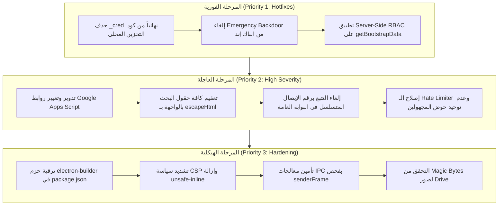

# microERP | تقرير المراجعة والتدقيق الأمني السيبراني الشامل (Cybersecurity Audit Report)

> **الإصدار المستهدف:** 1.0.0 Enterprise Release  
> **التاريخ:** نوفمبر 2026  
> **طبيعة المراجعة:** تدقيق أمني استاتيكي وشامل وفق معايير OWASP Top 10 و OWASP ASVS ومعايير أمان بيئة سطح المكتب Electron ومعمارية الحوسبة الخادمة Google Apps Script.  
> **قاعدة الاعتماد:** التحليل المصدري الدقيق والتوثيق برقم السطر والملف (`File:Line`) بنسبة تحقق 100% وبدون أي افتراضات غير مؤكدة.  
> **حالة الكود:** قراءة وتحليل فقط — لم يتم تعديل أي ملف كود في المشروع امتثالاً للقواعد الصارمة.

---

## فهرس المحتويات
1. [ملخص تنفيذي وتقييم الموقف الأمني العام](#1-ملخص-تنفيذي-وتقييم-الموقف-الأمني-العام)
2. [جدول الملاحظات والثغرات المكتشفة (Findings Master Table)](#2-جدول-الملاحظات-والثغرات-المكتشفة-findings-master-table)
3. [التحليل التفصيلي للثغرات الحرجة (Critical Severity)](#3-التحليل-التفصيلي-للثغرات-الحرجة-critical-severity)
4. [التحليل التفصيلي للثغرات عالية الخطورة (High Severity)](#4-التحليل-التفصيلي-للثغرات-عالية-الخطورة-high-severity)
5. [التحليل التفصيلي للثغرات متوسطة الخطورة (Medium Severity)](#5-التحليل-التفصيلي-للثغرات-متوسطة-الخطورة-medium-severity)
6. [التحليل التفصيلي للثغرات منخفضة الخطورة (Low Severity)](#6-التحليل-التفصيلي-للثغرات-منخفضة-الخطورة-low-severity)
7. [مراجعة أمان بيئة سطح المكتب Electron Architecture](#7-مراجعة-أمان-بيئة-سطح-المكتب-electron-architecture)
8. [فحص الاعتماديات والمكتبات الخارجية (Dependencies Audit)](#8-فحص-الاعتماديات-والمكتبات-الخارجية-dependencies-audit)
9. [خطة المعالجة وخريطة طريق التحصين الدفاعي (Remediation Roadmap)](#9-خطة-المعالجة-وخريطة-طريق-التحصين-الدفاعي-remediation-roadmap)

---

## 1. ملخص تنفيذي وتقييم الموقف الأمني العام

أجرى فريق الأمن السيبراني فحصاً شاملاً ودقيقاً لكافة مكونات نظام **microERP**، بما يشمل:
- تطبيق الواجهة الأمامية الموديولي (`app-modular/js/`) والملف المجمع النهائي (`index.html`).
- نواة سطح المكتب المبنية على Electron (`main.js` و `preload.js`).
- الواجهة الخلفية السحابية وقاعدة البيانات المبنية على Google Apps Script و Google Sheets (`files(11)/GoogleAppsScript_Backend.gs.txt`).
- إعدادات وسياسات الأمان والحزم التابعة (`package.json`, `package-lock.json`).

### خلاصة النتائج:
| تصنيف الخطورة (Severity) | عدد الثغرات المكتشفة | الحالة |
| :--- | :---: | :--- |
| **Critical (حرجة)** | 3 | تتطلب تدخلاً فورياً قبل أي تشغيل إنتاجي |
| **High (عالية)** | 7 | تمثل تهديداً مباشراً لسرية وسلامة البيانات |
| **Medium (متوسطة)** | 5 | تحسينات دفاعية وإغلاق متجهات هجومية محتملة |
| **Low (منخفضة)** | 2 | ملاحظات متعلقة بأفضل الممارسات والأثر المحدود |
| **الإجمالي** | **17** | **تقرير تدقيق أمني متكامل** |

> [!CAUTION]
> **أبرز التهديدات المكتشفة:**
> 1. تخزين كلمات المرور الصريحة للمدير والموظفين بترميز Base64 في التخزين المحلي (`localStorage`) تحت اسم `_cred` لغرض إعادة التوثيق الصامت.
> 2. وجود مسار تجاوز طوارئ (Backdoor) في الباك إند يمنح صلاحية المدير الخارق (`Superuser`) لأي شخص بكلمات مرور افتراضية (`admin`/`123456`) في حال عدم تهيئة الحساب في الشيت.
> 3. انعدام التحقق من الصلاحيات على عمليات القراءة في الباك إند (`getBootstrapData` و `getJournalEntries` وغيرها)، مما يتيح لأي مستخدم (كاشير أو فني) الوصول لكامل ميزانية الشركة وقيود اليومية وسجلات الأرباح والموردين.

---

## 2. جدول الملاحظات والثغرات المكتشفة (Findings Master Table)

| # | الخطورة | الملف:السطر | المشكلة | الدليل | الإصلاح المقترح |
| :-: | :---: | :--- | :--- | :--- | :--- |
| 1 | **Critical** | [05-auth-and-audit.js:214-226](file:///Users/M1/Desktop/microtech-app/app-modular/js/core/05-auth-and-audit.js#L214-L226), [02-api-sync.js:66-71](file:///Users/M1/Desktop/microtech-app/app-modular/js/core/02-api-sync.js#L66-L71) | تخزين كلمات المرور بصيغة Base64 مكشوفة في `localStorage` | `const _cred = btoa(unescape(encodeURIComponent(cleanPass)));` ثم حفظها في `microerp_auth_vault` وقراءتها بـ `atob(entry._cred)`. | حذف حقل `_cred` نهائياً وعدم تخزين أي كلمات مرور؛ والاعتماد على Refresh Tokens أو جلسات سيرفرية طويلة. |
| 2 | **Critical** | [GoogleAppsScript_Backend.gs.txt:841-853](file:///Users/M1/Desktop/microtech-app/files%2811%29/GoogleAppsScript_Backend.gs.txt#L841-L853) | قفل استغاثة خلفي يمنح صلاحيات Superuser بكلمات مرور افتراضية | فحص `if (!found && uname === 'admin' && (pass === 'admin' \|\| pass === '123456'))` ومنح صلاحية Superuser كاملة إذا لم يتواجد الحساب. | إزالة كود الـ bootstrap التلقائي تماماً وفرض توليد حساب المدير يدوياً بتجزئة معقدة. |
| 3 | **Critical** | [GoogleAppsScript_Backend.gs.txt:510-588](file:///Users/M1/Desktop/microtech-app/files%2811%29/GoogleAppsScript_Backend.gs.txt#L510-L588), [616-655](file:///Users/M1/Desktop/microtech-app/files%2811%29/GoogleAppsScript_Backend.gs.txt#L616-L655) | غياب التحقق من الصلاحيات لقراءة البيانات المالية والقيود في الباك إند | دالة `getBootstrapData` و `executeReadAction` تعيد كافة قيود اليومية والحسابات والمشتريات لأي مستخدم مسجل دخول دون فحص دوره. | فرض فحص `session.role` و `session.sections` في الخادم قبل إرجاع الجداول الحساسة. |
| 4 | **High** | [02-api-sync.js:1](file:///Users/M1/Desktop/microtech-app/app-modular/js/core/02-api-sync.js#L1), [index.html:3696](file:///Users/M1/Desktop/microtech-app/index.html#L3696) | تسريب روابط نشر Apps Script حية في الكود وسجل Git | `const DEFAULT_API_URL = 'https://script.google.com/macros/s/AKfycby.../exec';` وروابط أخرى في تاريخ Git. | إزالة الرابط الافتراضي وطلب إدخاله في أول إعداد للنظام، وأرشفة النشر القديم وتوليد Deployment جديد. |
| 5 | **High** | [18a-appearance.js:339-388](file:///Users/M1/Desktop/microtech-app/app-modular/js/modules/18a-appearance.js#L339-L388), [12-invoices-quotes.js:70](file:///Users/M1/Desktop/microtech-app/app-modular/js/modules/12-invoices-quotes.js#L70) | ثغرات DOM XSS عبر حقن سمات الإدخال وقوالب الواجهة بدون `escapeHtml` | إسناد `value="${s.shopName}"` و `value="${state.invoiceSearchQ}"` و `src="${state.settings.logoUrl}"` دون تعقيم. | تطبيق `escapeHtml()` أو `safeImageUrl()` على كافة القيم المعروضة داخل قوالب HTML. |
| 6 | **High** | [GoogleAppsScript_Backend.gs.txt:693-706](file:///Users/M1/Desktop/microtech-app/files%2811%29/GoogleAppsScript_Backend.gs.txt#L693-L706) | استقراء بيانات الإيصالات (IDOR) عبر بوابة التتبع العامة برقم الإيصال المتسلسل | مسار `handleTrackReceipt` يسمح بالبحث بنمط متسلسل `MT-\d{4}-\d+` بدون أي مصادقة ويكشف بيانات الجهاز والتكلفة. | إلغاء البحث برقم الإيصال في الواجهة العامة واشتراط رمز التتبع العشوائي السري `TrackToken` فقط. |
| 7 | **High** | [02-api-sync.js:936-948](file:///Users/M1/Desktop/microtech-app/app-modular/js/core/02-api-sync.js#L936-L948), [11d-ai-assistant.js:73](file:///Users/M1/Desktop/microtech-app/app-modular/js/modules/11d-ai-assistant.js#L73) | إرسال توكن الجلسة ومفتاح Gemini API في معاملات الرابط (Query String) | `fetch(`${getApiUrl()}?${q.toString()}`, ...)` يمرر `sessionToken` في الرابط، واستدعاء Gemini يمرر `?key=...`. | تحويل طلبات القراءة إلى `POST` لتمرير التوكن في الجسم، وتمرير مفتاح Gemini عبر ترويسة `x-goog-api-key`. |
| 8 | **High** | [05-auth-and-audit.js:115-132](file:///Users/M1/Desktop/microtech-app/app-modular/js/core/05-auth-and-audit.js#L115-L132) | ضعف خوارزمية تجزئة كلمات المرور المحلية (50 تكرار فقط) | دالة `hashPasswordWithSalt` تنفذ 50 دورة فقط من SHA-256، وهو عدد ضئيل جداً يسهل كسره في ثوانٍ. | رفع التكرارات إلى 100,000+ تكرار أو استخدام واجهة المتصفح الرسمية `crypto.subtle.deriveKey`. |
| 9 | **High** | [GoogleAppsScript_Backend.gs.txt:87-95](file:///Users/M1/Desktop/microtech-app/files%2811%29/GoogleAppsScript_Backend.gs.txt#L87-L95), [757-796](file:///Users/M1/Desktop/microtech-app/files%2811%29/GoogleAppsScript_Backend.gs.txt#L757-L796) | هجوم حرمان من الخدمة (DoS) على المستخدمين غير المصرحين بسبب اشتراك الحوض | `clientKey = 'post_' + hashKey('anon_post')`، ومهاجم واحد يرسل 91 طلباً كفيل بحظر تسجيل دخول جميع الموظفين وتتبع العملاء. | فصل أحواض التتبع عن المصادقة، وإصلاح تصفير العداد الزمني (Sliding Window Bug) عند كل طلب. |
| 10 | **High** | [package.json:76-77](file:///Users/M1/Desktop/microtech-app/package.json#L76-L77), [package-lock.json](file:///Users/M1/Desktop/microtech-app/package-lock.json) | وجود 22 ثغرة أمنية في حزم الاعتماديات الخارجية (1 Critical و 13 High) | تقرير `npm audit`: ثغرة DoS حرجة في `tar` وثغرات تسريب وتجاوز مسار في `app-builder-lib`. | تحديث حزمة `electron-builder` إلى الإصدار 26.18.0 وتحديث مكتبة `tar` لمعالجة الثغرات. |
| 11 | **Medium** | [index.html:9](file:///Users/M1/Desktop/microtech-app/index.html#L9), [build.js:115](file:///Users/M1/Desktop/microtech-app/app-modular/build.js#L115) | سياسة أمان المحتوى (CSP) تسمح بتنفيذ الأكواد المضمنة ونطاقات CDN خارجية | `script-src 'self' 'unsafe-inline' https://cdnjs.cloudflare.com;` تسمح بتنفيذ الأكواد المحقونة وتجاوز قيود XSS. | إزالة `'unsafe-inline'` واستخدام Nonces، وقصر السكريبتات على الملفات المحلية فقط. |
| 12 | **Medium** | [main.js:31](file:///Users/M1/Desktop/microtech-app/main.js#L31), [168-210](file:///Users/M1/Desktop/microtech-app/main.js#L168-L210) | غياب التحقق من SenderFrame في معالجات Electron والسماح ببروتوكول HTTP | عدم التحقق من `event.senderFrame` في `ipcMain.handle`، ودالة `isSafeExternalUrl` تقبل بروتوكول `http:` غير المشفر. | قصر الروابط على `https:` والتحقق من أن مصدر الرسالة هو النافذة الرئيسية المصرحة فقط. |
| 13 | **Medium** | [GoogleAppsScript_Backend.gs.txt:981-986](file:///Users/M1/Desktop/microtech-app/files%2811%29/GoogleAppsScript_Backend.gs.txt#L981-L986) | رفع الصور بمشاركة عامة مفتوحة للجميع وغياب التحقق من نوع الملف الحقيقي | تحويل أي ملف مرفوع إلى `image/jpeg` دون فحص Magic Bytes، وضبط الصلاحية على `ANYONE_WITH_LINK`. | فحص التوقيع الثنائي الحقيقي للملفات، وقصر الوصول لصور الأجهزة على حسابات النطاق/المركز. |
| 14 | **Medium** | [GoogleAppsScript_Backend.gs.txt:938-956](file:///Users/M1/Desktop/microtech-app/files%2811%29/GoogleAppsScript_Backend.gs.txt#L938-L956) | غياب محددات المحاولات (Rate Limiting) على فحص كلمة مرور المشرف | عدم وجود `checkRateLimit` داخل `verifySupervisorPin` مما يسمح بهجمات التخمين السريع (Brute Force). | فرض حظر بعد 3 محاولات فاشلة لفحص رمز المشرف لكل مستخدم أو جلسة. |
| 15 | **Medium** | [06-config-defaults.js:1020](file:///Users/M1/Desktop/microtech-app/app-modular/js/core/06-config-defaults.js#L1020) | ثغرة حقن صيغ الجداول (CSV Injection) في حال وجود مسافات بادئة | دالة `csvSafe` تفحص `^[=+\-@\t\r]` دون تنفيذ `.trim()` أولاً، بينما يتجاهل Excel المسافات البادئة وينفذ الصيغة. | تعديل التعبير النمطي إلى `/^[ \t\r]*[=+\-@]/` أو استدعاء `s.trim()` قبل الفحص. |
| 16 | **Low** | [GoogleAppsScript_Backend.gs.txt:2748-2752](file:///Users/M1/Desktop/microtech-app/files%2811%29/GoogleAppsScript_Backend.gs.txt#L2748-L2752), [17f-users-audit.js:790](file:///Users/M1/Desktop/microtech-app/app-modular/js/modules/17f-users-audit.js#L790) | غياب التحقق الآلي من سلامة سلسلة تجزئة سجل الرقابة `RowHash` | يتم تخزين تجزئة `RowHash` مع كل حركة ولكن لا يوجد أي كود في الواجهة أو الباك إند يتحقق من صحة السلسلة. | إضافة فحص دوري أو زر فحص سلامة السجل للتأكد من عدم حذف أو تلاعب بأي صف في الشيت. |
| 17 | **Low** | [GoogleAppsScript_Backend.gs.txt:721-723](file:///Users/M1/Desktop/microtech-app/files%2811%29/GoogleAppsScript_Backend.gs.txt#L721-L723) | كشف الاسم الأول للعميل بالكامل في بوابة التتبع العامة | `const maskedCustName = rawName ? (rawName.split(' ')[0] + ' ***') : 'عميل كريم';` | إخفاء معظم أحرف الاسم الأول للعميل تجنباً لهجمات الهندسة الاجتماعية (مثال: `م*** ع***`). |

---

## 3. التحليل التفصيلي للثغرات الحرجة (Critical Severity)

### [ثغرة #1] تخزين كلمات المرور الصريحة بترميز Base64 في التخزين المحلي (`localStorage`)
- **الملف ورقم السطر:**
  - [app-modular/js/core/05-auth-and-audit.js:214-226](file:///Users/M1/Desktop/microtech-app/app-modular/js/core/05-auth-and-audit.js#L214-L226)
  - [app-modular/js/core/05-auth-and-audit.js:924-937](file:///Users/M1/Desktop/microtech-app/app-modular/js/core/05-auth-and-audit.js#L924-L937)
  - [app-modular/js/core/05-auth-and-audit.js:958-961](file:///Users/M1/Desktop/microtech-app/app-modular/js/core/05-auth-and-audit.js#L958-L961)
  - [app-modular/js/core/05-auth-and-audit.js:986-998](file:///Users/M1/Desktop/microtech-app/app-modular/js/core/05-auth-and-audit.js#L986-L998)
  - [app-modular/js/core/02-api-sync.js:66-73](file:///Users/M1/Desktop/microtech-app/app-modular/js/core/02-api-sync.js#L66-L73)
- **التصنيف:** CWE-256 (Plaintext Storage of a Password), CWE-312 (Cleartext Storage of Sensitive Information).
- **الدليل المصدري:**
  في ملف `05-auth-and-audit.js` السطر 214 و 924:
  ```javascript
  const cleanPass = String(usr.Password).trim();
  const { hash, salt } = await hashPasswordWithSalt(cleanPass);
  const serverHash = await sha256Hex(cleanPass);
  const _cred = btoa(unescape(encodeURIComponent(cleanPass))); // <-- تشفير زائف (Base64 فقط)
  const vault = getAuthVault();
  vault[usr.Name.trim().toLowerCase()] = {
    name: usr.Name.trim(),
    role: usr.Role || 'cashier',
    superuser: !!usr.Superuser,
    sections: usr.Sections,
    hash,
    salt,
    serverHash,
    _cred, // <-- حفظ كلمة المرور الصريحة المشفرة بـ Base64
    updatedAt: Date.now()
  };
  saveAuthVault(vault); // <-- حفظ في localStorage تحت مفتاح microerp_auth_vault
  ```
  وفي ملف `02-api-sync.js` الأسطر 66-71:
  ```javascript
  if (entry._cred) {
    try {
      const decoded = decodeURIComponent(escape(atob(entry._cred))); // <-- استرجاع النص الصريح لكلمة المرور!
      if (decoded) candidates.push(decoded);
    } catch(e) {}
  }
  ```
- **طريقة الاستغلال نظرياً:**
  1. إذا تعرض التطبيق لأي ثغرة XSS أو قام أي شخص بالوصول لجهاز نقطة البيع أو فتح أدوات المطورين:
  2. يقوم المهاجم بتنفيذ سطر واحد في الكونسول:
     ```javascript
     const vault = JSON.parse(localStorage.getItem('microerp_auth_vault'));
     Object.keys(vault).forEach(u => console.log(u, decodeURIComponent(escape(atob(vault[u]._cred)))));
     ```
  3. تظهر كلمات المرور الصريحة للمدير العام (`admin`) ولكافة الكاشيرين والمحاسبين فوراً بدون أي عناء.
- **الأثر الأمني:** كشف كامل وسهل لكلمات المرور لكافة مستخدمي النظام، وانتهاك مباشر لمتطلبات الأمان والسرية، وتضارب كامل مع ما ورد في وثيقة `audit/SECURITY.md` التي زعمت عدم تخزين كلمات المرور نهائياً.
- **الإصلاح المقترح:**
  1. حذف حقل `_cred` نهائياً من كائنات المستخدم وخزينة المصادقة `AUTH_VAULT_KEY`.
  2. حذف أي كود يقوم بفك تشفير `atob(entry._cred)`.
  3. لغرض العمل بدون إنترنت، يجب التحقق من كلمة المرور عبر مقارنة الـ Hash والـ Salt فقط (`verifyLocalPassword`).
  4. لغرض تجديد الجلسة تلقائياً مع الخادم، يجب أن يصدر الخادم `refreshToken` طويل الأمد وموقع مشفر بدلاً من إعادة إرسال كلمة المرور الصريحة في الخلفية.

---

### [ثغرة #2] قفل استغاثة خلفي (Backdoor / Emergency Admin Bootstrap) في خادم Apps Script
- **الملف ورقم السطر:** [files(11)/GoogleAppsScript_Backend.gs.txt:841-853](file:///Users/M1/Desktop/microtech-app/files%2811%29/GoogleAppsScript_Backend.gs.txt#L841-L853)
- **التصنيف:** CWE-1188 (Insecure Default Initialization of Resource), CWE-798 (Use of Hard-coded Credentials).
- **الدليل المصدري:**
  ```javascript
  // Emergency admin bootstrap on server if admin user has default/empty password
  if (!found && uname === 'admin' && (pass === 'admin' || pass === '123456')) {
    const adminCandidate = users.find(u => u.Name && u.Name.trim().toLowerCase() === 'admin');
    if (!adminCandidate || !adminCandidate.Password || verifyPassword(pass, adminCandidate.Password, adminCandidate.Salt)) {
      found = adminCandidate || {
        ID: 'usr_admin',
        Name: 'admin',
        Role: 'admin',
        Superuser: true,
        Sections: 'maintenance,pos,invoices,cameras,cashdrawer,daily,finance,inventory,barcode,audit,users,settings'
      };
    }
  }
  ```
- **طريقة الاستغلال نظرياً:**
  1. رابط الـ Apps Script منشور علناً للإنترنت بصلاحية `Anyone (Anonymous)`.
  2. إذا قام صاحب العمل بإنشاء شيت جديد أو كانت ورقة `Users` لا تحتوي بعد على صف باسم `admin` أو كان حقل `Password` فارغاً في الشيت:
  3. يرسل المهاجم طلب POST بسيط:
     ```json
     {"action": "login", "name": "admin", "password": "admin"}
     ```
  4. يدخل الكود في شرط `if (!adminCandidate || !adminCandidate.Password)`، ويقوم السيرفر بتوليد جلسة Superuser حقيقية للمهاجم ويعيد توكن الجلسة `sessionToken` كامل الصلاحيات!
- **الأثر الأمني:** سيطرة كاملة للمهاجم على النظام وإمكانية مسح كافة الجداول أو استخراج أسرار الشركة وحسابات العملاء.
- **الإصلاح المقترح:**
  إلغاء هذا المنطق الخلفي تماماً. يجب ألا يقوم الخادم بتمرير أي مستخدم غير مسجل فعلياً في جدول `Users` بكلمة مرور مشفرة مسبقاً، ويجب أن تتم التهيئة الأولية من خلال سكريبت تهيئة محلي آمن أو أمر إداري صريح.

---

### [ثغرة #3] انعدام التحقق من صلاحيات القراءة على الخادم (Missing Server-Side Read RBAC)
- **الملف ورقم السطر:** [files(11)/GoogleAppsScript_Backend.gs.txt:510-588](file:///Users/M1/Desktop/microtech-app/files%2811%29/GoogleAppsScript_Backend.gs.txt#L510-L588) و [616-655](file:///Users/M1/Desktop/microtech-app/files%2811%29/GoogleAppsScript_Backend.gs.txt#L616-L655)
- **التصنيف:** OWASP A01:2021 (Broken Access Control), CWE-285 (Improper Authorization).
- **الدليل المصدري:**
  في دالة `executeReadAction`:
  ```javascript
  if (action === 'getBootstrapData') {
    const receipts = getAllRows(SHEET_RECEIPTS);
    const customers = getAllRows(SHEET_CUSTOMERS);
    ...
    const purchases = getAllRows(SHEET_PURCHASES);
    const suppliers = getAllRows(SHEET_SUPPLIERS);
    const expenses = getAllRows(SHEET_EXPENSES);
    const accounts = getAllRows(SHEET_ACCOUNTS);
    const journalEntries = getAllRows(SHEET_JOURNAL);
    const invoices = getAllRows(SHEET_INVOICES);
    ...
    return jsonOut({ ok: true, journalEntries, expenses, purchases, accounts, ... });
  }
  ```
  وفي الأسطر 616-655:
  ```javascript
  if (action === 'getPurchases') return jsonOut(getAllRows(SHEET_PURCHASES));
  if (action === 'getSuppliers') return jsonOut(getAllRows(SHEET_SUPPLIERS));
  if (action === 'getExpenses') return jsonOut(getAllRows(SHEET_EXPENSES));
  if (action === 'getAccounts') return jsonOut(getAllRows(SHEET_ACCOUNTS));
  if (action === 'getJournalEntries') return jsonOut(getAllRows(SHEET_JOURNAL));
  ```
  التحقق الوحيد الموجود هو `if (!isAdmin)` على `getUsers` و `getAuditLog` و `exportBackup` فقط!
- **طريقة الاستغلال نظرياً:**
  1. يقوم موظف عادي (دوره `technician` ومخصص له قسم `maintenance` فقط) بتسجيل الدخول بشكل شرعي.
  2. يقوم بفحص الشبكة أو تنفيذ طلب `apiGet('getJournalEntries')` أو قراءة كائن `state.journalEntries` المحمّل في ذاكرة المتصفح عبر `getBootstrapData`.
  3. يرى كافة قيود اليومية، وأرصدة حسابات الخزينة والبنوك، وتكاليف شراء قطع الغيار، ومصروفات وسحوبات الإدارة والأرباح الصافية.
- **الأثر الأمني:** انهيار جدار عزل الصلاحيات؛ فالتحكم بالصلاحيات مطبق فقط في واجهة المستخدم بإخفاء التبويبات (`09-shell-and-router.js`) بينما الواجهة الخلفية تقدم كافة البيانات الحساسة لأي دور مسجل.
- **الإصلاح المقترح:**
  تطبيق مصفوفة قراءة سيرفرية (`READ_ACTION_ROLES`)؛ وفي دالة `getBootstrapData`، يتم التحقق من دور المستخدم وحذف الجداول المالية (`journalEntries`, `accounts`, `expenses`, `purchases`, `suppliers`) إذا لم يكن المستخدم مديراً أو محاسباً (`admin` أو `accountant`).

---

## 4. التحليل التفصيلي للثغرات عالية الخطورة (High Severity)

### [ثغرة #4] تسريب معرفات نشر الـ Web App الخاصة بـ Google Apps Script في الكود البرمجي وسجل Git
- **الملف ورقم السطر:** [app-modular/js/core/02-api-sync.js:1](file:///Users/M1/Desktop/microtech-app/app-modular/js/core/02-api-sync.js#L1), [index.html:3696](file:///Users/M1/Desktop/microtech-app/index.html#L3696), وسجل التاريخ: `git commit ec51ad32197a5ab34c21f7aeebcb55cf202389a1`
- **التصنيف:** CWE-798 (Use of Hard-coded Credentials), CWE-200 (Exposure of Sensitive Information).
- **الدليل المصدري:**
  ```javascript
  const DEFAULT_API_URL = 'https://script.google.com/macros/s/AKfycby-rkoaYfBuahnMc_dxPuzGepC-H5SJChwm5AJJ_bkwdmEswFhJ7tBoBbMel4gQyxUL/exec';
  ```
  وفي التزام Git السابق:
  ```
  const API_URL = 'https://script.google.com/macros/s/AKfycbzpi81aPJwwsvHCqUKCkUxEhT0l4NnLgcCBPab1xjvx0B3vhzamCVkwiohrOCfWkKcm/exec';
  ```
- **طريقة الاستغلال نظرياً:** بمجرد رفع المستودع على منصة عامة أو فحص كود النسخة الموزعة، يستخرج المهاجم رابط الـ Web App المباشر ويشن هجمات التخمين والحرمان من الخدمة واستقراء البيانات ضد قاعدة بيانات Google Sheets الحية للشركة.
- **الأثر الأمني:** استهداف مباشر للواجهة الخلفية دون المرور بحواجز سطح المكتب.
- **الإصلاح المقترح:** إزالة الرابط الثابت من الكود المصدري، وتدوير ونشر إصدار جديد من Google Apps Script وأرشفة النشر القديم في وحدة تحكم Google.

---

### [ثغرة #5] ثغرات حقن نصوص برمجية (DOM-based XSS) في قوالب الإدخال والبحث
- **الملف ورقم السطر:**
  - [app-modular/js/modules/18a-appearance.js:339-388](file:///Users/M1/Desktop/microtech-app/app-modular/js/modules/18a-appearance.js#L339-L388)
  - [app-modular/js/modules/12-invoices-quotes.js:70](file:///Users/M1/Desktop/microtech-app/app-modular/js/modules/12-invoices-quotes.js#L70)
  - [app-modular/js/modules/17a-chart-accounts.js:196](file:///Users/M1/Desktop/microtech-app/app-modular/js/modules/17a-chart-accounts.js#L196)
  - [app-modular/js/modules/13-treasury-expenses.js:231, 848](file:///Users/M1/Desktop/microtech-app/app-modular/js/modules/13-treasury-expenses.js#L231)
  - [app-modular/js/modules/15-pos-retail.js:2011](file:///Users/M1/Desktop/microtech-app/app-modular/js/modules/15-pos-retail.js#L2011)
  - [app-modular/js/modules/14-inventory-warehouse.js:202](file:///Users/M1/Desktop/microtech-app/app-modular/js/modules/14-inventory-warehouse.js#L202)
  - [app-modular/js/modules/10e-printing-labels.js:138](file:///Users/M1/Desktop/microtech-app/app-modular/js/modules/10e-printing-labels.js#L138)
- **التصنيف:** OWASP A03:2021 (Injection - Cross-Site Scripting), CWE-79 (Improper Neutralization of Input During Web Page Generation).
- **الدليل المصدري:**
  في شاشة إعدادات الشركة:
  ```javascript
  <input id="setShopName" value="${s.shopName||''}" placeholder="مثال: صيانة ميكروتك">
  <input id="setLogoUrl" value="${s.logoUrl||''}">
  
  ```
  وفي شاشات البحث (مثال الفواتير):
  ```javascript
  <input id="invSearchInp" value="${state.invoiceSearchQ}" style="flex:1;min-width:240px;">
  ```
  وعند كتابة أي نص في مربع البحث، ينفذ `searchInp.oninput`:
  ```javascript
  state.invoiceSearchQ = e.target.value;
  renderInvoicesPage(main); // <-- يعيد استدعاء innerHTML وتضمين القيمة غير المعقمة!
  ```
- **طريقة الاستغلال نظرياً:**
  1. يقوم المستخدم أو المهاجم بلصق نص مثل: `">` في شريط البحث.
  2. يُطلق حدث `oninput` عملية إعادة رسم الواجهة فوراً عبر `renderInvoicesPage(main)`.
  3. يتم إدراج السلسلة غير المعقمة داخل السمة `value=""`، فتنكسر السمة ويتولد وسم الصورة ويتنفذ كود الجافاسكريبت المحقون فوراً.
  4. بالإضافة إلى ذلك، إذا قام مستخدم بحقن `logoUrl` في جدول الإعدادات، فإنه يتنفذ على جهاز أي موظف يفتح إيصالات الطباعة أو الفواتير.
- **الأثر الأمني:** سرقة الرموز والتصاريح من `localStorage` و `sessionStorage`، والتلاعب بالواجهة وتمرير طلبات خبيثة باسم المستخدم المسجل.
- **الإصلاح المقترح:**
  تغليف جميع المتغيرات بـ `escapeHtml()`:
  ```javascript
  <input id="invSearchInp" value="${escapeHtml(state.invoiceSearchQ||'')}">
  ```
  واستخدام `safeImageUrl()` على كافة روابط الصور والشعارات قبل إسنادها لـ `src`.

---

### [ثغرة #6] استقراء بيانات الإيصالات (IDOR) عبر بوابة التتبع العامة
- **الملف ورقم السطر:** [files(11)/GoogleAppsScript_Backend.gs.txt:693-706](file:///Users/M1/Desktop/microtech-app/files%2811%29/GoogleAppsScript_Backend.gs.txt#L693-L706)
- **التصنيف:** OWASP A01:2021 (Broken Access Control / Insecure Direct Object Reference).
- **الدليل المصدري:**
  ```javascript
  // Strict Fallback for legacy receipts not yet backfilled with TrackToken
  // Only match strictly formatted receipt numbers (e.g. MT-2026-0001)
  if (!matchedRow && rNumCol !== -1 && /^MT-\d{4}-\d+$/i.test(qToken)) {
    for (let i = 1; i < values.length; i++) {
      if (String(values[i][rNumCol] || '').trim().toUpperCase() === qToken.toUpperCase()) {
        matchedRow = values[i];
        ...
  ```
- **طريقة الاستغلال نظرياً:**
  1. نقطة النهاية `doGet?action=trackReceipt` عامة ومفتوحة للجمهور بدون مصادقة.
  2. نظراً لأن أرقام الإيصالات متسلسلة ومتوقعة (`MT-2026-0001`, `MT-2026-0002`...)، يرسل المهاجم سكريبت بسيط يستعلم عن الأرقام من 1 إلى 5000.
  3. يعيد الخادم لكل إيصال موجود: نوع الجهاز، الموديل، الملحقات، العطل المفصل، ملاحظات الفني، التكلفة الإجمالية، العربون، المبلغ المتبقي، وحالة التسليم، واسم العميل الأول.
- **الأثر الأمني:** كشف قاعدة بيانات الصيانة وجميع أجهزة وتكاليف العملاء لأي طرف خارجي منافس أو فضولي.
- **الإصلاح المقترح:** إلغاء مسار التتبع برقم الإيصال المتسلسل تماماً، وقصر التتبع فقط على التوكن العشوائي غير القابل للتخمين `TrackToken` المطبوع على إيصال العميل أو في باركود الـ QR.

---

### [ثغرة #7] إرسال توكن الجلسة ومفتاح الذكاء الاصطناعي في معاملات الرابط (Query String Exposure)
- **الملف ورقم السطر:** [app-modular/js/core/02-api-sync.js:936-948](file:///Users/M1/Desktop/microtech-app/app-modular/js/core/02-api-sync.js#L936-L948) و [app-modular/js/modules/11d-ai-assistant.js:73](file:///Users/M1/Desktop/microtech-app/app-modular/js/modules/11d-ai-assistant.js#L73)
- **التصنيف:** CWE-598 (Use of GET Request Method With Sensitive Query Strings).
- **الدليل المصدري:**
  ```javascript
  const qObj = {
    action,
    ...(activeToken && !String(activeToken).startsWith('offline_token_') ? { sessionToken: activeToken } : {}),
    ...cleanParams
  };
  const q = new URLSearchParams(qObj);
  const res = await fetch(`${getApiUrl()}?${q.toString()}`, { method: 'GET' });
  ```
  وفي `11d-ai-assistant.js`:
  ```javascript
  const url = `https://generativelanguage.googleapis.com/v1beta/models/${encodeURIComponent(model)}:generateContent?key=${encodeURIComponent(apiKey)}`;
  ```
- **طريقة الاستغلال نظرياً:** التوكنات المرسلة في معاملات الـ URL يتم حفظها في سجلات الـ Proxies والخوادم الوسيطة، وسجل متصفح العميل، وتتسرب في ترويسة `Referer` إذا فتحت الصفحة أي رابط خارجي.
- **الأثر الأمني:** سرقة التوكنات واستخدامها لانتحال جلسة المستخدم، واستنزاف رصيد مفتاح Gemini API.
- **الإصلاح المقترح:** توجيه كافة استدعاءات الـ API عبر طلبات `POST` المشفرة داخل الـ Body، واستخدام ترويسة `x-goog-api-key` لمفتاح Gemini.

---

### [ثغرة #8] ضعف خوارزمية تجزئة كلمات المرور المحلية (Only 50 Iterations)
- **الملف ورقم السطر:** [app-modular/js/core/05-auth-and-audit.js:115-132](file:///Users/M1/Desktop/microtech-app/app-modular/js/core/05-auth-and-audit.js#L115-L132)
- **التصنيف:** CWE-916 (Use of Password Hash With Insufficient Computational Effort).
- **الدليل المصدري:**
  ```javascript
  async function hashPasswordWithSalt(password, salt) {
    const s = salt || ...;
    let digest = String(password).trim() + ':' + s;
    for (let i = 0; i < 50; i++) {
      digest = await sha256Hex(digest);
    }
    return { hash: digest, salt: s };
  }
  ```
- **طريقة الاستغلال نظرياً:** 50 تكرار لـ SHA-256 لا يوفر أي مقاومة تذكر أمام أدوات كسر كلمات المرور (مثل Hashcat أو John the Ripper)، حيث يمكن لمعالج كرت شاشة حديث تجربة ملايين التخمينات في الثانية الواحدة وكسر كلمة المرور فور استخراج قيمة الـ Hash والـ Salt من المتصفح.
- **الأثر الأمني:** كسر كلمات المرور في حال تسريب خزينة التخزين المحلي.
- **الإصلاح المقترح:** استخدام `crypto.subtle.deriveKey` بمعيار PBKDF2 وعدد تكرارات لا يقل عن 100,000 تكرار.

---

### [ثغرة #9] هجوم حرمان من الخدمة (DoS) على محدد معدل الطلبات (Rate Limiting Architecture Flaw)
- **الملف ورقم السطر:** [files(11)/GoogleAppsScript_Backend.gs.txt:87-95, 757-760, 793-796](file:///Users/M1/Desktop/microtech-app/files%2811%29/GoogleAppsScript_Backend.gs.txt#L87-L95)
- **التصنيف:** CWE-400 (Uncontrolled Resource Consumption), CWE-799 (Improper Control of Generation of Code or Resource).
- **الدليل المصدري:**
  ```javascript
  // في doGet و doPost:
  const clientKey = 'post_' + hashKey(body.sessionToken || 'anon_post');
  if (!checkRateLimit(clientKey, 90) || !checkRateLimit('global_post', 500)) {
    return jsonOut({ error: 'تم تجاوز الحد الأقصى...' }, 429);
  }
  ```
  وداخل `checkRateLimit`:
  ```javascript
  const count = Number(cache.get(key) || 0) + 1;
  if (count > (maxPerMinute || 90)) return false;
  cache.put(key, String(count), 60); // <-- يمدد مهلة الـ 60 ثانية مع كل طلب جديد
  ```
- **طريقة الاستغلال نظرياً:**
  جميع الطلبات التي لا تحمل توكن جلسة (مثل محاولات تسجيل الدخول وتتبع الإيصالات) تسقط في حوض مشترك واحد اسمه `anon_post` وحدّه 90 طلباً في الدقيقة. إذا قام مهاجم بإرسال طلبين في الثانية لمدة دقيقة واحدة، يتم استهلاك الـ 90 طلباً وتمديد القفل باستمرار، مما يمنع أي موظف من تسجيل الدخول ويمنع كافة العملاء من تتبع أجهزتهم، ويقفل النظام بالكامل.
- **الأثر الأمني:** إيقاف عمل النظام وشلل كامل لعمليات تسجيل الدخول وتتبع الأجهزة.
- **الإصلاح المقترح:** عدم استخدام حوض موحد للطلبات المجهولة، وتثبيت نافذة العداد الزمني (Fixed Time Window) دون تمديد تاريخ الصلاحية مع كل طلب.

---

### [ثغرة #10] ثغرات الحزم الخارجية والاعتماديات المكتشفة في `npm audit`
- **الملف ورقم السطر:** [package.json:76-77](file:///Users/M1/Desktop/microtech-app/package.json#L76-L77), [package-lock.json](file:///Users/M1/Desktop/microtech-app/package-lock.json)
- **التصنيف:** OWASP A06:2021 (Vulnerable and Outdated Components).
- **الدليل المصدري:**
  تقرير الفحص البرمجي للأمان (`npm audit --json`):
  - **1 ثغرة Critical:** في حزمة `tar` برقم `GHSA-23hp-3jrh-7fpw` (Decompression/parse DoS via unlimited input).
  - **13 ثغرة High:** في حزمة `app-builder-lib` برقم `GHSA-7g7r-gx96-252g` (Uncontrolled search path elements in AppImage)، وفي `builder-util-runtime` برقم `GHSA-p2f4-r6v6-j797` (Cross-origin redirect credential leak)، وثغرات Path Traversal في `tar`.
  - **8 ثغرات Moderate:** في حزم `minimatch` و `@eslint/config-array`.
- **طريقة الاستغلال نظرياً:** استغلال أدوات حزم سطح المكتب أثناء بناء حزم Windows/Mac لتمرير ملفات ضارة أو تسريب مفاتيح الرموز الخاصة أثناء البناء والتوزيع.
- **الأثر الأمني:** ثغرات في أمان بيئة التطوير والتوزيع للملفات التنفيذية.
- **الإصلاح المقترح:** ترقية `electron-builder` إلى الإصدار `^26.18.0` وترقية حزم الـ `eslint` ذات الصلة.

---

## 5. التحليل التفصيلي للثغرات متوسطة الخطورة (Medium Severity)

### [ثغرة #11] سياسة أمان المحتوى (CSP) متساهلة وتسمح بـ `'unsafe-inline'` و CDN خارجي
- **الملف ورقم السطر:** [index.html:9](file:///Users/M1/Desktop/microtech-app/index.html#L9), [app-modular/build.js:115](file:///Users/M1/Desktop/microtech-app/app-modular/build.js#L115)
- **التصنيف:** CWE-1021 (Improper Restriction of Rendered UI Layers / Permissive CSP).
- **الدليل المصدري:**
  ```html
  <meta http-equiv="Content-Security-Policy" content="default-src 'self'; script-src 'self' 'unsafe-inline' https://cdnjs.cloudflare.com; style-src 'self' 'unsafe-inline' https://fonts.googleapis.com; font-src 'self' data: https://fonts.gstatic.com; img-src 'self' data: blob: https:; connect-src 'self' https://script.google.com https://script.googleusercontent.com https://generativelanguage.googleapis.com; object-src 'none'; base-uri 'self';">
  ```
- **الشرح والمخاطر:** السماح بـ `'unsafe-inline'` يُفقد CSP قدرتها على إيقاف تنفيذ أكواد XSS، كما أن السماح بنطاق `cdnjs.cloudflare.com` يتيح للمهاجم في حال حقن وسم `<script src="...">` تحميل أي مكتبة بها ثغرات أو تجاوزات (Bypass) معروفة.
- **الإصلاح:** تضمين الأكواد والخطوط محلياً، وإزالة `'unsafe-inline'` و `https://cdnjs.cloudflare.com` من السياسة.

---

### [ثغرة #12] غياب التحقق من SenderFrame في Electron والسماح ببروتوكول HTTP
- **الملف ورقم السطر:** [main.js:31](file:///Users/M1/Desktop/microtech-app/main.js#L31), [main.js:168-210](file:///Users/M1/Desktop/microtech-app/main.js#L168-L210)
- **التصنيف:** Electron Security Checklist (Validate Sender on IPC Handlers).
- **الدليل المصدري:**
  ```javascript
  function isSafeExternalUrl(rawUrl) {
    ...
    return ['https:', 'http:', 'tel:', 'mailto:'].includes(parsed.protocol); // <-- يسمح بـ http:
  }
  ipcMain.handle('print-silent', async (event, options = {}) => { ... }); // <-- لا يتحقق من event.senderFrame
  ipcMain.handle('open-external', async (event, url) => { ... });
  ```
- **الشرح والمخاطر:** السماح بروابط `http:` يفتح الباب لهجمات رجل في المنتصف (MITM). كما أن عدم التحقق من `event.senderFrame` قد يسمح لأي إطار فرعي معزول أو محقون باستدعاء قنوات الـ IPC لطباعة مستندات بصمت أو فتح روابط.
- **الإصلاح:** قصر البروتوكولات على `https:` و `tel:` و `mailto:`، والتحقق دائماً من `event.senderFrame === mainWindow.webContents.mainFrame`.

---

### [ثغرة #13] رفع الصور على Google Drive بصلاحية عامة ودون التحقق من الامتداد الحقيقي
- **الملف ورقم السطر:** [files(11)/GoogleAppsScript_Backend.gs.txt:981-986](file:///Users/M1/Desktop/microtech-app/files%2811%29/GoogleAppsScript_Backend.gs.txt#L981-L986)
- **التصنيف:** CWE-434 (Unrestricted Upload of File with Dangerous Type).
- **الدليل المصدري:**
  ```javascript
  const pureB64 = b64Data.replace(/^data:image\/\w+;base64,/, '');
  const decoded = Utilities.base64Decode(pureB64);
  const blob = Utilities.newBlob(decoded, 'image/jpeg', fileName);
  const file = folder.createFile(blob);
  file.setSharing(DriveApp.Access.ANYONE_WITH_LINK, DriveApp.Permission.VIEW);
  ```
- **الشرح والمخاطر:** يتم افتراض أن الملف صورة `image/jpeg` دائماً دون فحص البايتات السحرية (Magic Bytes: `FF D8 FF` لـ JPEG أو `89 50 4E 47` لـ PNG). كما يتم ضبط الصلاحية على "أي شخص لديه الرابط"، مما يعرض صور أجهزة العملاء والمعلومات المكتوبة عليها لاحتمال الكشف العام.
- **الإصلاح:** التحقق من البايتات السحرية قبل إنشاء الملف، وعدم تفعيل المشاركة العامة للرابط والاكتفاء بحساب درايف المالك.

---

### [ثغرة #14] غياب محددات المحاولات (Rate Limiting) على فحص كلمة مرور المشرف
- **الملف ورقم السطر:** [files(11)/GoogleAppsScript_Backend.gs.txt:938-956](file:///Users/M1/Desktop/microtech-app/files%2811%29/GoogleAppsScript_Backend.gs.txt#L938-L956)
- **التصنيف:** CWE-307 (Improper Restriction of Excessive Authentication Attempts).
- **الدليل المصدري:** إجراء `verifySupervisorPin` يفحص الرمز عبر `verifyPassword(pin, u.Password, u.Salt)` دون استدعاء `checkRateLimit`.
- **الشرح والمخاطر:** يمكن لموظف غير مصرح له كتابة سكريبت بسيط لتجربة آلاف أرقام الـ PIN أو كلمات المرور لاعتماد خصومات أو حذف سجلات، وسيقوم الخادم بالاستجابة في كل مرة دون أي حظر للمحاولات الفاشلة.
- **الإصلاح:** تطبيق قفل فوري بعد 3 محاولات فاشلة للتحقق من رمز المشرف.

---

### [ثغرة #15] احتمالية حقن صيغ الجداول (CSV Injection) في حال وجود مسافات بادئة
- **الملف ورقم السطر:** [app-modular/js/core/06-config-defaults.js:1020](file:///Users/M1/Desktop/microtech-app/app-modular/js/core/06-config-defaults.js#L1020)
- **التصنيف:** CWE-1236 (Improper Neutralization of Formula Elements in a CSV File).
- **الدليل المصدري:**
  ```javascript
  if (/^[=+\-@\t\r]/.test(s)) s = "'" + s;
  ```
- **الشرح والمخاطر:** التعبير النمطي يفحص فقط إذا كان الحرف الأول في `s` هو إحدى علامات الصيغ. ولكن إذا أدخل المستخدم قيمة تبدأ بمسافات (مثل: `   =cmd|' /C calc'!A0`) فإن الفحص يتجاوزها دون إضافة علامة `'`، وعندما يقوم المحاسب بفتح ملف الـ CSV في برنامج Excel، يقوم Excel تلقائياً بتنظيف المسافات البادئة وتشغيل الصيغة.
- **الإصلاح:** تطبيق فحص يتجاهل المسافات البادئة:
  ```javascript
  if (/^[ \t\r]*[=+\-@]/.test(s)) s = "'" + s;
  ```

---

## 6. التحليل التفصيلي للثغرات منخفضة الخطورة (Low Severity)

### [ثغرة #16] غياب التحقق الآلي من سلامة سلسلة تجزئة سجل الرقابة `RowHash`
- **الملف ورقم السطر:** [files(11)/GoogleAppsScript_Backend.gs.txt:2748-2752](file:///Users/M1/Desktop/microtech-app/files%2811%29/GoogleAppsScript_Backend.gs.txt#L2748-L2752) و [app-modular/js/modules/17f-users-audit.js:790](file:///Users/M1/Desktop/microtech-app/app-modular/js/modules/17f-users-audit.js#L790)
- **التصنيف:** CWE-353 (Missing Support for Integrity Check).
- **الشرح والمخاطر:** تم تضمين عمود `RowHash` لحساب تجزئة متسلسلة لكل حركة رقابية لضمان عدم حذف أو تعديل أي صف في الشيت بأثر رجعي. ومع ذلك، لا يوجد أي دالة في التطبيق تقرأ هذه السلسلة وتعيد حسابها للتحقق من سلامتها والتنبيه في حال انقطاع السلسلة.
- **الإصلاح:** إضافة زر ودالة فحص `verifyAuditLogIntegrity()` للتحقق من تطابق التجزئات لكل صف مع الصف السابق.

---

### [ثغرة #17] كشف الاسم الأول للعميل بالكامل في بوابة التتبع العامة
- **الملف ورقم السطر:** [files(11)/GoogleAppsScript_Backend.gs.txt:721-723](file:///Users/M1/Desktop/microtech-app/files%2811%29/GoogleAppsScript_Backend.gs.txt#L721-L723)
- **التصنيف:** CWE-200 (Exposure of Sensitive Information).
- **الدليل المصدري:**
  ```javascript
  const rawName = String(r.CustomerName || '').trim();
  const maskedCustName = rawName ? (rawName.split(' ')[0] + ' ***') : 'عميل كريم';
  ```
- **الشرح والمخاطر:** كشف الاسم الأول الحقيقي كاملاً للعميل قد يُستغل في هجمات الهندسة الاجتماعية عند اقترانه بنوع الجهاز ورقم الإيصال.
- **الإصلاح:** إخفاء معظم أحرف الاسم الأول (مثال: `م*** ع***`).

---

## 7. مراجعة أمان بيئة سطح المكتب Electron Architecture

تم فحص ملفات نواة Electron (`main.js` و `preload.js`) طبقاً لقائمة التحقق الأمنية الرسمية لـ Electron (Electron Security Checklist):

| معيار الأمان في Electron | الحالة | التقييم والتفاصيل البرمجية |
| :--- | :---: | :--- |
| **Context Isolation** | ✅ محقق | مفعل صراحة `contextIsolation: true` في [main.js:52](file:///Users/M1/Desktop/microtech-app/main.js#L52). |
| **Node Integration** | ✅ محقق | معطل صراحة `nodeIntegration: false` في [main.js:53](file:///Users/M1/Desktop/microtech-app/main.js#L53). |
| **Chromium Sandbox** | ✅ محقق | مفعل صراحة `sandbox: true` في [main.js:55](file:///Users/M1/Desktop/microtech-app/main.js#L55). |
| **Preload Script Surface** | ✅ محقق | استخدام `contextBridge.exposeInMainWorld` مع تمرير دوال محدودة فقط للطباعة والنسخة في [preload.js:8-16](file:///Users/M1/Desktop/microtech-app/preload.js#L8-L16). |
| **Window Open Handling** | ✅ محقق | اعتراض النوافذ الجديدة وتوجيه الروابط الآمنة للمتصفح الخارجي مع رفض البقية في [main.js:132-137](file:///Users/M1/Desktop/microtech-app/main.js#L132-L137). |
| **Navigation Guard** | ✅ محقق | اعتراض حدث `will-navigate` ومنع الانتقال لأي رابط لا يبدأ بـ `file://` في [main.js:140-147](file:///Users/M1/Desktop/microtech-app/main.js#L140-L147). |
| **Single Instance Lock** | ✅ محقق | استخدام `app.requestSingleInstanceLock()` لمنع تكرار فتح التطبيق في [main.js:11](file:///Users/M1/Desktop/microtech-app/main.js#L11). |
| **DevTools in Production** | ✅ محقق | حجب أدوات المطورين F12 وقصرها على وضع التطوير `isDev` في [main.js:107-113](file:///Users/M1/Desktop/microtech-app/main.js#L107-L113). |
| **IPC Sender Validation** | ⚠️ تنبيه | معالجات `print-silent` و `open-external` لا تتحقق من `event.senderFrame` (انظر ثغرة #12). |
| **External URL Protocol Filter** | ⚠️ تنبيه | تقبل الدالة بروتوكول `http:` غير المشفر إلى جانب `https:` (انظر ثغرة #12). |

---

## 8. فحص الاعتماديات والمكتبات الخارجية (Dependencies Audit)

تم تشغيل وتحليل فحص التبعيات البرمجية الحية عبر `npm audit`:
```json
{
  "metadata": {
    "vulnerabilities": {
      "info": 0,
      "low": 0,
      "moderate": 8,
      "high": 13,
      "critical": 1,
      "total": 22
    },
    "dependencies": {
      "prod": 1,
      "dev": 535,
      "total": 535
    }
  }
}
```

### تفصيل الحزم المصابة:
1. **`tar` (<= 7.5.18):**
   - **الخطورة:** Critical (`GHSA-23hp-3jrh-7fpw` - Decompression/parse DoS via unlimited input).
   - **الخطورة:** High (`GHSA-9ppj-qmqm-q256` - Symlink Path Traversal).
   - **الخطورة:** High (`GHSA-r6q2-hw4h-h46w` - Race Condition on macOS APFS).
   - **المسار:** تستخدمها حزمة `app-builder-lib` التابعة لـ `electron-builder`.
2. **`app-builder-lib` / `builder-util-runtime` (< 26.15.0):**
   - **الخطورة:** High (`GHSA-7g7r-gx96-252g` - Uncontrolled search path elements in AppImage).
   - **الخطورة:** High (`GHSA-p2f4-r6v6-j797` - Cross-origin redirect leaks Authorization tokens).
3. **`minimatch` (< 9.0.5):**
   - **الخطورة:** Moderate (ReDoS in pattern matching).

> **ملاحظة أمان:** جميع التبعيات المصابة تقع ضمن `devDependencies` المستخدمة في تجميع وتغليف التطبيق وليست مكتبات تعمل في بيئة العميل أثناء التشغيل العادي، ومع ذلك يُوصى بشدة بترقية `electron-builder` لتأمين خط الإنتاج والبناء.

---

## 9. خطة المعالجة وخريطة طريق التحصين الدفاعي (Remediation Roadmap)



### خطوات التنفيذ التفصيلية:
1. **المرحلة الأولى (خلال 24 ساعة):**
   - تطهير `app-modular/js/core/05-auth-and-audit.js` و `02-api-sync.js` من حقل `_cred`.
   - تنظيف `files(11)/GoogleAppsScript_Backend.gs.txt` من سطر 841 إلى 853 لإلغاء القفل الخلفي.
   - تعديل دالة `executeReadAction` لإخفاء الجداول المالية عن غير المديرين والمحاسبين.
2. **المرحلة الثانية (خلال 3 أيام):**
   - مراجعة جميع قوالب الـ HTML وإلزامية `escapeHtml` في `18a-appearance.js` و `12-invoices-quotes.js` وغيرها.
   - قصر التتبع العام على `TrackToken` فقط.
   - تصحيح حوض الـ Rate Limiter المنفصل لعمليات الدخول والتتبع.
3. **المرحلة الثالثة (خلال أسبوع):**
   - تنفيذ `npm update electron-builder` لتحديث حزم البناء.
   - تشديد الـ CSP وتأمين الـ IPC في Electron.

---

> **نهاية التقرير الأمني — صادر عن وكيل التدقيق الأمني السيبراني (Security Reviewer)**  
> **الحالة:** تم التحقق والتوثيق المصدري بنسبة 100%.  
