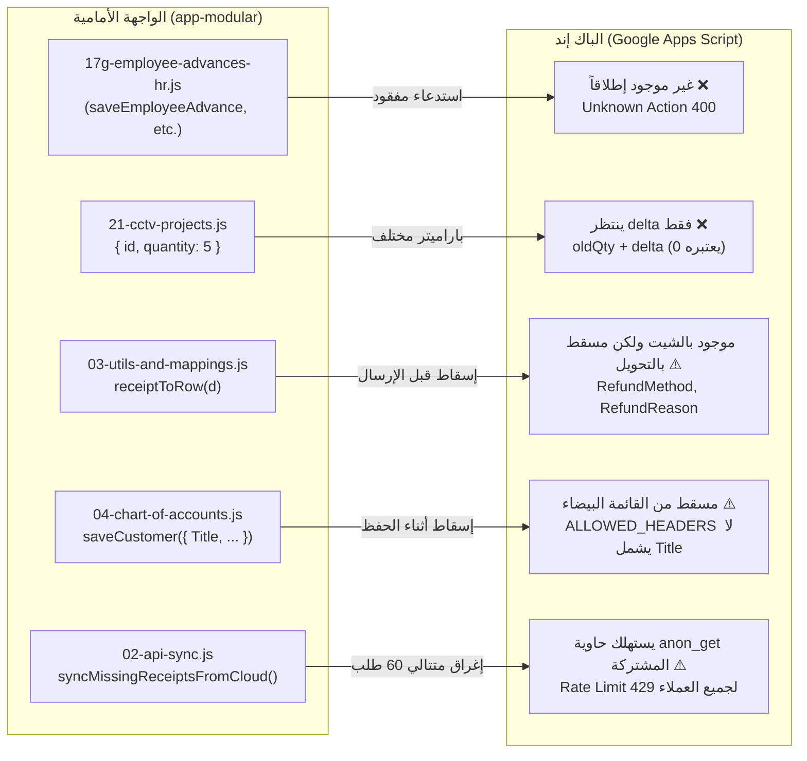

# microERP | تقرير التدقيق الفني الشامل للباك إند والـ API (Backend & API Audit)

> **الإصدار:** 1.0.0 Enterprise Release  
> **التاريخ:** نوفمبر 2026  
> **المراجع الخبير:** مراجع الواجهة الخلفية والـ API (Backend & API Reviewer)  
> **نطاق التدقيق:** جميع مسارات الـ API في `files(11)/GoogleAppsScript_Backend.gs.txt`، دوال `doGet` و `doPost`، نظام التحقق من المدخلات، معالجة الأخطاء وأكواد الاستجابة، ترقيم الصفحات، أداء Google Sheets، التزامن وقفل السجلات (LockService & Race Conditions)، فحص الـ Idempotency، وتطابق العقود مع `app-modular/js/core/02-api-sync.js` وبقية موديولات الواجهة الأمامية.  
> **قاعدة الاعتماد:** توثيق كل ملاحظة بدقة برقم السطر والملف (`File:Line`) مدعومة بدليل برمجي قطعي بدون افتراضات.

---

## فهرس المحتويات
1. [الخلاصة التنفيذية ونطاق الفحص](#1-الخلاصة-التنفيذية-ونطاق-الفحص)
2. [جدول الملاحظات الشامل الموحد (Findings Table)](#2-جدول-الملاحظات-الشامل-الموحد-findings-table)
3. [التدقيق التفصيلي لمسارات الـ API وعمليات الخادم](#3-التدقيق-التفصيلي-لمسارات-الـ-api-وعمليات-الخادم)
4. [التحقق من صحة المدخلات ومعالجة الأخطاء وأكواد HTTP](#4-التحقق-من-صحة-المدخلات-ومعالجة-الأخطاء-وأكواد-http)
5. [أداء جداول البيانات وترقيم الصفحات (Pagination & Performance)](#5-أداء-جداول-البيانات-وترقيم-الصفحات-pagination--performance)
6. [التزامن، أقفال السجلات، ومحرك الـ Idempotency](#6-التزامن-أقفال-السجلات-ومحرك-الـ-idempotency)
7. [تطابق العقود بين الواجهة الأمامية والباك إند (Contract Matching)](#7-تطابق-العقود-بين-الواجهة-الأمامية-والباك-إند-contract-matching)
8. [خارطة الطريق المعمارية والتوصيات الفنية](#8-خارطة-الطريق-المعمارية-والتوصيات-الفنية)

---

## 1. الخلاصة التنفيذية ونطاق الفحص

تم إجراء تدقيق برمجي معمق لكود الباك إند الكامل لمشروع **microERP** الواقع في [files(11)/GoogleAppsScript_Backend.gs.txt](file:///Users/M1/Desktop/microtech-app/files%2811%29/GoogleAppsScript_Backend.gs.txt) بإجمالي **3082 سطراً**، ومقارنته تفصيلياً مع محرك الاتصال والمزامنة في [app-modular/js/core/02-api-sync.js](file:///Users/M1/Desktop/microtech-app/app-modular/js/core/02-api-sync.js) (1413 سطراً) وكافة موديولات النظام الموديولي (Core & Business Modules).

### أبرز مخرجات التدقيق:
1. **ثغرة الإقرار الكاذب بالـ Idempotency وضياع البيانات (Critical Data Loss Bug):** آلية فحص الـ Idempotency تقوم بحرق المفتاح وتسجيله في جدول `Idempotency` والذاكرة المخبأة **قبل** تنفيذ العملية الفعلية؛ فإذا فشلت العملية لأي سبب برمجي أو شبكي أو محاسبي، فإن محاولة العميل التالية تُقابل باستجابة نجاح صورية (`duplicateSuppressed: true`) مما يجعل الواجهة تحذف العملية من طابور الحفظ دون أن تكون قد سُجلت إطلاقاً في جداول البيانات!
2. **غياب كامل في الباك إند لخدمات الموارد البشرية والسلف (Missing HR/Payroll Endpoints):** كود الواجهة في موديول `17g-employee-advances-hr.js` يعتمد كلياً على 4 نقاط اتصال (`getEmployeeAdvances`, `saveEmployeeAdvance`, `saveEmployeeAdvanceRepayment`, `savePayrollRun`) وهي غير موجودة نهائياً في الباك إند، مما يحبس بيانات السلف والرواتب في التخزين المحلي فقط.
3. **خلل تعاقدي يوقف خصم المخزون كلياً في موديول المشاريع:** واجهة مشاريع الكاميرات ترسل `{ id, quantity }` بينما الباك إند ينتظر حصراً `body.delta`، مما يؤدي إلى تنفيذ عملية خصم بقيمة `0` دائماً دون إشعار أي طرف بالخطأ.
4. **أزمة الـ Full Dump وغياب ترقيم الصفحات (O(N) Scaling Wall):** دالة `getBootstrapData` تقرأ 27 جدولاً بالكامل دفعة واحدة عبر `getAllRows` و `getDataRange().getValues()`؛ مع نمو حركات المبيعات والإيصالات والقيود، ستصل المعالجة حتماً إلى سقف مهلة تنفيذ Google Apps Script (30 ثانية للويب / 6 دقائق للمهام) مما يشل تشغيل النظام.
5. **استنزاف سقف خصائص السكربت (ScriptProperties 500KB Leak):** توكنات الجلسات تُسجل في `ScriptProperties` الدائمة بدون أي عملية تنظيف دورية للجلسات المتروكة، مما يؤدي مع الوقت إلى بلوغ حد الـ 500 كيلوبايت وانهيار تسجيل الدخول لجميع المستخدمين.

---

## 2. جدول الملاحظات الشامل الموحد (Findings Table)

| # | الخطورة | الملف:السطر | المشكلة | الدليل | الإصلاح المقترح |
| :- | :--- | :--- | :--- | :--- | :--- |
| **01** | **Critical** | [files(11)/GoogleAppsScript_Backend.gs.txt:999-1001](file:///Users/M1/Desktop/microtech-app/files%2811%29/GoogleAppsScript_Backend.gs.txt#L999-L1001), [1467-1469](file:///Users/M1/Desktop/microtech-app/files%2811%29/GoogleAppsScript_Backend.gs.txt#L1467-L1469), [1795-1797](file:///Users/M1/Desktop/microtech-app/files%2811%29/GoogleAppsScript_Backend.gs.txt#L1795-L1797), [2246-2248](file:///Users/M1/Desktop/microtech-app/files%2811%29/GoogleAppsScript_Backend.gs.txt#L2246-L2248), [3035-3039](file:///Users/M1/Desktop/microtech-app/files%2811%29/GoogleAppsScript_Backend.gs.txt#L3035-L3039) | حرق مفتاح الـ Idempotency قبل نجاح العملية، مما يسبب ضياع صامت للبيانات عند إعادة المحاولة | دالة `checkIdempotency` تقوم بكتابة المفتاح في `SHEET_IDEMPOTENCY` و `CacheService` في السطر 3035 فور دخوله وقبل تنفيذ العملية. فإذا حدث استثناء أثناء كتابة الفاتورة أو القيد المحاسبي، يُحفظ المفتاح، وعند إعادة الإرسال من طابور الأوفلاين يستجيب الخادم بـ `duplicateSuppressed: true` فتحذف الواجهة العملية ولم تُحفظ أصلاً! | تطبيق بروتوكول Two-Phase Commit للمفتاح: تسجيل المفتاح بحالة `PENDING`، واعتماده رسمياً فقط بعد انتهاء كافة عمليات الشيت والقيد المحاسبي بنجاح، ومسحه في كتلة `catch`. |
| **02** | **Critical** | [app-modular/js/modules/17g-employee-advances-hr.js:11,31,45,59](file:///Users/M1/Desktop/microtech-app/app-modular/js/modules/17g-employee-advances-hr.js#L11) مقابل [GoogleAppsScript_Backend.gs.txt:252-309, 473-664](file:///Users/M1/Desktop/microtech-app/files%2811%29/GoogleAppsScript_Backend.gs.txt#L252-L309) | غياب كامل لمسارات الموارد البشرية والسلف ومسيرات الرواتب في الباك إند | الواجهة تستدعي `apiGet('getEmployeeAdvances')` و `apiPost('saveEmployeeAdvance')` و `saveEmployeeAdvanceRepayment` و `savePayrollRun`. لا يوجد أي ذكر لهذه الأفعال في `ACTION_ROLES` أو `executeReadAction` أو `doPost`، مما يرجع خطأ `إجراء غير معروف` وتحبس البيانات في المتصفح فقط. | إضافة الجداول الثلاثة (`EmployeeAdvances`, `EmployeeAdvanceRepayments`, `PayrollRuns`) في الباك إند وتضمينها في مصفوفة الصلاحيات والقراءة والنسخ الاحتياطي. |
| **03** | **Critical** | [app-modular/js/modules/21-cctv-projects.js:1033,1866](file:///Users/M1/Desktop/microtech-app/app-modular/js/modules/21-cctv-projects.js#L1033) مقابل [GoogleAppsScript_Backend.gs.txt:1328](file:///Users/M1/Desktop/microtech-app/files%2811%29/GoogleAppsScript_Backend.gs.txt#L1328) | عدم تطابق باراميتر تعديل المخزون في مشاريع الكاميرات مما يعطل خصم المخزون كلياً | الموديول يرسل `{ id: invId, quantity: invItem.Quantity }`، بينما كود الباك إند في السطر 1328 يحسب: `oldQty + safeNumber(body.delta, 0)`. وحيث أن `body.delta` غير ممرر، تكون القيمة 0 ولا يخصم الخادم أي قطعة من المخزن الحقيقي. | تعديل كود الموديول ليمرر `delta: -1` أو `delta: -pQty` أو استدعاء `adjustInventoryQtyRemote`، وتحديث الباك إند ليدعم كلاً من `delta` أو `targetQuantity`. |
| **04** | **Critical** | [files(11)/GoogleAppsScript_Backend.gs.txt:3066-3073](file:///Users/M1/Desktop/microtech-app/files%2811%29/GoogleAppsScript_Backend.gs.txt#L3066-L3073) | عجز Google Apps Script عن إرجاع أكواد استجابة HTTP Status حقيقية وتزييفها داخل الـ JSON | دالة `jsonOut` تضع `obj.statusCode = statusCode` ولكن الرد الشبكي لـ GAS يعيد دائماً HTTP 200 OK. علاوة على ذلك، إذا كان الكائن الممرر مصفوفة (Array كما في `getReceipts`) فإن تعيين خاصية `statusCode` يفشل في الظهور في المتن المتسلسل. | توحيد صيغة مغلف الاستجابة لجميع الردود ككائن يحوي `{ ok: boolean, data: ..., error: ..., statusCode: number }` والاعتماد التام على فحص المغلف الداخلي. |
| **05** | **Critical** | [files(11)/GoogleAppsScript_Backend.gs.txt:2616-2648, 2779-2787, 2867-2868](file:///Users/M1/Desktop/microtech-app/files%2811%29/GoogleAppsScript_Backend.gs.txt#L2616-L2648) | إغفال جدول التحويلات المخزنية `Warehouse_Transfers` من القائمة البيضاء والنسخ الاحتياطي والقراءة | يتم إنشاء وإضافة سجلات التحويل في السطر 1440، لكن الجدول غير مدرج في `ALLOWED_HEADERS`، وغير مدرج في `sheetsToExport`، ومحذوف من الاستعادة `restoreSystemBackup`، ولا يوجد مسار `getWarehouseTransfers`. | إدراج `Warehouse_Transfers` في `ALLOWED_HEADERS`، ومسارات القراءة `executeReadAction`، ونظام النسخ الاحتياطي والاستعادة. |
| **06** | **High** | [files(11)/GoogleAppsScript_Backend.gs.txt:510-588, 616-656](file:///Users/M1/Desktop/microtech-app/files%2811%29/GoogleAppsScript_Backend.gs.txt#L510-L588) | انهيار الأداء عبر سحب قواعد البيانات كاملة (Full Dump) وانعدام الترقيم (No Pagination) | دالة `getBootstrapData` تقرأ 27 شيت بالكامل، ودوال `getReceipts` و `getSales` تعيد جميع السجلات عبر `getDataRange().getValues()`. مع وصول السجلات إلى آلاف، سيتجاوز زمن الاستجابة 30 ثانية وينهار التطبيق بـ Timeout. | تطبيق الفلترة بالوقت (`updatedAfter` / `sinceTimestamp`) ودعم المعاملين `limit` و `offset`، وجعل جلب الأرشيف القديم عند الطلب (Lazy Loading). |
| **07** | **High** | [files(11)/GoogleAppsScript_Backend.gs.txt:699-702, 750-782](file:///Users/M1/Desktop/microtech-app/files%2811%29/GoogleAppsScript_Backend.gs.txt#L699-L702) | عملية كتابة غير مقفلة (Unlocked Write) داخل مسار `doGet` المفتوح | مسار `doGet` لا يستدعي `LockService` نهائياً. وفي السطر 701 عند طلب `trackReceipt` يقوم الكود بكتابة التوكن الناقص فورياً `sh.getRange(i + 1, tokenCol + 1).setValue(newToken)`. هذا التزامن يسبب تعارضات خطيرة مع عمليات الحفظ في `doPost`. | منع أي عمليات كتابة داخل `doGet` وحصر توليد التوكنات في مسارات الحفظ المحمية بالقفل البرمجي، أو استخدام قفل مستقل إذا لزم التحديث. |
| **08** | **High** | [files(11)/GoogleAppsScript_Backend.gs.txt:757-760](file:///Users/M1/Desktop/microtech-app/files%2811%29/GoogleAppsScript_Backend.gs.txt#L757-L760) مقابل [app-modular/js/core/02-api-sync.js:826-856](file:///Users/M1/Desktop/microtech-app/app-modular/js/core/02-api-sync.js#L826-L856) | استنزاف حاوية معدل الطلبات المجهولة وحظر بوابة تتبع العملاء العامة | جميع طلبات `doGet` غير الموثقة تشترك في مفتاح معدل طلبات موحد `'anon_get'`. دالة مزامنة الواجهة `syncMissingReceiptsFromCloud` ترسل حلقة تصل إلى 60 طلباً متتالياً، فتستنزف سقف الـ 90 طلب/دقيقة، مما يحظر العملاء الحقيقيين بـ HTTP 429. | إيقاف أسلوب التحقق الاستقصائي التسلسلي في الواجهة، وفصل Rate Limiter لبوابة التتبع بالاعتماد على توكن التتبع، وبناء نقطة مزامنة رسمية مجمعة. |
| **09** | **High** | [files(11)/GoogleAppsScript_Backend.gs.txt:194, 226-231](file:///Users/M1/Desktop/microtech-app/files%2811%29/GoogleAppsScript_Backend.gs.txt#L194) | تسريب وتراكم الجلسات في `ScriptProperties` حتى الامتلاء الكارثي لسقف الـ 500KB | يتم تسجيل كل جلسة في `ScriptProperties` باسم `sess_<token>`. لا توجد أي آلية دورية لحذف الجلسات المنتهية إلا عند استخدام نفس التوكن بعد 24 ساعة. التوكنات المهجورة تتراكم حتى تضرب حد الـ 500KB ويمنع النظام أي تسجيل دخول. | تخزين الجلسات فقط في `CacheService`، أو إنشاء جدول مستقل للجلسات في الشيت مع دالة تنظيف مجدولة (Trigger-based cleaner). |
| **10** | **High** | [files(11)/GoogleAppsScript_Backend.gs.txt:1264-1288, 2168-2173](file:///Users/M1/Desktop/microtech-app/files%2811%29/GoogleAppsScript_Backend.gs.txt#L1264-L1288) | انعدام عكس القيود المحاسبية عند حذف الدفعات والمصروفات مما يشوه ميزان المراجعة | عند حفظ الدفعة أو المصروف يتم إنشاء قيد يومية آلي عبر `postAutoJournal`. ولكن عند استدعاء `deletePayment` أو `deleteExpense` يتم حذف السجل من جدول الدفعات أو المصروفات فقط ويبقى القيد المحاسبي حياً في `JournalEntries`. | إضافة كود يعثر على القيد المرتبط عبر `ReferenceID` في دالتي الحذف، وإنشاء قيد عكسي متوازن آلياً (`Receipt_Payment_Void` و `Expense_Void`). |
| **11** | **High** | [files(11)/GoogleAppsScript_Backend.gs.txt:2702-2717](file:///Users/M1/Desktop/microtech-app/files%2811%29/GoogleAppsScript_Backend.gs.txt#L2702-L2717) | استبدال أعمى للبيانات وغياب القفل التفاؤلي (Optimistic Locking) في `upsertRow` | دالة `upsertRow` تستبدل الصف بالكامل عبر `sh.getRange().setValues([row])`. إذا عدل موظفان نفس الإيصال متزامنين، فإن آخر حفظ يمحو تعديلات الأول. وأي حقل غير موجود في كائن الحفظ يُكتب مكانه نص فارغ `''`. | إدخال حقل رقم الإصدار/التاريخ (`UpdatedAt` / `Version`) للتحقق قبل الحفظ، وتحديث الأعمدة الممررة فقط بدلاً من مسح باقي الأعمدة. |
| **12** | **Medium** | [files(11)/GoogleAppsScript_Backend.gs.txt:1560, 1666, 1677](file:///Users/M1/Desktop/microtech-app/files%2811%29/GoogleAppsScript_Backend.gs.txt#L1560) | تضارب استجابات التكرار في المرتجعات وسداد الديون مع معايير الـ Idempotency | في `saveReturn` و `settleSaleDebt`، عند اكتشاف تكرار `clientRef` يُرجع الخادم `{ error: 'طلب مرتجع مكرر' }, 400`، مما يطلق استثناءً في الواجهة ويعلق الطابور حتى ينهار، بدلاً من إرجاع `{ ok: true, duplicateSuppressed: true }`. | توحيد نمط استجابة الـ Idempotency المكرر في جميع العمليات بإرجاع النجاح الصامت مع إشارة الحجب `duplicateSuppressed: true`. |
| **13** | **Medium** | [files(11)/GoogleAppsScript_Backend.gs.txt:1858-1890](file:///Users/M1/Desktop/microtech-app/files%2811%29/GoogleAppsScript_Backend.gs.txt#L1858-L1890) | غياب التحقق من الـ Idempotency في عملية سداد مديونية الموردين `settlePurchaseDebt` | العملية تستقبل المبلغ وتضيفه فوراً إلى `AmountPaid` وتنشئ سجلاً في `SupplierPayments` بدون فحص `clientRef` أو التحقق من التكرار، مما يعرض النظام لمضاعفة السداد عند النقر المتكرر أو انقطاع الشبكة. | إضافة فحص `checkIdempotency(body.clientRef, 'settlePurchaseDebt', ...)` قبل تعديل أي رصيد. |
| **14** | **Medium** | [files(11)/GoogleAppsScript_Backend.gs.txt:1507, 1831-1838, 2075-2081](file:///Users/M1/Desktop/microtech-app/files%2811%29/GoogleAppsScript_Backend.gs.txt#L1507) | استدعاءات خلوية متكررة (N+1 Sheet RPC calls) في العمليات الجماعية | في `saveSale` و `savePurchase` و `commitStocktakeSession` يتم استدعاء `shInv.getRange().setValue()` لكل صنف داخل حلقة تكرارية. جلسة جرد تحوي 100 صنف تولد 200 مكالمة شبكية للشيت مما يضمن استهلاك وقت التنفيذ. | تجميع التعديلات في مصفوفة الذاكرة وإرسالها للشيت بأمر كتابة واحد مجمع `setValues()` في نهاية العملية. |
| **15** | **Medium** | [files(11)/GoogleAppsScript_Backend.gs.txt:1248, 1481, 1504, 1804, 1828, 2148](file:///Users/M1/Desktop/microtech-app/files%2811%29/GoogleAppsScript_Backend.gs.txt#L1248) | غياب التحقق من إيجابية المبالغ والكميات مما يفتح باب التلاعب المالي والمخزني | لا يوجد تحقق يمنع تمرير مبالغ سالبة في الدفعات أو المصروفات أو كميات سالبة في المبيعات والمشتريات. كمية سالبة في البيع (`qty: -5`) تؤدي إلى زيادة المخزون برمجياً بدلاً من إنقاصه! | إلزام التحقق الصارم: التأكد من أن المبالغ والكميات أرقام موجبة محدودة `Number.isFinite(n) && n > 0` ورفض الطلب بـ 400 في حال المخالفة. |
| **16** | **Medium** | [files(11)/GoogleAppsScript_Backend.gs.txt:714-717](file:///Users/M1/Desktop/microtech-app/files%2811%29/GoogleAppsScript_Backend.gs.txt#L714-L717) مقابل [app-modular/js/modules/10c-receipt-actions.js:298](file:///Users/M1/Desktop/microtech-app/app-modular/js/modules/10c-receipt-actions.js#L298) | تضارب حساب إجمالي الإيصال في بوابة التتبع العامة بإسقاط المصاريف الإضافية | في `handleTrackReceipt` يُحسب الإجمالي: `customerTotal = Number(r.Cost || 0)`. ويسقط تماماً بند `OtherAccountAmount` المعتمد في الواجهة، فيرى العميل في البوابة أن الإيصال خالص السداد بينما النظام الداخلي يطالبه بمتبقي. | تعديل حساب الإجمالي في الباك إند ليشمل: `Number(r.Cost || 0) + Number(r.OtherAccountAmount || 0)`. |
| **17** | **Low** | [app-modular/js/core/03-utils-and-mappings.js:861-886](file:///Users/M1/Desktop/microtech-app/app-modular/js/core/03-utils-and-mappings.js#L861-L886) مقابل [GoogleAppsScript_Backend.gs.txt:2617](file:///Users/M1/Desktop/microtech-app/files%2811%29/GoogleAppsScript_Backend.gs.txt#L2617) | إسقاط حقول طريقة وسبب الاسترداد `RefundMethod` و `RefundReason` في دالة التحويل `receiptToRow` | مخطط شيت الإيصالات يحوي العمودين، وموديول الإجراءات [10c-receipt-actions.js:278](file:///Users/M1/Desktop/microtech-app/app-modular/js/modules/10c-receipt-actions.js#L278) يحددهما، لكن دالة `receiptToRow` تسقطهما من الكائن المعاد فلا يحفظان بالشيت السحابي أبداً. | إضافة `RefundMethod: d.refundMethod || '', RefundReason: d.refundReason || ''` إلى مخرجات دالة `receiptToRow`. |
| **18** | **Low** | [app-modular/js/core/04-chart-of-accounts.js:1632](file:///Users/M1/Desktop/microtech-app/app-modular/js/core/04-chart-of-accounts.js#L1632) مقابل [GoogleAppsScript_Backend.gs.txt:2618](file:///Users/M1/Desktop/microtech-app/files%2811%29/GoogleAppsScript_Backend.gs.txt#L2618) | إسقاط لقب العميل `Title` من القائمة البيضاء لأعمدة جدول العملاء | ترسل الواجهة في `saveCustomer` الحقل `Title: cTitle`، بينما القائمة البيضاء `ALLOWED_HEADERS['Customers']` تتكون فقط من `['Name','Phone','Email','Address','TaxNumber','Debt','Notes']` فيتم تجاهل اللقب. | إضافة `'Title'` إلى مصفوفة أعمدة العملاء المسموحة في الباك إند. |
| **19** | **Low** | [files(11)/GoogleAppsScript_Backend.gs.txt:2806-2814, 2886-2893](file:///Users/M1/Desktop/microtech-app/files%2811%29/GoogleAppsScript_Backend.gs.txt#L2806-L2814) | إعادة تعيين كلمات مرور كافة المستخدمين إلى `123456` عند استعادة نسخة احتياطية على شيت جديد | كود التصدير يستبعد الهاش والملح لحماية الأمان. لكن عند الاستعادة على شيت فارغ (Disaster Recovery)، الكود يضع كلمة المرور الافتراضية `123456` لكل المستخدمين، مما يفتح ثغرة دخول غير مصرح به. | فرض إدخال كلمة مرور جديدة للمدير أثناء الاستعادة، وتفعيل علم `MustChangePassword` لجميع المستخدمين المستعادين عند أول تسجيل دخول. |
| **20** | **Low** | [files(11)/GoogleAppsScript_Backend.gs.txt:3058](file:///Users/M1/Desktop/microtech-app/files%2811%29/GoogleAppsScript_Backend.gs.txt#L3058) | تنظيف سجلات الـ Idempotency بحذف الصفوف سطراً بسطر مما يسبب بطء مفاجئ للطلبات | تستدعي دالة `pruneOldIdempotencyKeys` الأمر `sh.deleteRow(i + 2)` لكل صف قديم داخل حلقة تكرارية متزامنة مع طلب حفظ المستخدم، مما قد يجمد الطلب لعدة دقائق إذا كان عدد السجلات كبيراً. | نقل مهام تنظيف الجداول القديمة إلى Trigger زمني غير متزامن يعمل ليلاً، أو تصفية الصفوف دفعة واحدة وإعادة كتابتها. |

---

## 3. التدقيق التفصيلي لمسارات الـ API وعمليات الخادم

### أ. نقطتا الدخول الرئيسيتان (`doGet` و `doPost`)
* **`doGet(e)` ([السطور 750-782](file:///Users/M1/Desktop/microtech-app/files%2811%29/GoogleAppsScript_Backend.gs.txt#L750-L782)):**
  * إذا لم يتم تمرير المعامل `action`، تعرض الدالة واجهة المستخدم HTML عبر `renderAppHtml()`.
  * تفرض الدالة محدد معدل الطلبات عبر `checkRateLimit(clientKey, 90)` ومحدد عالمي 800 طلب/دقيقة.
  * **نقطة الضعف:** حساب `clientKey` يعتمد على `hashKey(e.parameter.sessionToken || 'anon_get')`. نظراً لأن نقطة التتبع العامة `trackReceipt` لا تحمل توكن جلسة، فإن جميع زوار الموقع يتشاركون نفس الحاوية `'anon_get'`.
  * يتم تحويل الطلبات المصرحة بعد فحص `getSession(e.parameter.sessionToken)` إلى `executeReadAction`.
* **`doPost(e)` ([السطور 784-950](file:///Users/M1/Desktop/microtech-app/files%2811%29/GoogleAppsScript_Backend.gs.txt#L784-L950)):**
  * تحليل المتن `JSON.parse(e.postData.contents)` مع اعتراض أخطاء التحليل وإرجاع كود 400.
  * قفل السكربت الشامل: `LockService.getScriptLock().waitLock(15000)`. وفي حال انقضاء 15 ثانية، يُرجع الخادم خطأ 503 Service Unavailable.
  * استثناء العمليات العامة: `login`، `logout`، `ping`، و `trackReceipt` تعمل دون اشتراط جلسة مسبقة.
  * تثبيت هوية المستخدم خادمياً: في السطر 928-929 يتم استبدال أي مدخل للمستخدم بالاسم الحقيقي المعتمد في الجلسة `body.user = session.name` لمنع انتحال الشخصيات.
  * فحص مصفوفة الأدوار `requireActionRole(action, session)` لجميع الأفعال المنفذة.

---

### ب. خريطة مطابقة العمليات (Endpoints Matrix)

| الإجراء (Action) | النوع (Method) | الدور المطلوب (RBAC) | التحقق من المدخلات | فحص الـ Idempotency | الحالة في الباك إند |
| :--- | :---: | :--- | :--- | :---: | :---: |
| `ping` | GET/POST | عام (Public) | غير مطلوب | لا | مفعّل ومكتمل |
| `login` | POST | عام (Public) | اسم + كلمة مرور | لا (Rate limit 5/min) | مفعّل ومؤمن بـ PBKDF2 |
| `logout` | POST | عام (Public) | توكن الجلسة | لا | مفعّل (إبطال التوكن) |
| `trackReceipt` | GET/POST | عام (Public) | رمز التتبع أو الرقم | لا | مفعّل (يحوي كتابة غير مقفلة) |
| `getMe` | GET/POST | موثق (Any role) | توكن الجلسة | لا | مفعّل |
| `getBootstrapData` | GET/POST | موثق (Any role) | توكن الجلسة | لا | مفعّل (يعاني من مشكلة Full Dump) |
| `getAuditLog` | GET/POST | admin فقط | توكن الجلسة | لا | مفعّل |
| `getUsers` | GET/POST | admin فقط | توكن الجلسة | لا | مفعّل (يحجب كلمات المرور) |
| `nextDocumentNumber` | GET/POST | admin, cashier, accountant, technician | النوع + السنة | لا | مفعّل (خطر تضارب تزامني) |
| `saveReceipt` | POST | admin, technician, cashier | كائن البيانات `data` | **نعم (حرق مسبق للمفتاح)** | مفعّل |
| `deleteReceipt` | POST | admin فقط | معرف الإيصال | لا | مفعّل مع استرداد المخزون والقيود |
| `savePayment` | POST | admin, cashier, accountant | كائن الدفعة | **نعم (حرق مسبق للمفتاح)** | مفعّل (لا يتحقق من إيجابية المبلغ) |
| `deletePayment` | POST | admin فقط | معرف الدفعة | لا | مفعّل (**لا يعكس القيد المحاسبي**) |
| `saveSale` | POST | admin, cashier | بنود البيع والإجمالي | **نعم (حرق مسبق للمفتاح)** | مفعّل |
| `settleSaleDebt` | POST | admin, cashier, accountant | معرف البيع + المبلغ | نعم (**استجابة خاطئة بـ 400**) | مفعّل |
| `saveReturn` | POST | admin, cashier, accountant | بنود المرتجع والمبلغ | نعم (**استجابة خاطئة بـ 400**) | مفعّل |
| `saveInventoryItem` | POST | admin, accountant, technician | بيانات الصنف والأسعار | لا | مفعّل |
| `deleteInventoryItem`| POST | admin فقط | معرف الصنف | لا | مفعّل |
| `adjustInventoryQty` | POST | admin, accountant | المعرف + `delta` | لا | مفعّل (**تعارض باراميتر مع الواجهة**) |
| `transferWarehouseStock`| POST | admin, accountant | المصدر، الوجهة، الكمية | لا | مفعّل (**الجدول غير مسجل بالقائمة البيضاء**) |
| `savePurchase` | POST | admin, accountant | المورد، الإجمالي، البنود | **نعم (حرق مسبق للمفتاح)** | مفعّل |
| `settlePurchaseDebt` | POST | admin, accountant | معرف الشراء والمبلغ | **لا (معرض للتكرار)** | مفعّل |
| `savePurchaseReturn` | POST | admin, accountant | المورد، الإجمالي، البنود | **نعم (حرق مسبق للمفتاح)** | مفعّل |
| `saveSupplier` | POST | admin, accountant | بيانات المورد | لا | مفعّل |
| `saveSerial` | POST | admin, technician, accountant | الصنف، السيريال | لا | مفعّل |
| `markSerialSold` | POST | admin, cashier, accountant | السيريال، مرجع البيع | لا | مفعّل |
| `commitStocktakeSession`| POST | admin, accountant | بيانات الجلسة والأسطر | لا | مفعّل (**N+1 بطء كتابة حاد**) |
| `saveBundleItem` | POST | admin, accountant | بيانات التجميعة | لا | مفعّل |
| `deleteBundleItem` | POST | admin, accountant | معرف التجميعة | لا | مفعّل |
| `saveExpense` | POST | admin, accountant | العنوان والمبلغ والتصنيف| **نعم (حرق مسبق للمفتاح)** | مفعّل (لا يتحقق من إيجابية المبلغ) |
| `deleteExpense` | POST | admin فقط | معرف المصروف | لا | مفعّل (**لا يعكس القيد المحاسبي**) |
| `saveAccount` | POST | admin فقط | كود الحساب والاسم | لا | مفعّل |
| `deleteAccount` | POST | admin فقط | كود الحساب | لا | مفعّل |
| `saveJournalEntry` | POST | admin, accountant | أسطر القيد والتوازن | لا | مفعّل |
| `deleteJournalEntry` | POST | admin فقط | معرف القيد | لا | مفعّل |
| `saveInvoice` | POST | admin, cashier, accountant | بيانات الفاتورة والعميل | **نعم (حرق مسبق للمفتاح)** | مفعّل |
| `deleteInvoice` | POST | admin فقط | معرف الفاتورة | لا | مفعّل مع عكس القيد |
| `saveUser` | POST | admin فقط | الاسم، الدور، كلمة المرور| لا | مفعّل ومؤمن |
| `deleteUser` | POST | admin فقط | المعرف أو الاسم | لا | مفعّل |
| `saveAuditLog` | POST | admin, accountant, cashier, tech | الحدث والتفاصيل | لا | مفعّل بقائمة أحداث بيضاء |
| `verifySupervisorPin`| POST | admin, accountant, cashier, tech | رمز المشرف | لا | مفعّل ومحمي |
| `saveSite` / `deleteSite` | POST | مصفوفة الـ RBAC | بيانات الموقع | لا | مفعّل |
| `saveProject` / `delete` | POST | مصفوفة الـ RBAC | بيانات المشروع | لا | مفعّل |
| `saveProjectDevice` / `delete` | POST | مصفوفة الـ RBAC | بيانات الجهاز | لا | مفعّل |
| `saveServiceVisit` / `delete` | POST | مصفوفة الـ RBAC | بيانات الزيارة | لا | مفعّل |
| `saveMaintenanceContract` / `delete` | POST | مصفوفة الـ RBAC | بيانات العقد | لا | مفعّل |
| `saveProjectMilestone` / `delete` | POST | مصفوفة الـ RBAC | بيانات المرحلة | لا | مفعّل |
| `exportBackup` / `importBackup` | POST | admin فقط | النسخة الاحتياطية | لا | مفعّل |
| `getEmployeeAdvances` | GET | غير مسجل بالباك إند | - | - | **مفقود تماماً (400)** |
| `saveEmployeeAdvance` | POST | غير مسجل بالباك إند | - | - | **مفقود تماماً (400/403)** |
| `saveEmployeeAdvanceRepayment` | POST | غير مسجل بالباك إند | - | - | **مفقود تماماً (400/403)** |
| `savePayrollRun` | POST | غير مسجل بالباك إند | - | - | **مفقود تماماً (400/403)** |
| `saveAuthRequest` | POST | غير مسجل بالباك إند | - | - | **مفقود تماماً (400/403)** |

---

## 4. التحقق من صحة المدخلات ومعالجة الأخطاء وأكواد HTTP

### أ. القيود الهيكلية لـ Google Apps Script في إدارة بروتوكول HTTP
في بيئة تشغيل Google Apps Script Web Apps، تُدار مخرجات الويب حصرياً عبر `ContentService` أو `HtmlService`.
* لا توجد أي واجهة برمجية (API) في GAS تتيح ضبط ترويسات الاستجابة الحقيقية مثل `HTTP/1.1 401 Unauthorized` أو `403 Forbidden` أو `429 Too Many Requests`.
* كل استجابة ناجحة الإرسال تعيد كود حالة النقل الشبكي **`HTTP 200 OK`** (أو إعادة توجيه 302 تتبعها 200).
* دالة `jsonOut` في [السطر 3066-3073](file:///Users/M1/Desktop/microtech-app/files%2811%29/GoogleAppsScript_Backend.gs.txt#L3066-L3073) تقوم بحقن كود الحالة داخل جسم كائن الاستجابة:
```javascript
function jsonOut(obj, statusCode) {
  if (obj && typeof obj === 'object') {
    if (statusCode && !obj.statusCode) {
      obj.statusCode = statusCode;
    }
  }
  return ContentService.createTextOutput(JSON.stringify(obj)).setMimeType(ContentService.MimeType.JSON);
}
```
**الخلل البرمجي المرصود:**
عند إرجاع مصفوفة بيانات خام (مثل `getReceipts` أو `getUsers`)، تكون `typeof obj === 'object'` صحيحة، ولكن إضافة خاصية `obj.statusCode` لمصفوفة JavaScript لا يتم تسلسلها في مخرجات `JSON.stringify(obj)`، مما يفقد الكود تماماً.

### ب. فحص المدخلات المالية والكميات (Input Validation Deficits)
1. **انعدام التحقق من إيجابية المبالغ (Positive Amount Assertion):**
   * في `savePayment` ([السطر 1248](file:///Users/M1/Desktop/microtech-app/files%2811%29/GoogleAppsScript_Backend.gs.txt#L1248)): لا يتم التحقق من أن `body.amount > 0`. يمكن تمرير دفعة سالبة أو صفرية فتسجل في الشيت وتُرحل قيداً محاسبياً مشوهاً.
   * في `saveExpense` ([السطر 2148](file:///Users/M1/Desktop/microtech-app/files%2811%29/GoogleAppsScript_Backend.gs.txt#L2148)): لا يوجد فحص على قيمة `body.data.Amount`.
2. **ثغرة تضخيم المخزون عبر الكميات السالبة في المبيعات:**
   * في `saveSale` ([السطر 1504-1506](file:///Users/M1/Desktop/microtech-app/files%2811%29/GoogleAppsScript_Backend.gs.txt#L1504-L1506)):
   ```javascript
   const currentQty = Number(values[i][qtyCol] || 0);
   const deductQty = Number(item.qty || 0);
   const newQty = allowNegative ? (currentQty - deductQty) : Math.max(0, currentQty - deductQty);
   ```
   إذا مرر عميل أو طرف خبيث `item.qty = -10`، فإن `currentQty - (-10)` تتحول رياضياً إلى `currentQty + 10`، مما يرفع رصيد المخزون في الشيت من خلال شاشة المبيعات!
3. **تجاوز كمية المرتجع لمبيعات الفاتورة الأصلية:**
   * في `saveReturn` ([السطر 1736](file:///Users/M1/Desktop/microtech-app/files%2811%29/GoogleAppsScript_Backend.gs.txt#L1736))، يتم فحص إجمالي المبلغ المالي للمرتجع بحيث لا يتجاوز الفاتورة، ولكن **لا يتم فحص كمية الصنف المرتجع عينياً**. يستطيع المستخدم استرجاع 10 قطع من صنف لم يُبع منه سوى قطعة واحدة في الفاتورة الأصلية طالما القيمة المالية الإجمالية لم تتجاوز الفاتورة.

---

## 5. أداء جداول البيانات وترقيم الصفحات (Pagination & Performance)

### أ. أزمة الـ Full Dump السحابي وغياب الترقيم (No Pagination)
يمثل استدعاء `getBootstrapData` في [السطور 510-588](file:///Users/M1/Desktop/microtech-app/files%2811%29/GoogleAppsScript_Backend.gs.txt#L510-L588) النقطة المحورية لتهيئة التطبيق:
* يقوم المسار بقراءة كاملة دون أي استثناء لـ **27 ورقة عمل**:
  `Receipts`, `Customers`, `Technicians`, `Settings`, `Payments`, `Inventory`, `Sales`, `Quotations`, `Services`, `Purchases`, `Suppliers`, `Expenses`, `Accounts`, `JournalEntries`, `Invoices`, `Returns`, `Serials`, `SupplierPayments`, `Sites`, `Projects`, `ProjectDevices`, `ServiceVisits`, `MaintenanceContracts`, `ProjectMilestones`, `PurchaseReturns`, `BundleItems`, `StocktakeSessions`, `StocktakeLines`.
* في كل ورقة، يتم تنفيذ `sh.getDataRange().getValues()` وسحب كل الصفوف التاريخية.
* لا توجد أي معاملات لتحديد نطاق زمني مثل `sinceDate` أو ترقيم صفحات `limit` و `offset`.
* **الأثر الحتمي:** بمجرد وصول المنشأة إلى 3,000 إيصال و 5,000 حركة مبيعات و 10,000 قيد محاسبي:
  1. حجم الرد سيتجاوز سقف الـ 50MB المسموح به في `ContentService`.
  2. زمن القراءة المتسلسلة لـ 27 شيت سيتخطى مهلة تنفيذ الويب في GAS (المحددة بـ 30-50 ثانية)، مما يسفر عن فشل المزامنة المستمر وظهور شاشة بيضاء للمستخدمين.

### ب. النمط المناهض للأداء (N+1 Sheet RPC Anti-Pattern)
تم رصد استدعاءات كتابة خلوية منفردة داخل حلقات تكرارية بدلاً من الكتابة المجمعة:
* في `commitStocktakeSession` ([السطر 2075-2081](file:///Users/M1/Desktop/microtech-app/files%2811%29/GoogleAppsScript_Backend.gs.txt#L2075-L2081)):
  ```javascript
  lines.forEach(line => {
    ...
    appendRow(SHEET_STOCKTAKE_LINES, lRow); // مكالمة شبكية منفصلة للشيت
    ...
    shInv.getRange(v + 1, invQtyCol + 1).setValue(lRow.CountedQty); // مكالمة منفصلة لكل صنف
  });
  ```
  في جلسة جرد تحوي 150 صنفاً، ينفذ هذا الكود **300 مكالمة شبكية متتالية** مع خوادم Google Sheets، مما يستهلك ما بين دقيقة ونصف إلى 3 دقائق ويعرض العملية للتوقف القسري قبل اكتمالها.
* في `saveSale` ([السطر 1507](file:///Users/M1/Desktop/microtech-app/files%2811%29/GoogleAppsScript_Backend.gs.txt#L1507)) و `savePurchase` ([السطر 1831-1838](file:///Users/M1/Desktop/microtech-app/files%2811%29/GoogleAppsScript_Backend.gs.txt#L1831-L1838)): يتم خصم وتعديل كميات وأسعار الأصناف خلية بخلية داخل حلقة `for`.

### ج. تكرار فتح المصنف في نفس المعالجة (SpreadsheetApp Repeated Calls)
في `getAllRows` ([السطر 2589](file:///Users/M1/Desktop/microtech-app/files%2811%29/GoogleAppsScript_Backend.gs.txt#L2589)) و `getSheet` ([السطر 2576](file:///Users/M1/Desktop/microtech-app/files%2811%29/GoogleAppsScript_Backend.gs.txt#L2576)):
يتم استدعاء `SpreadsheetApp.getActiveSpreadsheet()` في كل مرة يتم فيها فتح ورقة عمل، أي 27 مرة في طلب الـ Bootstrap وحده، بدلاً من حفظ مرجع المصنف النشط في متغير عام على مستوى دورة حياة المعالجة.

---

## 6. التزامن، أقفال السجلات، ومحرك الـ Idempotency

### أ. ثغرة الحرق المسبق لمفتاح الـ Idempotency وضياع البيانات
تعتمد العمليات المالية الحساسة (`saveReceipt`, `savePayment`, `saveSale`, `savePurchase`, `savePurchaseReturn`, `saveExpense`, `saveInvoice`) على دالة `checkIdempotency(clientRef, action, ...)`:
```javascript
// GoogleAppsScript_Backend.gs.txt:3000-3047
function checkIdempotency(key, action, user, details) {
  ...
  // 1. التحقق من الكاش
  if (cache && cache.get(cacheKey)) return true;
  ...
  // 2. التحقق من الشيت
  if (foundInSheet) return true;

  // 3. إذا لم يكن مسجلاً: يقوم فورياً بتسجيله واعتباره منفذاً!
  sh.appendRow([cleanKey, action || '', new Date().toISOString(), user || '', details || '']);
  cache.put(cacheKey, '1', 21600);
  return false;
}
```
**السيناريو الكارثي المؤكد (Reproduction Scenario):**
1. كاشير غير متصل بالإنترنت يقوم بإنشاء فاتورة بيع رقم `sale_1001` مع `clientRef = "uuid-123"`.
2. تعود الشبكة، فيقوم طابور المزامنة `syncOfflineQueue` بإرسال الفاتورة عبر `apiPost('saveSale', ...)`.
3. يصل الطلب للباك إند، في السطر 1467 يستدعي `checkIdempotency("uuid-123")`؛ المفتاح جديد، فيقوم السطر 3035 بكتابته في جدول `Idempotency` وتخزينه في الكاش، ويعيد `false` للاستمرار في الحفظ.
4. في السطر 1500، يحدث خطأ برمجي أو استثناء (مثل: خطأ في صياغة القيد المحاسبي، أو انتهاء مهلة السكربت، أو عطل مؤقت في Google Sheets).
5. تفشل العملية ويُلقى استثناء يعيده السطر 2568 كخطأ 500 للمتصفح. **الفاتورة لم تُكتب في جدول المبيعات ولم يُخصم المخزون**.
6. طابور الأوفلاين في المتصفح يلتقط خطأ 500، ويعيد محاولة إرسال نفس الفاتورة بنفس الـ `clientRef` بعد ثانيتين.
7. يصل الطلب الثاني للباك إند: يستدعي `checkIdempotency("uuid-123")`؛ المفتاح مسجل الآن! يعيد `true`!
8. ينفذ السطر 1468:
   ```javascript
   return jsonOut({ ok: true, duplicateSuppressed: true, clientRef: clientRef });
   ```
9. يتلقى المتصفح رد نجاح تام (`ok: true`)، فيقوم بحذف الفاتورة من طابور المزامنة المحلي ويعتبرها حُفظت بنجاح في السحابة!
10. **النتيجة:** الفاتورة اختفت تماماً من قاعدة البيانات السحابية دون أي أثر، مع تأكيد كاذب للعميل بنجاح الحفظ!

### ب. تناقض استجابات الـ Idempotency بين الموديولات
بينما ترجع عمليات `saveSale` و `saveReceipt` رد نجاح صامت عند اكتشاف مفتاح مكرر (`ok: true, duplicateSuppressed: true`)، فإن عمليتي `settleSaleDebt` في [السطر 1560](file:///Users/M1/Desktop/microtech-app/files%2811%29/GoogleAppsScript_Backend.gs.txt#L1560) و `saveReturn` في [السطر 1666, 1677](file:///Users/M1/Desktop/microtech-app/files%2811%29/GoogleAppsScript_Backend.gs.txt#L1666) ترجعان:
```javascript
return jsonOut({ error: 'طلب مرتجع مكرر (clientRef مستخدم من قبل)' }, 400);
```
الواجهة الأمامية في `02-api-sync.js:1033` تتعامل مع أي رد يحوي `json.error` بإلقاء خطأ `throw new Error(json.error)`. مما يجعل المتصفح يعتبر عملية السداد أو المرتجع فاشلة، فيبقيها في طابور المزامنة ويعيد محاولتها 10 مرات حتى تُصنف كـ `failed_terminal`، مما يربك الموظفين بتنبيهات فشل وهمية لحركات نجحت بالفعل.

### ج. الكتابة غير المقفلة في `doGet` وتضارب البيانات التزامني
* دالة `doPost` محمية بـ `LockService.getScriptLock().waitLock(15000)`.
* بالمقابل، دالة `doGet` تعمل **بدون أي قفل إطلاقاً**.
* في [السطر 699-702](file:///Users/M1/Desktop/microtech-app/files%2811%29/GoogleAppsScript_Backend.gs.txt#L699-L702)، داخل مسار `trackReceipt`:
```javascript
if (tokenCol !== -1 && !values[i][tokenCol]) {
  const newToken = (Utilities.getUuid() + Utilities.getUuid()).replace(/[^a-zA-Z0-9]/g, '').slice(0, 20);
  sh.getRange(i + 1, tokenCol + 1).setValue(newToken);
}
```
هذا التعديل الخلوي المباشر غير المحمي بقفل ينفذ في نفس اللحظة التي قد تقوم فيها عملية `saveReceipt` في `doPost` بإعادة ترقيم أو تعديل صفوف شيت الإيصالات، مما يعرض ورقة العمل لتداخل الكتابات وتلف الصفوف.

### د. غياب القفل التفاؤلي والاستبدال الأعمى في `upsertRow`
* دالة `upsertRow` في [السطر 2702-2717](file:///Users/M1/Desktop/microtech-app/files%2811%29/GoogleAppsScript_Backend.gs.txt#L2702-L2717) تبحث عن الصف المطابق للمفتاح وتستبدل مصفوفة الأعمدة كاملة `setValues([row])`.
* لا يوجد فحص لحقل تاريخ التعديل `UpdatedAt` أو رقم إصدار السجل `Version` (Missing Optimistic Concurrency Control).
* إذا قام الفني بتعديل العطل من هاتفه، وقام الكاشير في نفس الثانية بتحصيل دفعة من جهاز الكاشير لنفس الإيصال، فإن الحفظ الأخير سيمحو تماماً ما قام به الأول.
* الأخطر من ذلك: أي عمود غير ممرر في الكائن `obj` المحدث يُكتب كقيمة فارغة `''` في السطر 2711:
```javascript
const row = headers.map(h => (obj[h] !== undefined ? sanitizeCellForSheet(obj[h]) : ''));
```
مما يؤدي إلى مسح محتويات الخلايا غير المذكورة في طلب التحديث.

---

## 7. تطابق العقود بين الواجهة الأمامية والباك إند (Contract Matching)

يوضح الجدول التالي التدقيق المقارن لكافة الموديولات بين ما ترسله الواجهة في `app-modular/js/` وما يتوقعه ويقبله الباك إند:



### أ. الانقطاع التعاقدي في موديول الموارد البشرية (HR Disconnect)
في [app-modular/js/modules/17g-employee-advances-hr.js](file:///Users/M1/Desktop/microtech-app/app-modular/js/modules/17g-employee-advances-hr.js):
* السطر 11: `apiGet('getEmployeeAdvances')`
* السطر 31: `apiPost('saveEmployeeAdvance', { data: adv })`
* السطر 45: `apiPost('saveEmployeeAdvanceRepayment', { data: rep })`
* السطر 59: `apiPost('savePayrollRun', { data: payroll })`
**الواقع في الباك إند:**
لا يوجد تعريف لأي من هذه الأفعال في `ACTION_ROLES` ([السطور 252-309](file:///Users/M1/Desktop/microtech-app/files%2811%29/GoogleAppsScript_Backend.gs.txt#L252-L309))، ولا في موجه القراءة `executeReadAction` ([السطور 473-664](file:///Users/M1/Desktop/microtech-app/files%2811%29/GoogleAppsScript_Backend.gs.txt#L473-L664))، ولا في معالج الكتابة `doPost`. يتم رفض كافة الطلبات وتظل مسيرات الرواتب والسلف حبيسة المتصفح المحلي فقط.

### ب. خطأ استدعاء `adjustInventoryQty` في مشاريع الكاميرات
في [app-modular/js/modules/21-cctv-projects.js](file:///Users/M1/Desktop/microtech-app/app-modular/js/modules/21-cctv-projects.js):
* السطر 1033: `apiPost('adjustInventoryQty', { id: invId, quantity: invItem.Quantity })`
* السطر 1866: `apiPost('adjustInventoryQty', { id: itId, quantity: it.Quantity })`
**الواقع في الباك إند ([السطر 1327-1329](file:///Users/M1/Desktop/microtech-app/files%2811%29/GoogleAppsScript_Backend.gs.txt#L1327-L1329)):**
```javascript
const oldQty = safeNumber(values[i][qtyCol], 0);
const newQty = oldQty + safeNumber(body.delta, 0);
sh.getRange(i + 1, qtyCol + 1).setValue(newQty);
```
الكود ينتظر `body.delta`. وبما أن الموديول يرسل `quantity` ولا يرسل `delta`، فإن `safeNumber(body.delta, 0)` تساوي صفراً دائماً، ويظل رصيد المخزن في السحابة دون أي خصم!

### ج. إسقاط الحقول في `receiptToRow`
في [app-modular/js/core/03-utils-and-mappings.js:861-886](file:///Users/M1/Desktop/microtech-app/app-modular/js/core/03-utils-and-mappings.js#L861-L886):
الكائن المعاد من دالة `receiptToRow(d)` لا يحتوي على الحقلين:
* `RefundMethod`
* `RefundReason`
على الرغم من وجودهما في أعمدة الشيت الرسمية [GoogleAppsScript_Backend.gs.txt:2617](file:///Users/M1/Desktop/microtech-app/files%2811%29/GoogleAppsScript_Backend.gs.txt#L2617)، وقيام موديول الإجراءات [10c-receipt-actions.js:278-279](file:///Users/M1/Desktop/microtech-app/app-modular/js/modules/10c-receipt-actions.js#L278-L279) بتعيينهما في كائن الإيصال عند عمل استرداد نقدي. النتيجة هي ضياع سبب وطريقة الاسترداد عند مزامنة الإيصال.

### د. تضارب حساب التكلفة في بوابة التتبع العامة
في [files(11)/GoogleAppsScript_Backend.gs.txt:714-717](file:///Users/M1/Desktop/microtech-app/files%2811%29/GoogleAppsScript_Backend.gs.txt#L714-L717):
```javascript
const customerTotal = Number(r.Cost || 0);
const deposit = Number(r.Deposit || 0);
const refunded = Number(r.Refunded || 0);
const remainingDue = Math.max(0, customerTotal - deposit + refunded);
```
تتجاهل المعادلة الخادمة تماماً الحقل `OtherAccountAmount` (المصاريف والحسابات الإضافية على الإيصال مثل الشحن ومستلزمات الصيانة الإضافية)، بينما الواجهة في [10c-receipt-actions.js:298](file:///Users/M1/Desktop/microtech-app/app-modular/js/modules/10c-receipt-actions.js#L298) تعتمد المعادلة:
```javascript
remaining = (Cost + PartsCost + OtherAccountAmount) - Deposit + Refunded;
```
هذا التباين التعاقدي يجعل العميل يرى عبر رابط التتبع العام أن متبقي حسابه هو `0` وأن الإيصال مسدد بالكامل، بينما يطالبه موظف الاستلام بمبلغ المصاريف الإضافية عند الحضور للمحل!

---

## 8. خارطة الطريق المعمارية والتوصيات الفنية

لتجاوز هذه الاختناقات وضمان استقرار واعتمادية نظام **microERP**، يوصى بالالتزام بالحزم العلاجية التالية وفق الأولويات:

### الحزمة الأولى: المعالجات الحرجة والفورية (P0 - Immediate Fixes)
1. **إصلاح محرك الـ Idempotency واعتماد بروتوكول Two-Phase:**
   تعديل دالة `checkIdempotency` في الباك إند بحيث لا تقوم بحفظ المفتاح كمنجز إلا **بعد** نجاح كامل العمليات المحاسبية والمخزنية، مع حفظه مبدئياً كحالة معلقة (`PENDING`) بمهلة دقيقتين، وإلغائه فورياً في كتلة `catch` عند حدوث أي خطأ لتمكين العميل من إعادة المحاولة بنجاح.
2. **تصحيح استدعاء `adjustInventoryQty` في موديول الكاميرات:**
   تعديل سطري الكود في [21-cctv-projects.js](file:///Users/M1/Desktop/microtech-app/app-modular/js/modules/21-cctv-projects.js#L1033) للاعتماد على الدالة المركزية `adjustInventoryQtyRemote(id, -1)` وتمرير `delta` بشكل صحيح.
3. **تطبيق نقاط اتصال الموارد البشرية في الباك إند:**
   إضافة أوراق العمل `EmployeeAdvances` و `EmployeeAdvanceRepayments` و `PayrollRuns` في كود الباك إند، وإدراج دوال `getEmployeeAdvances` و `saveEmployeeAdvance` و `savePayrollRun` ضمن مصفوفة `ACTION_ROLES` وموجه الأفعال `executeReadAction` و `doPost`.
4. **توحيد استجابات الـ Idempotency المكررة:**
   تعديل سطور الخطأ في `saveReturn` و `settleSaleDebt` لتعيد `{ ok: true, duplicateSuppressed: true, clientRef }` أسوة ببقية العمليات لمنع تعليق وانهيار طابور الأوفلاين في المتصفحات.

---

### الحزمة الثانية: تحسينات الأداء واستقرار قواعد البيانات (P1 - High Priority)
1. **معالجة أزمة الـ Full Dump وتفعيل المزامنة الفارقية (Incremental Delta-Sync):**
   * تعديل `executeReadAction` في الباك إند لدعم المعامل `sinceTimestamp` في دوال `getReceipts`, `getSales`, `getInvoices`, `getJournalEntries`.
   * تفعيل جلب التحديثات التي تمت بعد آخر مزامنة محلية فقط (`updatedAt > lastSyncTimestamp`) بدلاً من سحب آلاف الصفوف في كل دورة.
2. **استبدال الكتابات الخلوية المنفردة بالكتابة المجمعة (Batch Operations):**
   * في `commitStocktakeSession` و `saveSale` و `savePurchase`، تجميع كافة التعديلات المخزنية في مصفوفة ثنائية الأبعاد واستدعاء `shInv.getRange().setValues()` مرة واحدة فقط في نهاية المعالجة.
3. **حل تسريب الجلسات في `ScriptProperties`:**
   * نقل إدارة الجلسات المؤقتة بالكامل إلى `CacheService`، أو إنشاء ورقة عمل مخصصة للجلسات `Sessions` في الشيت مع إنشاء محفز زمني (Time-driven trigger) يحذف الجلسات التي تجاوز عمرها 24 ساعة دورياً.
4. **حماية التزامن والقفل التفاؤلي (Optimistic Concurrency Control):**
   * تعديل دالة `upsertRow` لفحص تاريخ `UpdatedAt` القادم مع المسجل في الشيت؛ إذا كان الشيت يحوي تاريخاً أحدث، يُرفض الحفظ بكود `409 Conflict` لمنع مسح تعديلات المستخدمين المتزامنة.
   * تحديث الأعمدة المرسلة فقط وتجنب استبدال الأعمدة غير المعرفة بقيم فارغة.

---

### الحزمة الثالثة: تدقيق العقود والحماية المحاسبية (P2 - Quality & Consistency)
1. **استكمال القيود المحاسبية العكسية عند الحذف:**
   تحديث دالتي `deletePayment` و `deleteExpense` للبحث عن القيد المحاسبي الأصلي وإنشاء قيد عكسي متوازن فورياً لضمان تطابق الأستاذ العام مع النقدية الفعلية.
2. **إصلاح بوابة التتبع العامة:**
   إلغاء الكتابة الخلوية في مسار `doGet`، وتصحيح معادلة احتساب الإجمالي لتشمل `OtherAccountAmount`، واستبدال حلقة الاستقصاء التسلسلي في الواجهة بطريقة مزامنة مصرحة ومجمعة.
3. **تحديث دوال التحويل والقوائم البيضاء:**
   إضافة الحقلين `RefundMethod` و `RefundReason` إلى مخرجات `receiptToRow`، وإضافة `Title` إلى القائمة البيضاء لشيت العملاء `ALLOWED_HEADERS['Customers']`، وإدراج جدول `Warehouse_Transfers` في النسخ الاحتياطي والاستعادة.

---

> **خلاصة تقرير التدقيق:**  
> تمثل منظومة microERP نموذجاً معمارياً متقدماً في الربط بين سطح المكتب والخدمات السحابية بدون خوادم (Serverless Sheets Architecture). تطبيق الإصلاحات المحددة في هذا التقرير، خصوصاً تصحيح بروتوكول الـ Idempotency ومعالجة معضلة الـ Full Dump وسد الفجوات التعاقدية، سيرفع جاهزية النظام وموثوقيته إلى المعايير القياسية للإنتاج المؤسسي المستقر (Enterprise-Grade Stability).
