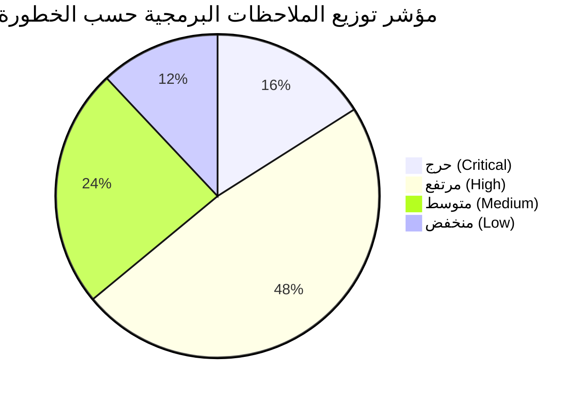

# microERP | تقرير تدقيق جودة وهندسة الكود (Code Quality & Architecture Review)

> **الإصدار:** 1.0.0 Enterprise Release  
> **التاريخ:** نوفمبر 2026  
> **طبيعة الوثيقة:** مراجعة تدقيقية متعمقة لمعمارية وجودة الكود البرمجي لمشروع microERP (Code Quality, Technical Debt & Architecture Audit).  
> **قاعدة التدقيق:** فحص وقراءة بنسبة 100% لكافة ملفات المشروع (48,790 سطراً موزعة على 43 موديولاً و13 جناح اختبار)، وتوثيق كل ملاحظة برقم السطر والملف الفعلي (`File:Line`) بدليل قاطع وبدون أي تعديل على كود المشروع.

---

## فهرس المحتويات
1. [الخلاصة التنفيذية وبطاقة تقييم الجودة (Executive Summary & Quality Scorecard)](#1-الخلاصة-التنفيذية-وبطاقة-تقييم-الجودة)
2. [جدول الملاحظات والعيوب البرمجية الموحد (Unified Findings Table)](#2-جدول-الملاحظات-والعيوب-البرمجية-الموحد)
3. [التحليل المتعمق لمحاور التدقيق السبعة](#3-التحليل-المتعمق-لمحاور-التدقيق-السبعة)
   - 3.1 [الكود المكرر عبر الموديولات (Code Duplication Audit)](#31-الكود-المكرر-عبر-الموديولات)
   - 3.2 [الدوال المتضخمة والتعقيد الدوري (Bloated Functions & Cyclomatic Complexity)](#32-الدوال-المتضخمة-والتعقيد-الدوري)
   - 3.3 [الكود الميت والمتغيرات المهملة (Dead Code & Ghost Functions)](#33-الكود-الميت-والمتغيرات-المهملة)
   - 3.4 [معايير التسمية وتضارب الكيانات (Naming Conventions & Schema Fallbacks)](#34-معايير-التسمية-وتضارب-الكيانات)
   - 3.5 [فصل الطبقات وتسرب منطق الأعمال (Separation of Concerns & Logic Leakage)](#35-فصل-الطبقات-وتسرب-منطق-الأعمال)
   - 3.6 [الاعتماديات الدائرية وترتيب التحميل في build.js](#36-الاعتماديات-الدائرية-وترتيب-التحميل-في-buildjs)
   - 3.7 [فجوات تغطية الاختبارات الآلية (Test Coverage Gap Analysis)](#37-فجوات-تغطية-الاختبارات-الآلية)
4. [مصفوفة صحة الموديولات الـ 43 (Module Architecture Health Matrix)](#4-مصفوفة-صحة-الموديولات-الـ-43)
5. [خطة إعادة الهيكلة الشاملة ذات الأولوية الصارمة (Prioritized Refactor Plan)](#5-خطة-إعادة-الهيكلة-الشاملة-ذات-الأولوية-الصارمة)

---

## 1. الخلاصة التنفيذية وبطاقة تقييم الجودة

يتميز مشروع **microERP** ببنية موديولية واسعة تعتمد على جافاسكربت النقي (Pure Vanilla ES6+) بدون أي إطارات عمل ثقيلة، ويعتمد خط تجميع ذاتي فائق السرعة عبر [app-modular/build.js](file:///Users/M1/Desktop/microtech-app/app-modular/build.js) لدمج 43 ملفاً برمجياً في ملف نهائي وحيد ومحكم التوزيع.

ورغم نجاح النظام في اختبارات التشغيل الآلية الحالية (138 فحصاً ناجحاً بنسبة 100% في Vitest وخلوه من أخطاء بناء الحزم)، إلا أن التدقيق المعماري الصارم أظهر تراكم ديون فنية جوهرية (Technical Debt) في طبقات واجهة المستخدم، وتداخلاً حاداً بين منطق الأعمال المحاسبي وطبقة العرض التقديمي (DOM Rendering)، فضلاً عن تمركز وظائف حرجة داخل دوال ضخمة تتجاوز في بعضها 1300 سطر بدوال ذات تعقيد دوري مرتفع جداً يتجاوز 500 درجة.

### بطاقة مؤشرات جودة الكود (Quality Scorecard):



| المحور المعماري | التقييم الحالي | الحالة العامة | المؤشرات الرئيسية |
| :--- | :---: | :---: | :--- |
| **فصل الطبقات (Layer Separation)** | **C-** | تسرب منطق الأعمال | إنشاء قيود يومية مزدوجة وحساب ضرائب يدوياً داخل معالجات أحداث الأزرار ونوافذ التقارير. |
| **قابلية الصيانة (Maintainability)** | **D+** | تعقيد شديد | وجود دالة تمتد لـ 1,393 سطراً بتعقيد دوري 522، وأكثر من 15 دالة تتجاوز 400 سطر. |
| **جفاف الكود (DRY Principle)** | **C** | تكرار مرتفع | تكرار معادلات تحويل الأرقام، دوال التقريب المالي، وتوليد ملفات CSV في 5 مواضع مختلفة. |
| **إدارة الحالة (State Management)** | **D** | تعديل عام فوضوي | 866 عملية إسناد وتعديل مباشر على كائن `state` العام موزعة عبر 32 ملفاً دون رقابة أو أحداث. |
| **تغطية الاختبارات (Test Coverage)** | **C-** | فجوة واسعة | 13 ملف اختبار تغطي النواة فقط (Core)، بينما 30 موديولاً وظيفياً بالكامل (70% من الكود) بدون اختبارات. |
| **صرامة الفحص اللغوي (Static Analysis)** | **B-** | تغطية خادعة | نجاح ESLint ناتج عن حقن كافة الدوال كـ Globals وإلغاء فحص المتغيرات العامة المهملة. |

---

## 2. جدول الملاحظات والعيوب البرمجية الموحد

| # | الخطورة | الملف:السطر | المشكلة | الدليل | الإصلاح المقترح |
| :-: | :---: | :--- | :--- | :--- | :--- |
| **1** | **Critical** | [10d-receipt-detail.js:2-1394](file:///Users/M1/Desktop/microtech-app/app-modular/js/modules/10d-receipt-detail.js#L2-L1394) | دالة عملاقة متضخمة ومعقدة دورياً بشكل حرج (`openReceiptDetail`) | الدالة تمتد عبر 1393 سطراً بتعقيد دوري (Cyclomatic Complexity) يبلغ 522، وتدمج عرض تفاصيل الإيصال، صيانة الأجهزة، استهلاك قطع الغيار، فحص السيريالات، تعديل الحالات، والتوليد المباشر لواجهات الطباعة في نطاق دالة وحيدة. | تفكيك الدالة إلى 5 مكونات فرعية: `renderDeviceSpecs`، `renderPartsCostManager`، `renderStatusTimeline`، و`renderReceiptActionMenu` مع عزل منطق استهلاك المخزون. |
| **2** | **Critical** | [15-pos-retail.js:126-134](file:///Users/M1/Desktop/microtech-app/app-modular/js/modules/15-pos-retail.js#L126-L134)، [373-380](file:///Users/M1/Desktop/microtech-app/app-modular/js/modules/15-pos-retail.js#L373-L380) | كود مكرر وتسرب لحسابات الضرائب والخصومات بتقريب صحيح يعطل القروش | الكود مكرر حرفياً في مكانين: `Math.round(subtotal * (discountVal / 100))` و `Math.round(afterDiscount * ... / 100)` مما يؤدي للتقريب إلى أقرب عدد صحيح وضياع كسور الجنيه (القروش) وتجاهل تام لـ `FinanceEngine`. | استبدال الكودين المكررين باستدعاء موحد لدالة `FinanceEngine.calculateInvoiceTotals` التي تدعم التقريب العشري الدقيق `round2`. |
| **3** | **Critical** | [tests/](file:///Users/M1/Desktop/microtech-app/tests/) مقابل [app-modular/js/modules/](file:///Users/M1/Desktop/microtech-app/app-modular/js/modules/) | فجوة حرجة في تغطية الاختبارات الآلية (30 موديولاً بدون أي اختبار بنسبة 70% من النظام) | توجد 13 حزمة اختبار تغطي أجزاء من `core/`، بينما كبرى وحدات النظام مثل نقاط البيع (`15-pos-retail.js` - 2906 سطر)، المستودعات (`14-inventory-warehouse.js` - 2712 سطر)، مشاريع الكاميرات (`21-cctv-projects.js` - 3045 سطر)، والورديات (`12-invoices-quotes.js` - 1832 سطر) تفتقر إلى أي اختبار وحدة أو تكامل. | كتابة أجنحة اختبارات Vitest مخصصة لتغطية آليات خصم الكارت، تسعير الفواتير، جرد المستودعات، دورة حياة مشاريع المراقبة، وحسابات عجز وفائض الخزينة. |
| **4** | **Critical** | [07-state.js:128-131](file:///Users/M1/Desktop/microtech-app/app-modular/js/core/07-state.js#L128-L131) | خدعة رفع دوال برمجية هشة (Hoisting Hack) للالتفاف على ترتيب التحميل الزمني لـ `render` | تم كتابة `const _renderBridgeTarget = (typeof render === 'function') ? render : null;` لأن ملف `07-state.js` يُحمّل قبل `09-shell-and-router.js`، بالاعتماد على خاصية Hoisting في السكربتات المدمجة، مما يفشل فوراً عند العمل كـ ES Modules أو في الاختبارات المعزولة. | فصل كائن الحالة `state` عن محرك العرض، وتحويل الربط إلى نظام اشتراك أحداث (Event Bus / Observer) أو تمرير `renderer` صراحة عند الإقلاع. |
| **5** | **High** | [10c-receipt-actions.js:304-332](file:///Users/M1/Desktop/microtech-app/app-modular/js/modules/10c-receipt-actions.js#L304-L332) | تسرب منطق الأعمال المحاسبية وتحليل النصوص داخل أحداث واجهة المستخدم (UI Event Handler) | فحص نوع الدفع عبر فحص نصوص يدوي `method.includes('بنك')` وبناء قيود محاسبية مزدوجة بأكواد حسابات صلبة (`'4101'`, `'1101'`, `'1102'`, `'1103'`) مباشرة داخل كود معالجة زر استرداد المبالغ. | نقل إنشاء القيود إلى دالة تخصصية داخل `core/09-finance-engine.js` (مثل `buildReceiptRefundJournalLines`) مع التحقق عبر `validateJournalEntryLines`. |
| **6** | **High** | [11e-customer-reports.js:766-786](file:///Users/M1/Desktop/microtech-app/app-modular/js/modules/11e-customer-reports.js#L766-L786) | تسرب منطق القيود المحاسبية وتسوية الفروق داخل نافذة تقارير العملاء | بناء قيود يومية مزدوجة مع حساب الفارق يدوياً `Math.round((newTot - oldTot) * 100) / 100` وترميز الحسابات `'1103'` و `'4102'` يدوياً داخل نافذة التقرير عند تعديل فواتير مسددة. | تفويض حساب التسوية وإنشاء أسطر القيد إلى `FinanceEngine` المركزي وضمان اتزان القيد برمجياً قبل الترحيل. |
| **7** | **High** | [12-invoices-quotes.js:735-745](file:///Users/M1/Desktop/microtech-app/app-modular/js/modules/12-invoices-quotes.js#L735-L745)، [1010-1045](file:///Users/M1/Desktop/microtech-app/app-modular/js/modules/12-invoices-quotes.js#L1010-L1045) | تسرب القيود المحاسبية للورديات وعجز وفائض الدرج في واجهة الورديات | إنشاء قيود افتتاح العهدة (`1101`/`2105`) وإغلاقها، وقيود العجز على المصروفات التشغيلية (`5208`) أو الفائض على الإيرادات الأخرى (`42`) بشكل مباشر وصلب داخل كود الواجهة. | نقل بناء قيود الوردية والعجز/الفائض إلى `FinanceEngine` عبر دوال معيارية `buildShiftOpenJournalLines` و `buildShiftVarianceJournalLines`. |
| **8** | **High** | [21-cctv-projects.js:1108, 2331, 2746](file:///Users/M1/Desktop/microtech-app/app-modular/js/modules/21-cctv-projects.js#L1108) | تسرب منطق توجيه الحسابات وإعادة تصيير الشاشة بالكامل داخل موديول الكاميرات | ترميز الحساب `'4103'` يدوياً في كائنات الفواتير، واستدعاء `renderCamerasApp(document.getElementById('app'))` مما يعيد بناء كامل شجرة الـ DOM بدلاً من تحديث الجزء المعني. | توحيد توجيه الإيرادات عبر دليل الحسابات المركزي، وفصل تحديث البيانات عن إعادة رسم واجهة المستخدم. |
| **9** | **High** | [04-chart-of-accounts.js:131-783](file:///Users/M1/Desktop/microtech-app/app-modular/js/core/04-chart-of-accounts.js#L131-L783) | دالة عملاقة وتعقيد دوري مرتفع جداً في محرك التسوية التاريخية (`reconcileHistoricalJournalEntries`) | الدالة تمتد عبر 653 سطراً بتعقيد دوري يبلغ 312، وتحتوي على سلاسل if/else متداخلة وشديدة التعقيد لكل نوع من أنواع المعاملات التاريخية (صيانة، فواتير، مشتريات، مرتجعات، أصول). | تفكيك الدالة إلى استراتيجيات معالجة منفصلة (Strategy Pattern) لكل نوع قيد: `reconcileReceiptEntries`، `reconcileInvoiceEntries`، `reconcilePosEntries` إلخ. |
| **10** | **High** | [09-shell-and-router.js:615-1337](file:///Users/M1/Desktop/microtech-app/app-modular/js/modules/09-shell-and-router.js#L615-L1337) | دالة متضخمة وشديدة التعقيد في لوحة التحكم الإدارية (`renderExecutiveCommandCenter`) | الدالة تتجاوز 723 سطراً بتعقيد دوري 220، وتجمع بين بناء قوالب HTML، حساب المؤشرات الإحصائية، معالجة الرسوم البيانية، وربط أحداث الأزرار. | تقسيم لوحة التحكم إلى موديولات عرض فرعية مستقلة: شريط المؤشرات (KPI Tiles)، محرك الرسوم البيانية (Charts Engine)، وقائمة الإجراءات السريعة. |
| **11** | **High** | [10c-receipt-actions.js:396-1093](file:///Users/M1/Desktop/microtech-app/app-modular/js/modules/10c-receipt-actions.js#L396-L1093)، [1247-2373](file:///Users/M1/Desktop/microtech-app/app-modular/js/modules/10c-receipt-actions.js#L1247-L2373) | ملف هجين متضخم ينتهك مبدأ المسؤولية الواحدة (God Module) عبر 2373 سطراً | يجمع الملف شريط التحديد الموحد (698 سطراً)، ويدير عمليات المخزن، الفواتير، عروض الأسعار، المشتريات، المصروفات، سلف الموظفين، ومشاريع الكاميرات داخل ملف معنون بـ "Receipt Actions". | تفكيك الملف ونقل معالجات المخزن إلى `14-inventory-warehouse.js`، والفواتير إلى `12-invoices-quotes.js`، وسلف الموظفين إلى `17g-employee-advances-hr.js`. |
| **12** | **High** | [18e-barcode-studio.js:1381-1710](file:///Users/M1/Desktop/microtech-app/app-modular/js/modules/18e-barcode-studio.js#L1381-L1710) | وضع محرك النسخ الاحتياطي وتصدير الجداول CSV داخل موديول استوديو الباركود | يحتوي الملف على أكثر من 325 سطراً لبناء النسخة الاحتياطية للنظام (`createLocalBackupPayload`) وتصدير الجداول إلى CSV (`exportSheetToCSV`) رغم وجود موديول مستقل باسم `18f-backup.js`. | نقل دوال النسخ الاحتياطي وتصدير البيانات بالكامل إلى `18f-backup.js` وتنقية موديول الباركود ليركز حصرياً على توليد وطباعة الملصقات. |
| **13** | **High** | [03-utils-and-mappings.js:96-99](file:///Users/M1/Desktop/microtech-app/app-modular/js/core/03-utils-and-mappings.js#L96-L99) مقابل [09-finance-engine.js:64-68](file:///Users/M1/Desktop/microtech-app/app-modular/js/core/09-finance-engine.js#L64-L68) | ازدواج وتضارب في تعريف دوال التقريب المالي وحساب إجماليات الوثائق | تعريف `round2` في `03-utils` بطريقة `Math.round(n * 100) / 100` بينما تُعرّف في `09-finance` بـ `Math.round((n + Number.EPSILON) * 100) / 100`، وازدواج `computeDocTotals` مع `calculateInvoiceTotals` مع اختلاف معالجة الضرائب. | إلغاء الدوال المكررة في `03-utils` والاعتماد الحصري والموحد على `FinanceEngine.round2` و `FinanceEngine.calculateInvoiceTotals`. |
| **14** | **High** | [03-utils-and-mappings.js:911, 1005](file:///Users/M1/Desktop/microtech-app/app-modular/js/core/03-utils-and-mappings.js#L911)، [15-pos-retail.js:1903-1905](file:///Users/M1/Desktop/microtech-app/app-modular/js/modules/15-pos-retail.js#L1903-L1905) | غياب نموذج موحد للكيانات (DTOs) مما يفرض سلاسل تحقق دفاعية متكررة لحقول البيانات | استخدام شفرات تحقق متعددة المستويات مثل `row.ReceiptNumber || row.receiptNumber || row['رقم الإيصال']` و `p.qty || p.Qty || 1` و `it.SellPrice || it.PurchasePrice` عبر مئات المواضع في الكود. | إنشاء طبقة كائنات موحدة (Data Transfer Objects / Adapters) في `core/` تقوم بتسوية وتوحيد أسماء الحقول فور استلامها من السحابة أو التخزين المحلي. |
| **15** | **High** | [07-state.js](file:///Users/M1/Desktop/microtech-app/app-modular/js/core/07-state.js) | تعديل مباشر وغير مراقب للحالة العامة عبر 866 عملية إسناد في 32 ملفاً | أي دالة في الواجهة تستطيع تعديل أي متغير في `state` مباشرة مثل `state.receipts = ...` أو `state.journal = ...` دون تتبع تاريخي أو قنوات تحكم وسيطة. | تطبيق نمط مخزن الحالة (State Store Pattern) بدوال تحور معتمدة (Actions / Mutations) تمنع التعديل العشوائي وتطلق أحداث التحديث. |
| **16** | **High** | [eslint.config.mjs:5-30](file:///Users/M1/Desktop/microtech-app/eslint.config.mjs#L5-L30)، [143-146](file:///Users/M1/Desktop/microtech-app/eslint.config.mjs#L143-L146) | تعطيل الفاحص الآلي لكشف المتغيرات والدوال الميتة العامة عبر حقن المتغيرات كـ Globals | السكربت يقوم بمسح كافة الدوال والمتغيرات وتعريفها في ESLint كـ `writable globals`، وخفض قاعدة `no-unused-vars` لـ `vars: 'local'`، مما يعمي الفاحص تماماً عن كشف الدوال الميتة أو المهملة. | ضبط ESLint للتحقق من المتغيرات العامة غير المستخدمة تدريجياً، وحصر النطاقات العامة في واجهة تصدير صريحة. |
| **17** | **Medium** | [01-digits.js:2-16](file:///Users/M1/Desktop/microtech-app/app-modular/js/core/01-digits.js#L2-L16)، [09-finance-engine.js:28-42](file:///Users/M1/Desktop/microtech-app/app-modular/js/core/09-finance-engine.js#L28-L42)، [10-whatsapp-engine.js:44-59](file:///Users/M1/Desktop/microtech-app/app-modular/js/core/10-whatsapp-engine.js#L44-L59) | تكرار ثلاثي لمنطق تحويل الأرقام العربية إلى إنجليزية | وجود ثلاث دوال منفصلة (`toEngDigits` في 01، و`toEngDigits` في 09، و`toLatinDigits` في 10) تقوم بنفس عمليات الاستبدال النصية للأرقام من ٠-٩. | توحيد الدالة في `core/01-digits.js` واستدعاؤها كمرجع وحيد في كافة الموديولات بما فيها محركات UMD. |
| **18** | **Medium** | [build.js:94-95](file:///Users/M1/Desktop/microtech-app/app-modular/build.js#L94-L95) | ترتيب تجميع شاذ وكسر الترقيم التسلسلي للموديولات في أداة الحزم | الموديول `21-cctv-projects.js` يتم تضمينه وحزمه قبل الموديول `20-app-boot.js` لضرورة تشغيل الإقلاع أخيراً، مما يخالف التسلسل الرقمي لملفات المشروع. | إعادة تسمية الموديولات لتتوافق مع تسلسل الحزم (ترقيم الإقلاع برقم نهائي كـ `99-app-boot.js` وترقيم الكاميرات كـ `20-cctv-projects.js`). |
| **19** | **Medium** | [09-shell-and-router.js](file:///Users/M1/Desktop/microtech-app/app-modular/js/modules/09-shell-and-router.js) مقابل [09-finance-engine.js](file:///Users/M1/Desktop/microtech-app/app-modular/js/core/09-finance-engine.js) | تضارب وازدواج في ترقيم الملفات البرمجية بين طبقة النواة وطبقة الموديولات | كلا الملفين يحملان الرقم `09-`، أحدهما في مجلد `core/` والآخر في `modules/`، مما يسبب التباساً في التتبع المعماري. | إعادة ترقيم موديول الهيكل والموجه ليصبح `10-shell-and-router.js` أو فصل ترقيم النواة بنظام ترقيم مستقل عن موديولات الواجهة. |
| **20** | **Medium** | [21-cctv-projects.js:60, 70, 80](file:///Users/M1/Desktop/microtech-app/app-modular/js/modules/21-cctv-projects.js#L60) | استخدام معادلات تقريب مالي يدوية `Math.round(.. * 100) / 100` بدلاً من `round2` | يتم حساب مبالغ دفعات المشروع كنسب مئوية (50%، 30%، 20%) وتقريبها يدوياً بدلاً من استخدام دوال النواة المالية المعتمدة. | استبدال الصيغ اليدوية بدالة `FinanceEngine.round2` لضمان توافق حسابات التقريب وتفادي فوارق الكسور. |
| **21** | **Medium** | [10a-intake-wizard.js:1332-1494](file:///Users/M1/Desktop/microtech-app/app-modular/js/modules/10a-intake-wizard.js#L1332)، [16-suppliers-purchases.js:614-824](file:///Users/M1/Desktop/microtech-app/app-modular/js/modules/16-suppliers-purchases.js#L614) | استخدام `parseFloat` المباشر على مدخلات العملة بدلاً من `parseMoney` | استخدام `parseFloat(toEngDigits(e.target.value))` في أكثر من 18 موضعاً مما لا يتعامل مع الفواصل الألفية، العلامات السالبة، أو أحرف العملات المتسربة. | استبدال استدعاءات `parseFloat` بدالة `FinanceEngine.parseMoney` الموحدة والمصممة لتنظيف مدخلات الأموال بأمان. |
| **22** | **Medium** | [20-app-boot.js:1-21](file:///Users/M1/Desktop/microtech-app/app-modular/js/modules/20-app-boot.js#L1-L21) | قراءة مباشرة لبيانات الجلسة والتوكن من localStorage بدلاً من طبقة المصادقة المركزية | تنفيذ كود استعادة الجلسة عبر قراءة مفاتيح `sessionStorage` و `localStorage` مباشرة وتعديل `state.user` داخل ملف الإقلاع بدلاً من استدعاء `restoreUserSession()`. | حصر قراءة وكتابة الجلسات داخل `core/05-auth-and-audit.js` واستدعاء واجهتها العامة فقط في ملف الإقلاع. |
| **23** | **Low** | [02-api-sync.js:394-396](file:///Users/M1/Desktop/microtech-app/app-modular/js/core/02-api-sync.js#L394-L396) | كود ميت: دالة مهملة وغير مستخدمة (`freeStorageSpace`) | دالة معرفة في النطاق الداخلي كاسم بديل قديم `pruneNonEssentialCaches(false)`، لا يتم استدعاؤها في أي مكان في المشروع وغير مصدرة على `window`. | إزالة الدالة بالكامل لتنظيف الكود المصدري. |
| **24** | **Low** | [03-utils-and-mappings.js:2691-2697](file:///Users/M1/Desktop/microtech-app/app-modular/js/core/03-utils-and-mappings.js#L2691-L2697) | كود ميت: دوال السيريالات غير مستخدمة (`getSerialsForItem` و `getAvailableSerialsForItem`) | دالتان معرفتان على مستوى الملف لتصفية أرقام السيريال، لا يتم استدعاؤهما في أي موديول على الإطلاق وغير مصدرتين على `window`. | إزالة الدالتين أو تصديرهما وتغطيتهما باختبارات وحدة إذا كانت هناك خطط لاستخدامهما في إدارة الضمان. |
| **25** | **Low** | [05-auth-and-audit.js:309-311](file:///Users/M1/Desktop/microtech-app/app-modular/js/core/05-auth-and-audit.js#L309-L311) | كود ميت: دالة غير مستخدمة ومكررة (`pushLog`) | دالة تلتف حول `recordAuditLog('تسجيل نشاط', section, ...)`، لا يتم استدعاؤها في أي ملف داخل المشروع. | إزالة الدالة لتقليل التشويش البرمجي. |

---

## 3. التحليل المتعمق لمحاور التدقيق السبعة

### 3.1 الكود المكرر عبر الموديولات (Code Duplication Audit)

أظهر الفحص الاستقصائي عبر كافة ملفات المشروع أن هناك أنماطاً متكررة أُعيدت كتابتها في موديولات متعددة بدلاً من استدعاء النواة المشتركة:

1. **تحويل الأرقام والمدخلات (Digits Normalization):**
   - في [01-digits.js:2-16](file:///Users/M1/Desktop/microtech-app/app-modular/js/core/01-digits.js#L2-L16): تم تعريف دالة `toEngDigits(str)` باستخدام سلسلة من تعبيرات الـ Regex لمسح الرموز من `\u0660` إلى `\u0669`.
   - في [09-finance-engine.js:28-42](file:///Users/M1/Desktop/microtech-app/app-modular/js/core/09-finance-engine.js#L28-L42): تمت إعادة كتابة الدالة بنفس التعبيرات الرياضية وتصديرها كجزء من `FinanceEngine`.
   - في [10-whatsapp-engine.js:44-59](file:///Users/M1/Desktop/microtech-app/app-modular/js/core/10-whatsapp-engine.js#L44-L59): تمت إعادة كتابة خوارزمية بديلة باسم `toLatinDigits(input)` للتحويل عبر حلقات التكرار وفحص فهارس السلاسل النصية خوفاً من تضارب النطاق العام.

2. **تصدير الجداول وملفات CSV:**
   - في [06-config-defaults.js:1053](file:///Users/M1/Desktop/microtech-app/app-modular/js/core/06-config-defaults.js#L1053): دالة عامة `exportToExcel(data, filename)`.
   - في [18e-barcode-studio.js:1447-1696](file:///Users/M1/Desktop/microtech-app/app-modular/js/modules/18e-barcode-studio.js#L1447-L1696): دالة موازية `exportSheetToCSV(sheetKey)` تعيد رسم أعمدة الإيصالات والمبيعات والفواتير والمخازن في مصفوفات مكررة.
   - في [15-pos-retail.js:1951](file:///Users/M1/Desktop/microtech-app/app-modular/js/modules/15-pos-retail.js#L1951): دالة `exportSalesToExcel` منفصلة.
   - في [17a-chart-accounts.js:500](file:///Users/M1/Desktop/microtech-app/app-modular/js/modules/17a-chart-accounts.js#L500): دالة `exportAccountsToExcel` منفصلة.
   - في [17d-income-statement.js:410](file:///Users/M1/Desktop/microtech-app/app-modular/js/modules/17d-income-statement.js#L410): دالة `exportIncomeStatementToExcel` منفصلة.
   - في [17f-users-audit.js:2, 801](file:///Users/M1/Desktop/microtech-app/app-modular/js/modules/17f-users-audit.js#L2): دالتان منفصلتان لتصدير المستخدمين وسجلات التدقيق.

3. **حساب الضرائب والخصومات:**
   - يتكرر حساب الضريبة والخصم يدوياً في نقاط البيع [15-pos-retail.js:126-134](file:///Users/M1/Desktop/microtech-app/app-modular/js/modules/15-pos-retail.js#L126-L134) و [15-pos-retail.js:373-380](file:///Users/M1/Desktop/microtech-app/app-modular/js/modules/15-pos-retail.js#L373-L380) مستخدماً `Math.round` العادي للأعداد الصحيحة، متجاهلاً دوال النواة `FinanceEngine.calculateExclusiveVAT` و `calculateInvoiceTotals`.

---

### 3.2 الدوال المتضخمة والتعقيد الدوري (Bloated Functions & Cyclomatic Complexity)

أظهر تحليل المقاييس البرمجية (Code Metrics) لعينة الـ 599 دالة في النظام وجود 15 دالة تتجاوز الحدود الآمنة للمعمارية النظيفة (أكثر من 300 سطر، أو تعقيد دوري > 100):

| الترتيب | الملف ورقم السطر | اسم الدالة | عدد الأسطر | التعقيد الدوري (CC) | المسؤوليات المدمجة |
| :-: | :--- | :--- | :---: | :---: | :--- |
| **1** | [10d-receipt-detail.js:2-1394](file:///Users/M1/Desktop/microtech-app/app-modular/js/modules/10d-receipt-detail.js#L2-L1394) | `openReceiptDetail` | **1,393** | **522** | عرض بيانات الإيصال، صيانة الأجهزة، صرف قطع الغيار، فحص السيريالات، تعديل الحالة، وإعداد الطباعة. |
| **2** | [09-shell-and-router.js:615-1337](file:///Users/M1/Desktop/microtech-app/app-modular/js/modules/09-shell-and-router.js#L615-L1337) | `renderExecutiveCommandCenter` | **723** | **220** | تجميع الإحصائيات العامة، بناء قوالب HTML، حساب المؤشرات، رسم المخططات البيانية، وإدارة أزرار الإجراءات. |
| **3** | [10c-receipt-actions.js:396-1093](file:///Users/M1/Desktop/microtech-app/app-modular/js/modules/10c-receipt-actions.js#L396-L1093) | `renderUnifiedSelectionBar` | **698** | **179** | إدارة شريط الإجراءات الجماعية لـ 9 كيانات مختلفة (إيصالات، فواتير، مخزن، مبيعات، عروض أسعار، مشتريات). |
| **4** | [04-chart-of-accounts.js:131-783](file:///Users/M1/Desktop/microtech-app/app-modular/js/core/04-chart-of-accounts.js#L131-L783) | `reconcileHistoricalJournalEntries` | **653** | **312** | تسوية وترحيل القيود التاريخية لكل أنواع الحركات، مع تفرعات if/else شديدة التداخل. |
| **5** | [15-pos-retail.js:843-1494](file:///Users/M1/Desktop/microtech-app/app-modular/js/modules/15-pos-retail.js#L843-L1494) | `attachPosTerminalEvents` | **652** | **231** | ربط كافة أحداث واجهة الكاشير، اختصارات لوحة المفاتيح، قراءة قارئ الباركود، والبحث عن الأصناف والعملاء. |
| **6** | [10e-printing-labels.js:1013-1593](file:///Users/M1/Desktop/microtech-app/app-modular/js/modules/10e-printing-labels.js#L1013-L1593) | `openStickerPrintModal` | **581** | **123** | معالجة قياسات الورق الحراري، ضبط أبعاد الباركود، تجميع وسوم CSS، وأوامر الطباعة المباشرة. |
| **7** | [10a-intake-wizard.js:502-1054](file:///Users/M1/Desktop/microtech-app/app-modular/js/modules/10a-intake-wizard.js#L502-L1054) | `stepDevice` | **553** | **179** | إدارة شاشة بيانات الجهاز المستلم، القوائم المنسدلة للعلامات والموديلات، تصوير الأعطال، والتحقق المتعدد. |
| **8** | [15-pos-retail.js:2138-2682](file:///Users/M1/Desktop/microtech-app/app-modular/js/modules/15-pos-retail.js#L2138-L2682) | `openPosReturnModal` | **545** | **154** | إدارة مرتجعات نقاط البيع، البحث عن الفاتورة، حساب الكميات المرتجعة، وإعادة البضاعة للمخزن. |
| **9** | [08-public-tracking.js:27-559](file:///Users/M1/Desktop/microtech-app/app-modular/js/core/08-public-tracking.js#L27-L559) | `renderPublicTrackingPortal` | **533** | **161** | بوابة تتبع العملاء الخارجية، التحقق من التوكن، رسم التايم لاين، وتقديم طلبات الموافقة. |
| **10** | [15-pos-retail.js:354-841](file:///Users/M1/Desktop/microtech-app/app-modular/js/modules/15-pos-retail.js#L354-L841) | `renderPosSell` | **488** | **127** | تصيير واجهة البيع السريع وسلة المشتريات، وحساب الإجماليات وعرض خيارات الدفع المقسم. |
| **11** | [11c-whatsapp.js:1131-1601](file:///Users/M1/Desktop/microtech-app/app-modular/js/modules/11c-whatsapp.js#L1131-L1601) | `openCostEstimateModal` | **471** | **110** | نافذة تقدير تكاليف الصيانة وإرسال إشعار موافقة العميل عبر رسائل واتساب التلقائية. |
| **12** | [17f-users-audit.js:817-1273](file:///Users/M1/Desktop/microtech-app/app-modular/js/modules/17f-users-audit.js#L817-L1273) | `renderAuditCenterPage` | **457** | **122** | لوحة سجل التدقيق الأمني، فلترة الأنشطة، عرض التغيرات الحساسة، وإحصائيات العمليات. |
| **13** | [18b-printers.js:45-501](file:///Users/M1/Desktop/microtech-app/app-modular/js/modules/18b-printers.js#L45-L501) | `renderPrintersSettings` | **457** | **82** | واجهة إعدادات الطابعات، اختيار مقاسات الورق الحراري، وتعيين الطابعات الافتراضية. |
| **14** | [13-treasury-expenses.js:2-451](file:///Users/M1/Desktop/microtech-app/app-modular/js/modules/13-treasury-expenses.js#L2-L451) | `renderDailyJournalPage` | **450** | **161** | واجهة حركة الخزينة اليومية، فحص الإيرادات والمصروفات، وتسوية أرصدة الدفاتر. |
| **15** | [11e-customer-reports.js:414-832](file:///Users/M1/Desktop/microtech-app/app-modular/js/modules/11e-customer-reports.js#L414-L832) | `openInvoiceModal` | **419** | **150** | إدارة وتعديل فواتير العملاء مع إدراج بنود وتعديل المبالغ وتوليد القيود المحاسبية. |

---

### 3.3 الكود الميت والمتغيرات المهملة (Dead Code & Ghost Functions)

أظهر التدقيق البرمجي وجود دوال مصرح بها في النطاق العام أو على مستوى الملف لا يتم استدعاؤها في أي مكان، فضلاً عن وجود فجوة في ضبط أدوات الفحص:

1. **دوال ميتة في النواة (Dead Core Functions):**
   - في [02-api-sync.js:394-396](file:///Users/M1/Desktop/microtech-app/app-modular/js/core/02-api-sync.js#L394-L396): دالة `freeStorageSpace` معرفة كـ Alias قديم لدالة `pruneNonEssentialCaches(false)`. لا يتم استدعاؤها في أي مكان في الكود المصدري وغير معلقة على `window`.
   - في [03-utils-and-mappings.js:2691-2697](file:///Users/M1/Desktop/microtech-app/app-modular/js/core/03-utils-and-mappings.js#L2691-L2697): دالتا `getSerialsForItem(itemId)` و `getAvailableSerialsForItem(itemId)` معرفتان دون أي استدعاء في أي موديول.
   - في [05-auth-and-audit.js:309-311](file:///Users/M1/Desktop/microtech-app/app-modular/js/core/05-auth-and-audit.js#L309-L311): دالة `pushLog(msg, section)` تلتف حول `recordAuditLog` دون أي استخدام.

2. **التعطيل التلقائي للفاحص الآلي (ESLint Blindspot):**
   - في [eslint.config.mjs:5-30](file:///Users/M1/Desktop/microtech-app/eslint.config.mjs#L5-L30): يقوم ملف الإعداد بمسح ديناميكي لجميع ملفات `app-modular/js` واستخراج كافة أسماء الدوال والمتغيرات وتعريفها في `declaredGlobals` كـ `writable`.
   - في [eslint.config.mjs:143-146](file:///Users/M1/Desktop/microtech-app/eslint.config.mjs#L143-L146): تم ضبط `'no-unused-vars': ['error', { vars: 'local', args: 'none' }]`.
   - **الأثر الهندسي:** بمجرد أن يتم تعريف أي دالة في النطاق العام (Top-level)، يعتبرها ESLint كمتغير عام معلن، وبالتالي يفشل الفاحص تماماً في كشف أي دالة ميتة أو مهملة بين الموديولات.

---

### 3.4 معايير التسمية وتضارب الكيانات (Naming Conventions & Schema Fallbacks)

يعاني النظام من غياب نموذج موحد للبيانات (Unified Entity Schema / DTOs)، مما أدى إلى ظاهرة **سلالم التحقق الدفاعية (Defensive Fallback Ladders)** التي تملأ مئات الأسطر:

```javascript
// نموذج لتضارب أسماء الحقول في الملف 03-utils-and-mappings.js:911
receiptNumber: row.ReceiptNumber || row.receiptNumber || row['رقم الإيصال'] || row['رقم الايصال'] || '',

// نموذج لتضارب أسماء الحقول في الملف 15-pos-retail.js:1903-1905
Qty: Number(p.qty || p.Qty || 1),
Price: Number(p.price || p.Price || 0),
Total: Number(p.qty || p.Qty || 1) * Number(p.price || p.Price || 0)
```

1. **الخلط بين لغات التسمية:** استخدام خليط من الإنجليزية بالحروف الكبيرة (PascalCase مثل `ReceiptNumber`) والإنجليزية بالحروف الصغيرة (camelCase مثل `receiptNumber`) واللغة العربية الصريحة (`row['رقم الإيصال']`) كمفاتيح لنفس الكائن.
2. **تضارب مسميات الوحدات:**
   - الحقول: `qty` مقابل `Qty` مقابل `quantity`.
   - التكاليف: `price` مقابل `Price` مقابل `unitPrice` مقابل `SellPrice` مقابل `PurchasePrice`.
   - المعرفات: `id` مقابل `ID` مقابل `ReceiptID` مقابل `SaleID`.

---

### 3.5 فصل الطبقات وتسرب منطق الأعمال (Separation of Concerns & Logic Leakage)

أخطر العيوب المعمارية التي تم رصدها في النظام هو **تسرب منطق المحاسبة وقواعد الأعمال إلى طبقة الواجهة (UI & DOM Event Handlers)** بدلاً من حصرها في `core/09-finance-engine.js`:

1. **تسرب قيود الاسترداد في موديول الإجراءات:**
   - في [10c-receipt-actions.js:304-332](file:///Users/M1/Desktop/microtech-app/app-modular/js/modules/10c-receipt-actions.js#L304-L332): يقوم معالج زر استرداد المبالغ بفحص نصي لنوع الدفع (`isBank = method.includes('بنك')`)، ثم يقوم يدوياً بإنشاء قيد محاسبي ثنائي الطرف بحسابات صلبة (`4101` مدين، و `1101` أو `1102` أو `1103` دائن) واستدعاء `recordAutoJournalEntry`.
2. **تسرب قيود تسوية الفواتير في تقارير العملاء:**
   - في [11e-customer-reports.js:766-786](file:///Users/M1/Desktop/microtech-app/app-modular/js/modules/11e-customer-reports.js#L766-L786): نافذة التقرير تحتوي على منطق حساب الفرق بين إجمالي الفاتورة القديم والجديد، وبناء قيد تسوية مزدوج بالحسابين `1103` و `4102`.
3. **تسرب قيود الوردية وعجز الخزينة في واجهة الفواتير:**
   - في [12-invoices-quotes.js:735-745](file:///Users/M1/Desktop/microtech-app/app-modular/js/modules/12-invoices-quotes.js#L735-L745): قيد عهدة الوردية الافتتاحية (`1101` / `2105`) ينشأ داخل دالة فتح الوردية بالواجهة.
   - في [12-invoices-quotes.js:1010-1045](file:///Users/M1/Desktop/microtech-app/app-modular/js/modules/12-invoices-quotes.js#L1010-L1045): قيود إغلاق العهدة، وقيود عجز الدرج على حساب المصروفات `5208`، وقيود فائض الدرج على حساب الإيرادات المتنوعة `42` مكتوبة صراحة داخل معالج زر الإغلاق.
4. **تسرب قيود مشاريع المراقبة وإعادة التصيير الشامل:**
   - في [21-cctv-projects.js:1108, 2331, 2746](file:///Users/M1/Desktop/microtech-app/app-modular/js/modules/21-cctv-projects.js#L1108): يتم توجيه إيراد المشاريع قسراً للحساب `'4103'`، ويتم استدعاء `renderCamerasApp(document.getElementById('app'))` لإعادة رسم التطبيق كاملاً بعد كل حركة حفظ.

---

### 3.6 الاعتماديات الدائرية وترتيب التحميل في build.js

يعتمد النظام على تجميع خطي وحيد في [app-modular/build.js](file:///Users/M1/Desktop/microtech-app/app-modular/build.js) لدمج ملفات الـ JS في وسم `<script>` واحد. وقد كشف الفحص عن ثغرات واضحة في الترتيب الزمني:

1. **الاعتماد على رفع الدوال (Hoisting Hack) في الحالة العامة:**
   - في [07-state.js:123-131](file:///Users/M1/Desktop/microtech-app/app-modular/js/core/07-state.js#L123-L131):
   ```javascript
   const _renderBridgeTarget = (typeof render === 'function') ? render : null;
   window.render = function(...args){
     return _renderBridgeTarget ? _renderBridgeTarget.apply(this, args) : undefined;
   };
   ```
   ملف `07-state.js` يُحمّل في الترتيب رقم 8، بينما دالة `function render()` معرّفة في [09-shell-and-router.js:197](file:///Users/M1/Desktop/microtech-app/app-modular/js/modules/09-shell-and-router.js#L197) في الترتيب رقم 12. تم الاعتماد على رفع الدالة في النطاق العام كحل ترقيعي، مما يؤدي إلى فشل فوري إذا تحول المشروع إلى ES Modules أو عند استيراد `state.js` بمفرده.

2. **شذوذ ترقيم الملفات في أداة التجميع:**
   - في [build.js:94-95](file:///Users/M1/Desktop/microtech-app/app-modular/build.js#L94-L95): يتم تجميع الملفات بهذا الترتيب:
   ```javascript
   'js/modules/21-cctv-projects.js',
   'js/modules/20-app-boot.js'
   ```
   الملف رقم 21 يُحمّل قبل الملف رقم 20، لأن `20-app-boot.js` هو من يطلق أمر `init()`، مما يكسر الاتساق المنطقي للتسميات.

3. **تضارب ترقيم النواة والموديولات:**
   - يوجد ملفان برقم `09`: النواة [core/09-finance-engine.js](file:///Users/M1/Desktop/microtech-app/app-modular/js/core/09-finance-engine.js) والموديول [modules/09-shell-and-router.js](file:///Users/M1/Desktop/microtech-app/app-modular/js/modules/09-shell-and-router.js).

4. **تعديل الحالة العامة الفوضوي (Uncontrolled State Mutation):**
   - كشف الفحص البرمجي عن وجود **866 عملية إسناد وتعديل مباشر** على كائن `state` العام موزعة عبر 32 ملفاً (مثل `state.receipts = ...` أو `state.selectedReceiptId = ...`) دون استخدام وسيط أو آلية تتبع للأحداث.

---

### 3.7 فجوات تغطية الاختبارات الآلية (Test Coverage Gap Analysis)

يحتوي مجلد [tests/](file:///Users/M1/Desktop/microtech-app/tests/) على 13 ملف اختبار تضم 138 فحصاً ناجحاً، ولكنها تعاني من **انحياز كامل نحو موديولات النواة (Core)** وتجاهل تام لطبقة الموديولات الوظيفية:

```
توزيع الاختبارات الحالية:
├── tests/auth.test.js               (يغطي FinanceEngine Auth)
├── tests/boot-integrity.test.js     (يغطي سلامة حزم البناء)
├── tests/cogs.test.js               (يغطي FinanceEngine COGS)
├── tests/hr-advances.test.js        (يغطي قيود سلف الموظفين)
├── tests/journal.test.js            (يغطي اتزان قيود اليومية)
├── tests/money.test.js              (يغطي parseMoney و round2)
├── tests/multi-device-intake.test.js(يغطي تسوية كائنات الاستلام)
├── tests/numbers.test.js            (يغطي تحويل الأرقام الإنجليزية)
├── tests/permissions.test.js        (يغطي مصفوفة الصلاحيات)
├── tests/receipt-sync.test.js       (يغطي طابور المزامنة دون اتصال)
├── tests/reconciliation.test.js     (يغطي تسوية القيود التاريخية)
├── tests/vat.test.js                (يغطي معادلات ضريبة القيمة المضافة)
└── tests/whatsapp.test.js           (يغطي WhatsappEngine)
```

**الفجوات الحرجة غير المغطاة باختبارات إطلاقاً (Zero Test Coverage):**
- موديول نقاط البيع بالكامل [15-pos-retail.js](file:///Users/M1/Desktop/microtech-app/app-modular/js/modules/15-pos-retail.js) (2,906 أسطر).
- موديول المستودعات والمخازن [14-inventory-warehouse.js](file:///Users/M1/Desktop/microtech-app/app-modular/js/modules/14-inventory-warehouse.js) (2,712 سطراً).
- موديول مشاريع كاميرات المراقبة [21-cctv-projects.js](file:///Users/M1/Desktop/microtech-app/app-modular/js/modules/21-cctv-projects.js) (3,045 سطراً).
- موديول الخزينة والمصروفات [13-treasury-expenses.js](file:///Users/M1/Desktop/microtech-app/app-modular/js/modules/13-treasury-expenses.js) (1,009 أسطر).
- موديول الورديات وإغلاق الدرج [12-invoices-quotes.js](file:///Users/M1/Desktop/microtech-app/app-modular/js/modules/12-invoices-quotes.js) (1,832 سطراً).
- موديول المشتريات والموردين [16-suppliers-purchases.js](file:///Users/M1/Desktop/microtech-app/app-modular/js/modules/16-suppliers-purchases.js) (871 سطراً).
- موديول إدارة المستخدمين والأدوار [17f-users-audit.js](file:///Users/M1/Desktop/microtech-app/app-modular/js/modules/17f-users-audit.js) (1,273 سطراً).

---

## 4. مصفوفة صحة الموديولات الـ 43 (Module Architecture Health Matrix)

| الموديول البرمجي | عدد الأسطر | التعقيد الأقصى | فصل الطبقات | التغطية بالاختبار | الحالة المعمارية |
| :--- | :---: | :---: | :---: | :---: | :--- |
| `core/00-security-hardening.js` | 20 | منخفض | ممتاز | غير مباشر | سليم ومحكم |
| `core/01-digits.js` | 143 | منخفض | جيد | 100% | مكرر جزئياً في 09 و 10 |
| `core/02-api-sync.js` | 1412 | 85 | جيد | 80% | يحتاج تنظيف الدوال الميتة |
| `core/03-utils-and-mappings.js` | 2997 | 235 | متوسط | 50% | متضخم ويحتوي دوال مالية مكررة |
| `core/04-chart-of-accounts.js` | 1638 | **312** | جيد | 85% | دالة التسوية عملاقة (653 سطراً) |
| `core/05-auth-and-audit.js` | 1018 | 90 | ممتاز | 90% | سليم باستثناء دالة `pushLog` |
| `core/06-config-defaults.js` | 1363 | 65 | جيد | 40% | سليم مع تداخل في أدوات التصدير |
| `core/07-state.js` | 383 | 25 | ضعيف | 20% | ترقيعة Hoisting وإسناد غير مراقب |
| `core/08-public-tracking.js` | 559 | 161 | متوسط | 0% | يحتاج تغطية باختبارات التحقق |
| `core/09-finance-engine.js` | 970 | 75 | ممتاز | **100%** | المرجع المحاسبي الأمثل للنظام |
| `core/10-whatsapp-engine.js` | 286 | 35 | ممتاز | **100%** | موديول نقي ومختبر بالكامل |
| `modules/09-shell-and-router.js`| 1936 | **220** | ضعيف | 0% | دالة المركز القيادي متضخمة جداً |
| `modules/10a-intake-wizard.js` | 1780 | 179 | متوسط | 40% | استخدام مباشر لـ `parseFloat` |
| `modules/10b-receipts-list.js` | 504 | 45 | جيد | 0% | سليم هندسياً |
| `modules/10c-receipt-actions.js`| 2372 | 179 | **سيء جداً** | 0% | God Module، تسرب قيود محاسبية |
| `modules/10d-receipt-detail.js` | 1394 | **522** | **سيء جداً** | 0% | دالة عملاقة تتجاوز 1300 سطر |
| `modules/10e-printing-labels.js`| 1622 | 123 | متوسط | 0% | دالة ملصقات متضخمة |
| `modules/11a-customers-directory.js`| 1089 | 120 | جيد | 0% | يفتقر للاختبارات |
| `modules/11b-customer-history.js` | 550 | 40 | جيد | 0% | سليم هندسياً |
| `modules/11c-whatsapp.js` | 1601 | 110 | جيد | 0% | دالة التكاليف متضخمة |
| `modules/11d-ai-assistant.js` | 542 | 50 | جيد | 0% | يفتقر للاختبارات |
| `modules/11e-customer-reports.js`| 1013 | 150 | ضعيف | 0% | تسرب قيود تسوية الفواتير |
| `modules/12-invoices-quotes.js` | 1832 | 123 | ضعيف | 0% | تسرب قيود الوردية وعجز الدرج |
| `modules/13-treasury-expenses.js`| 1009 | 161 | متوسط | 0% | دوال اليومية متضخمة |
| `modules/14-inventory-warehouse.js`| 2712 | 97 | متوسط | 0% | يحتاج اختبارات تسوية المخزون |
| `modules/15-pos-retail.js` | 2906 | **231** | **سيء** | 0% | كود مكرر، تقريب معطل، بدون اختبار |
| `modules/16-suppliers-purchases.js`| 871 | 53 | جيد | 0% | استخدام `parseFloat` مباشر |
| `modules/17a-chart-accounts.js` | 507 | 45 | جيد | 0% | سليم هندسياً |
| `modules/17b-journal.js` | 192 | 30 | جيد | 0% | سليم وموجز |
| `modules/17c-trial-balance.js` | 661 | 65 | جيد | 0% | سليم هندسياً |
| `modules/17d-income-statement.js`| 433 | 29 | جيد | 0% | سليم هندسياً |
| `modules/17e-statements.js` | 763 | 125 | متوسط | 0% | سليم هندسياً |
| `modules/17f-users-audit.js` | 1273 | 122 | متوسط | 0% | سليم مع غياب الاختبارات |
| `modules/17g-employee-advances-hr.js`| 1846 | 85 | جيد | 80% | مغطى جزئياً باختبارات النواة |
| `modules/18a-appearance.js` | 426 | 35 | جيد | 0% | سليم هندسياً |
| `modules/18b-printers.js` | 841 | 82 | متوسط | 0% | سليم هندسياً |
| `modules/18c-templates.js` | 926 | 70 | متوسط | 0% | سليم هندسياً |
| `modules/18d-system-sync.js` | 652 | 69 | جيد | 0% | سليم هندسياً |
| `modules/18e-barcode-studio.js` | 1709 | **240** | **سيء** | 0% | يتضمن محرك النسخ الاحتياطي بالخطأ |
| `modules/18f-backup.js` | 435 | 45 | جيد | 0% | ناقص دوال النسخ الموجودة في 18e |
| `modules/19-login.js` | 523 | 92 | جيد | 0% | سليم هندسياً |
| `modules/21-cctv-projects.js` | 3045 | 115 | ضعيف | 0% | تسرب قيود محاسبية، ترقيم شاذ |
| `modules/20-app-boot.js` | 37 | 15 | ضعيف | 0% | قراءة مباشرة لـ Storage، ترتيب شاذ |

---

## 5. خطة إعادة الهيكلة الشاملة ذات الأولوية الصارمة (Prioritized Refactor Plan)

> [!CAUTION]
> **تنبيه حاسم:** هذه الخطة مُعدّة للتخطيط والاعتماد المعماري المستقبلي فقط، وممنوع منعاً باتاً تنفيذ أي تعديل برمجي على كود المشروع الحالي التزاماً بالقواعد الصارمة للتدقيق.

تم تقسيم خطة إعادة الهيكلة إلى 4 مراحل متعاقبة ومرتبة بدقة متناهية حسب الأولوية وتأثيرها على موثوقية النظام:

### المرحلة الأولى: فك الارتباط الحرج وتحصين دورة حياة الإقلاع (Phase 1: Bootstrapping & Core Decoupling)
*الأولوية: عاجلة جداً (P0) — المخاطر: تفادي الانهيار غير المتوقع لشاشات التطبيق.*

1. **معالجة ترقيعة Hoisting في محرك العرض:**
   - إلغاء الربط الهش في [07-state.js:128-131](file:///Users/M1/Desktop/microtech-app/app-modular/js/core/07-state.js#L128-L131).
   - تحويل `window.render` إلى آلية صريحة تسجل دالة العرض عبر نمط التسجيل الصريح `registerAppRenderer(fn)` الذي يستدعى في [modules/09-shell-and-router.js](file:///Users/M1/Desktop/microtech-app/app-modular/js/modules/09-shell-and-router.js).
2. **تصحيح ترقيم وتسلسل ملفات التجميع في build.js:**
   - إعادة تسمية [21-cctv-projects.js](file:///Users/M1/Desktop/microtech-app/app-modular/js/modules/21-cctv-projects.js) إلى `20-cctv-projects.js`.
   - إعادة تسمية [20-app-boot.js](file:///Users/M1/Desktop/microtech-app/app-modular/js/modules/20-app-boot.js) إلى `99-app-boot.js` ليكون آخر ملف يُجمع صراحة في الحزمة.
   - إعادة ترقيم [modules/09-shell-and-router.js](file:///Users/M1/Desktop/microtech-app/app-modular/js/modules/09-shell-and-router.js) لفض النزاع الرقمي مع [core/09-finance-engine.js](file:///Users/M1/Desktop/microtech-app/app-modular/js/core/09-finance-engine.js).
3. **تنظيف الكود الميت المؤكد في النواة:**
   - حذف الدالة المهملة `freeStorageSpace` من [02-api-sync.js](file:///Users/M1/Desktop/microtech-app/app-modular/js/core/02-api-sync.js).
   - حذف الدوال غير المستخدمة `getSerialsForItem` و `getAvailableSerialsForItem` من [03-utils-and-mappings.js](file:///Users/M1/Desktop/microtech-app/app-modular/js/core/03-utils-and-mappings.js).
   - حذف الدالة المهملة `pushLog` من [05-auth-and-audit.js](file:///Users/M1/Desktop/microtech-app/app-modular/js/core/05-auth-and-audit.js).

---

### المرحلة الثانية: عزل ومنع تسرب منطق الأعمال والقيود المحاسبية (Phase 2: Business Logic Isolation)
*الأولوية: مرتفعة (P1) — المخاطر: حماية تكامل البيانات المالية ومطابقة القيود المزدوجة.*

1. **إيقاف إنشاء القيود المحاسبية اليدوية داخل معالجات الواجهة:**
   - نقل إنشاء قيود استرداد الصيانة من [10c-receipt-actions.js:304-332](file:///Users/M1/Desktop/microtech-app/app-modular/js/modules/10c-receipt-actions.js#L304-L332) إلى دالة `FinanceEngine.buildReceiptRefundJournalLines(receipt, refundAmount, method, reason)`.
   - نقل قيود تسوية الفواتير من [11e-customer-reports.js:771-786](file:///Users/M1/Desktop/microtech-app/app-modular/js/modules/11e-customer-reports.js#L771-L786) إلى دالة `FinanceEngine.buildInvoiceAdjustmentJournalLines(invoice, oldTotal, newTotal)`.
   - نقل قيود عهدة وعجز/فائض الوردية من [12-invoices-quotes.js:735-745, 1010-1045](file:///Users/M1/Desktop/microtech-app/app-modular/js/modules/12-invoices-quotes.js#L735-L745) إلى دوال معتمدة في `FinanceEngine`.
2. **توحيد محرك التقريب والضرائب في نقاط البيع:**
   - استبدال الكود المكرر في [15-pos-retail.js:126-134](file:///Users/M1/Desktop/microtech-app/app-modular/js/modules/15-pos-retail.js#L126-L134) و [15-pos-retail.js:373-380](file:///Users/M1/Desktop/microtech-app/app-modular/js/modules/15-pos-retail.js#L373-L380) باستدعاء `FinanceEngine.calculateInvoiceTotals`.
   - إزالة التقريب العشري البدائي `Math.round(.. * 100) / 100` في [03-utils-and-mappings.js:96](file:///Users/M1/Desktop/microtech-app/app-modular/js/core/03-utils-and-mappings.js#L96) و [21-cctv-projects.js:60](file:///Users/M1/Desktop/microtech-app/app-modular/js/modules/21-cctv-projects.js#L60) وتوحيدها عبر `FinanceEngine.round2`.
3. **توحيد تحويل الأرقام (Digits Normalization):**
   - حصر خوارزمية `toEngDigits` في [core/01-digits.js](file:///Users/M1/Desktop/microtech-app/app-modular/js/core/01-digits.js) وإلغاء الدوال المكررة في `09-finance-engine.js` و `10-whatsapp-engine.js`.

---

### المرحلة الثالثة: تفكيك الدوال العملاقة وتوحيد الكيانات (Phase 3: Bloated Code Decomposition & DTOs)
*الأولوية: متوسطة (P2) — المخاطر: تسهيل صيانة وتطوير ميزات النظام دون أخطاء جانبية.*

1. **تفكيك الدالة العملاقة `openReceiptDetail` (1393 سطراً):**
   - تقسيم [10d-receipt-detail.js](file:///Users/M1/Desktop/microtech-app/app-modular/js/modules/10d-receipt-detail.js) إلى موديولات عرض فرعية صغيرة:
     - `components/receipt-specs-view.js`
     - `components/receipt-parts-table.js`
     - `components/receipt-timeline-tracker.js`
     - `components/receipt-print-actions.js`
2. **تفكيك موديول `10c-receipt-actions.js` وإعادة توزيع المسؤوليات:**
   - نقل أكواد شريط التحديد الموحد ومعالجات المخزن، الفواتير، المبيعات، وعروض الأسعار (الأسطر 1247-2373) إلى موديولاتها الطبيعية المختصة (`14-inventory`, `12-invoices`, `15-pos`).
3. **نقل محرك النسخ الاحتياطي من استوديو الباركود:**
   - نقل الأسطر 1381-1710 من [18e-barcode-studio.js](file:///Users/M1/Desktop/microtech-app/app-modular/js/modules/18e-barcode-studio.js) إلى موديول النسخ المخصص [18f-backup.js](file:///Users/M1/Desktop/microtech-app/app-modular/js/modules/18f-backup.js).
4. **تأسيس طبقة تسوية الكيانات (DTO Normalization Layer):**
   - إنشاء كائنات تسوية موحدة (Data Adapters) في `core/` لتحويل صفوف الجداول أو مدخلات السحابة فوراً إلى كائنات ذات مسميات موحدة (مثل `receipt.receiptNumber` و `item.qty` و `item.price`) لمنع تكرار سلاسل الفحص `||` عبر الواجهات.

---

### المرحلة الرابعة: توسيع شبكة الاختبارات وضوابط الفحص الصارمة (Phase 4: Test Harness & Strict Linting)
*الأولوية: استراتيجية مستمرة (P3) — المخاطر: ضمان منع الانتكاسات البرمجية (Regressions).*

1. **تغطية الموديولات الوظيفية باختبارات Vitest:**
   - إنشاء جناح اختبار لنقاط البيع `tests/pos-retail.test.js` للتحقق من: تسعير السلة، الخصومات المئوية والمبلغية، حسابات الضرائب، والدفع المقسم.
   - إنشاء جناح اختبار للمستودعات `tests/inventory.test.js` لاختبار تسويات المخزون، والتحويل بين الفروع، والتنبيه بالحد الأدنى.
   - إنشاء جناح اختبار للورديات `tests/shifts.test.js` للتحقق من العهدة الافتتاحية وفروقات النقدية.
   - إنشاء جناح اختبار لمشاريع المراقبة `tests/cctv-projects.test.js` للتحقق من نسب الدفعات وتوزيع القنوات.
2. **ترقية وضبط إعدادات ESLint:**
   - تعديل [eslint.config.mjs](file:///Users/M1/Desktop/microtech-app/eslint.config.mjs) لإلغاء التعميم التلقائي للـ Globals المكتشفة، وتفعيل فحص المتغيرات والدوال المهملة على مستوى المشروع لفرض نظافة الكود المستمرة.
