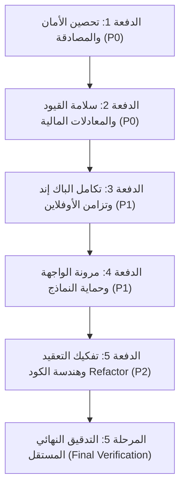

# خطة الإصلاح الشاملة والجدول الزمني للتنفيذ
## docs/audit/07-remediation-plan.md

**المشروع:** microERP  
**الفرع:** `review/full-audit`  
**المرحلة:** المرحلة 2 - خطة الإصلاح والترتيب الزمني (Remediation Plan)  
**الحالة:** بانتظار اعتماد مدير المشروع والمستخدم للانتقال إلى المرحلة 3 (الإصلاح والاختبار)

---

## 1. منهجية التنفيذ وقواعد السلامة الهندسية

وفقاً للقواعد الإلزامية الصارمة للمشروع، ستتم معالجة الملاحظات الـ 82 المكتشفة في المرحلة 1 عبر خطة هندسية دقيقة مقسمة إلى **5 دفعات متسلسلة (Batches)**، تخضع لكل منها دورة TDD الصارمة:
1. **اختبار فاشل أولاً (Red Test):** كتابة اختبار يثبت وجود المشكلة أو الثغرة ويفشل في بيئة الكود الحالية.
2. **إصلاح جراحي دقيق (Green Fix):** تعديل الكود المحدد دون المساس بأي وظائف جانبية.
3. **نجاح الاختبار وتأكيد عدم التراجع (Green & Regression-Free):** التأكد من نجاح الاختبار الجديد واجتياز كافة الاختبارات الـ 138 السابقة بنسبة 100%.
4. **تجميع مستقل (Atomic Git Commit):** تسجيل commit مستقل لكل دفعة مع وصف دقيق لما تم إنجازه.

---

## 2. جدول الدفعات والأولويات التنفيذية (Phased Batches)

---

## 3. الدفعة 1: تحصين الأمان والمصادقة (Security & Credentials Hardening - P0)

| المعرف | الأولوية | المشكلة | الملفات المتأثرة | المخاطر المحتملة (Regression Risks) | الاختبار المطلوب (Test Specification) |
|---|:---:|---|---|---|---|
| **SEC-01** | **Critical** | تخزين كلمات المرور بـ Base64 في `localStorage._cred` وإرسالها مع كل طلب. | `app-modular/js/core/05-auth-and-audit.js:214-226` `app-modular/js/core/02-api-sync.js:66-71` | تعطل تسجيل الدخول التلقائي أو استعادة الجلسة عند إعادة فتح التطبيق دون اتصال. | كتابة اختبار `tests/auth-security.test.js`: التأكد أن `localStorage.getItem('_cred')` يعيد `null` دائماً، وأن المصادقة تعتمد حصرياً على `sessionToken` مع تشفير الخزانة المحلية بـ SHA-256 المتعدد. |
| **SEC-02** | **Critical** | وجود باب خلفي في كود الطوارئ بالباك إند يمنح صلاحيات Superuser ببيانات افتراضية `admin/admin`. | `files(11)/GoogleAppsScript_Backend.gs.txt:841-853` | إغلاق حساب المسؤول إذا كانت قاعدة البيانات فارغة تماماً عند التثبيت الجديد لأول مرة. | كتابة اختبار وحدة يفحص دالة `login`: التحقق من أن طلب الدخول بحساب `admin/admin` أو `admin/123456` يُرفض بكود 401 ولا ينشئ مستخدماً خارقاً إلا بوجود سجل رسمي مسبق بكلمة مرور مشفرة بـ Salted Hash. |
| **SEC-03** | **Critical** | غياب التحقق من صلاحيات القراءة على الخادم وتسريب القيود والدفتر المالي لأي مستخدم (Missing Read RBAC). | `files(11)/GoogleAppsScript_Backend.gs.txt:510-588, 616-655` | تعطل واجهة الكاشير أو فني الصيانة إذا تم حجب جداول أساسية يحتاجونها في عملهم اليومي. | كتابة اختبار محاكاة لـ `getBootstrapData` بأدوار مختلفة: التحقق من أن دور `cashier` و `technician` لا يستلمان جداول `JournalEntries`، `Purchases`، أو `COA`، بينما يستلم `admin` و `accountant` كافة الجداول. |
| **SEC-04** | **High** | ثغرات DOM XSS عبر إدراج حقول البحث وبيانات المنشأة مباشرة في سمات HTML دون تعقيم. | `app-modular/js/modules/18a-appearance.js:339-388` `app-modular/js/modules/12-invoices-quotes.js:70` | تشويه عرض الشعار أو اسم الشركة أو كسر التنسيق إذا كانت البيانات تحتوي على رموز خاصة مشروعة. | اختبار حقن في `tests/security-xss.test.js`: تمرير `">` في اسم الشركة وحقول البحث والتأكد من تحويلها إلى كيانات آمنة عبر `escapeHtml`. |

---

## 4. الدفعة 2: سلامة القيود والمعادلات المالية (Accounting & Calculations - P0)

| المعرف | الأولوية | المشكلة | الملفات المتأثرة | المخاطر المحتملة (Regression Risks) | الاختبار المطلوب (Test Specification) |
|---|:---:|---|---|---|---|
| **ACC-01** | **Critical** | اختلال توازن قيد مبيعات POS المجزأة (Split Payment) وإغفال المتبقي الآجل وعدم خصم الفكة. | `app-modular/js/core/03-utils-and-mappings.js:1984-2046` `app-modular/js/modules/15-pos-retail.js:1260-1275` | رفض الخادم لقيد البيع لعدم الاتزان، أو حدوث عجز حقيقي في درج النقدية. | كتابة اختبار `tests/pos-split-payment.test.js`: محاكاة فاتورة بقيمة 250 ج.م، مدفوع 100 نقداً (مع إعطاء 120 وارجاع 20 فكة) و 50 بنك و 100 آجل، والتحقق أن القيد متوازن بدقة: المدين (نقدية 100 + بنك 50 + عميل 100 = 250) والدائن (مبيعات 250) مع `isBalancedEntry === true`. |
| **ACC-02** | **Critical** | مضاعفة إيرادات وتكلفة البضاعة المباعة تلقائياً عند تشغيل المطابقة التاريخية لتضارب بادئة المرجع (`POS_Sale_` مقابل `Sale_`). | `app-modular/js/core/03-utils-and-mappings.js:2069` `app-modular/js/core/04-chart-of-accounts.js:193` | حذف قيود صحيحة أو ترك فواتير قديمة دون قيود إذا تغيرت شروط البحث. | اختبار تسوية في `tests/reconciliation-pos.test.js`: إدخال 5 عمليات بيع، تشغيل دالة المطابقة `reconcileHistoricalJournalEntries()`، والتأكد من عدم إنشاء أي قيد مكرر وسلامة رصيد حساب 4102 و 5102. |
| **ACC-03** | **Critical** | تشويه ومضاعفة تكلفة الوحدة المرجحة WAC عند التوريد في ظل رصيد مخزون سالب. | `app-modular/js/core/03-utils-and-mappings.js:2319` `files(11)/GoogleAppsScript_Backend.gs.txt:1836` | خطأ في تقييم المخزون المتبقي إذا تم الشراء بأسعار مختلفة. | اختبار في `tests/inventory-wac.test.js`: رصيد سالب (-5) وشراء 10 قطع بسعر 100 ج.م، والتحقق أن WAC الجديد يصبح 100.00 ج.م بدقة وليس 200 ج.م. |
| **ACC-04** | **Critical** | مرتجعات المبيعات والمشتريات لا تعكس ضريبة القيمة المضافة (1105 و 2104). | `app-modular/js/modules/15-pos-retail.js:2549, 2621` `app-modular/js/core/03-utils-and-mappings.js:2966` `Backend:1760, 1969` | اختلال رصيد الضريبة المستحقة أو هدر حق استرداد ضريبة المدخلات. | اختبار في `tests/vat-returns.test.js`: إجراء مرتجع بيع بقيمة 114 ج.م، والتحقق من تسجيل مدين 4102 بقيمة 100 ومدين 2104 بقيمة 14 ودائن النقدية 114. |
| **ACC-05** | **Critical** | قيد يومية الرواتب يختل توازنه إذا زادت استقطاعات الموظف عن راتبه الأساسي. | `app-modular/js/modules/17g-employee-advances-hr.js:355-361` `app-modular/js/core/09-finance-engine.js:869` | ضياع المتبقي من السلفة على المنشأة إذا تم تصفيرها بالكامل. | اختبار في `tests/payroll-balance.test.js`: راتب 3000 وسلف مستحقة 3500، والتحقق أن صافي الصرف في القيد 0.00 وليس سالباً، وأن القيد متوازن بدقة، وترحيل 500 ج.م للشهر التالي. |
| **ACC-06** | **High** | استخدام حسابات تجميعية (`42` و `52`) في القيود الآلية مما يسبب رفض الخادم للقيد وإسقاطه في صمت. | `app-modular/js/core/03-utils-and-mappings.js:2240, 2258` `app-modular/js/modules/12-invoices-quotes.js:1041` | ظهور فروق في ميزان المراجعة إذا لم تكن الحسابات الفرعية البديلة متوافقة مع شجرة الحسابات. | اختبار ترحيل قيود تسوية الخزينة والمصروفات، والتأكد من استخدام الحسابات الفرعية `4201` و `5208` بنجاح ودون أخطاء. |
| **ACC-07** | **High** | خلل دالة `round2` في تقريب القيم السالبة النصفية (مثل `-1.005`). | `app-modular/js/core/09-finance-engine.js:64-68` | تأثير طفيف على فوارق القروش في كشوفات الحساب المدينة والدائنة. | إضافة حالات اختبارية في `tests/money.test.js` تفحص الأرقام السالبة النصفية مثل `-1.005` و `-2.015` والتأكد من مطابقتها للقيمة المحاسبية المتماثلة. |

---

## 5. الدفعة 3: تكامل الباك إند وتزامن الأوفلاين (Backend & Integration - P1)

| المعرف | الأولوية | المشكلة | الملفات المتأثرة | المخاطر المحتملة (Regression Risks) | الاختبار المطلوب (Test Specification) |
|---|:---:|---|---|---|---|
| **INT-01** | **Critical** | غياب مسارات الموارد البشرية والسلف والرواتب بالكامل في مصفوفة الباك إند وجداول الشيت. | `files(11)/GoogleAppsScript_Backend.gs.txt:252-309, 473-664` `app-modular/js/modules/17g-employee-advances-hr.js:11,31,45,59` | فشل إنشاء جداول `HR_Advances` و `HR_Payroll` في Google Sheets إذا كانت الصلاحيات السحابية ناقصة. | اختبار تكاملي يستدعي الدوال الأربع للموارد البشرية والتحقق من عودة استجابة 200 OK وتخزين السجلات في الشيتات السحابية. |
| **INT-02** | **Critical** | ثغرة الإقرار الكاذب بالـ Idempotency وضياع الفواتير والإيصالات صامتاً عند تعثر الحفظ. | `files(11)/GoogleAppsScript_Backend.gs.txt:999, 1467, 1795, 2246, 3035` | تكرار العمليات إذا تم تحرير القفل بشكل غير سليم أثناء المحاولة الثانية. | اختبار محاكاة لخطأ سحابي أثناء حفظ فاتورة بمفتاح معين، وإعادة إرسال نفس المفتاح والتأكد من محاولة الحفظ مجدداً وعدم إعادة نجاح كاذب. |
| **INT-03** | **Critical** | طابور الأوفلاين يفكك كائنات البيانات مسبباً انهيار مزامنة عروض الأسعار والمشاريع بـ `TypeError`. | `app-modular/js/core/02-api-sync.js:600-602, 1175-1178` `app-modular/js/modules/21-cctv-projects.js:24` | تلف المهام المخزنة حالياً في طابور الأوفلاين بالمتصفح. | اختبار في `tests/offline-queue.test.js`: إضافة مهمة عرض أسعار للطابور، واستدعاء دالة المعالجة والتأكد من وصول كائن `{ data: ... }` مكتملاً للخادم. |
| **INT-04** | **Critical** | تعارض باراميتر تعديل المخزون في مشاريع الكاميرات (`id, quantity` مقابل `delta`) يوقف الخصم كلياً. | `app-modular/js/modules/21-cctv-projects.js:1033, 1866` `Backend:1328` | خصم مضاعف للمخزون إذا احتسب الكود الفارق مرتين. | اختبار في `tests/cctv-inventory.test.js`: صرف كاميرات لمشروع، والتأكد من إرسال واستقبال `delta` بدقة وخصم المخزون سحابياً ومحلياً. |
| **INT-05** | **Critical** | الخادم يحول نوع أي قيد مرسل قسرياً إلى `Manual` مما يدمر تصنيفات القيود. | `files(11)/GoogleAppsScript_Backend.gs.txt:2226` | تمكين مستخدم غير مصرح من إرسال قيود نظامية حساسة إذا فُتحت الصلاحية بالكامل. | اختبار إرسال قيد بنوع `Payroll` من نظام موثق والتحقق من حفظ النوع الأصلي، بينما يُحول القيد اليدوي العادي إلى `Manual`. |
| **INT-06** | **High** | واجهة الذكاء الاصطناعي معطلة بخطأ 404 لاعتمادها على معرف وهمي غير موجود (`gemini-3.5-flash`). | `app-modular/js/core/06-config-defaults.js:120` `app-modular/js/modules/11d-ai-assistant.js:45,73` | رفض مفتاح API إذا كان النموذج الجديد يتطلب تنسيقاً مختلفاً في نص البرومبت. | اختبار وحدة يفحص الرابط المبني لاستدعاء الذكاء الاصطناعي والتأكد من استخدام المعرف الرسمي `gemini-2.5-flash` أو `gemini-1.5-flash`. |
| **INT-07** | **High** | تراكم جلسات تسجيل الدخول في ScriptProperties حتى سقف 500KB وتوقف النظام بالكامل. | `files(11)/GoogleAppsScript_Backend.gs.txt:194, 226-231` | تسجيل خروج مستخدمين نشطين إذا تم تنظيف الجلسات بشكل خاطئ. | اختبار دالة تنظيف الجلسات والتأكد من مسح الجلسات منتهية الصلاحية مع الحفاظ التام على الجلسات الحية. |

---

## 6. الدفعة 4: مرونة الواجهة وحماية النماذج (UI Resilience & Forms - P1)

| المعرف | الأولوية | المشكلة | الملفات المتأثرة | المخاطر المحتملة (Regression Risks) | الاختبار المطلوب (Test Specification) |
|---|:---:|---|---|---|---|
| **UI-01** | **High** | غياب منع الإرسال المزدوج (Double-Submission) في نوافذ الفواتير والقيود والمدفوعات. | `app-modular/js/modules/11e-customer-reports.js:726-827` `app-modular/js/modules/17b-journal.js:148-187` `app-modular/js/modules/10a-intake-wizard.js:1746` | بقاء الأزرار معطلة إذا فشل التحقق الأولي للنموذج أو حدث استثناء غير ملتقط. | اختبار واجهة بمحاكاة النقر المزدوج السريع (أقل من 300ms) والتأكد من إطلاق طلب شبكي وحيد وتعطيل الزر مؤقتاً مع مؤشر تحميل. |
| **UI-02** | **High** | خصم المخزون الاستباقي محلياً بنقطة البيع قبل إتمام العملية مما يضاعف الخصم عند فشل الشبكة. | `app-modular/js/modules/15-pos-retail.js:1410-1431` | بيع صنف نفد مخزونه إذا تأخر التحديث اللحظي. | اختبار محاكاة فشل إتمام البيع والتأكد من عودة كميات المخزون في الذاكرة لما كانت عليه وإبقاء السلة كما هي. |
| **UI-03** | **Medium** | غياب عزل نصوص أرقام الهواتف (BiDi Isolation) مما يقلب علامة `+` الدولية في كروت الصيانة. | `app-modular/js/modules/10b-receipts-list.js:104,209` | انكسار تصميم الجدول أو تمدد الأعمدة. | فحص كود التوليد والتأكد من تغليف أرقام الهواتف بسمات `dir="ltr"` و `unicode-bidi: isolate`. |
| **UI-04** | **Medium** | عدم استعادة أزرار الحفظ لحالتها ونصوصها الأصلية عند حدوث خطأ شبكي. | `app-modular/js/modules/10a-intake-wizard.js:1746,1778` | عدم قدرة المستخدم على إعادة الضغط بعد تصحيح الخطأ. | اختبار معالجة الخطأ والتأكد من إعادة تفعيل الزر وإعادة النص الأصلي "حفظ وطباعة". |

---

## 7. الدفعة 5: تفكيك التعقيد وهندسة الكود (Refactoring & Code Quality - P2)

| المعرف | الأولوية | المشكلة | الملفات المتأثرة | المخاطر المحتملة (Regression Risks) | الاختبار المطلوب (Test Specification) |
|---|:---:|---|---|---|---|
| **REF-01** | **High** | تسرب منطق القيود المحاسبية وحسابات الأستاذ العام مباشرة داخل معالجات أحداث أزرار الواجهة. | `app-modular/js/modules/10c-receipt-actions.js:304-332` `app-modular/js/modules/12-invoices-quotes.js:735, 1010` `app-modular/js/modules/11e-customer-reports.js:766-786` | فقدان بعض الحقول الوصفية أو المراجع الخاصة بالشاشات عند التوحيد. | اختبارات وحدة مركزية في `tests/finance-engine-entries.test.js` تضمن أن كافة القيود المولدة عبر `FinanceEngine` مطابقة تماماً للمخرجات السابقة. |
| **REF-02** | **High** | تفكيك الدالة العملاقة `renderReceiptDetailModal` (1,390 سطراً، تعقيد دوري 522). | `app-modular/js/modules/10d-receipt-detail.js:2-1394` | انكسار ربط مستمعات الأحداث (Event Listeners) أو تبديل التبويبات داخل النافذة المنبثقة. | اختبارات تكاملية لفتح النافذة، تعديل البيانات، إضافة دفعة، وتبديل التبويبات بنجاح. |
| **REF-03** | **Medium** | فك ترقيعة الـ Hoisting الهشة في `07-state.js` وضبط تسلسل استدعاءات الموديولات في `build.js`. | `app-modular/js/core/07-state.js:128-131` `app-modular/build.js` | انهيار الإقلاع المبكر إذا استُدعيت دالة قبل تعريفها. | تشغيل `npm run verify` و `npm test` والتأكد من إقلاع التطبيق دون أي أخطاء `ReferenceError`. |
| **REF-04** | **Low** | إزالة الكود الميت ونقل وظائف النسخ الاحتياطي المحشورة في موديول استوديو الباركود إلى موديولها المخصص. | `app-modular/js/modules/18e-barcode-studio.js:1381-1710` `app-modular/js/modules/18f-backup.js` | تعطل توليد الباركود أو تصدير النسخ الاحتياطية. | فحص شامل لوظائف طباعة الباركود وتصدير واستيراد النسخ الاحتياطية والتأكد من عملهما باستقلالية تامة. |

---

## 8. معايير القبول والجاهزية للمرحلة 3 (Exit Criteria)

لكي ننتقل من هذه الخطة إلى التنفيذ في **المرحلة 3 (الإصلاح والاختبار)**:
1. **الموافقة الصريحة:** اعتماد المستخدم لهذه الخطة وترتيب أولوياتها.
2. **اختبارات قبلية:** لن يتم تعديل سطر برمجي واحد دون كتابة الاختبار التوكيدي الفاشل أولاً.
3. **سلامة خط الأساس:** التأكد من اجتياز الـ 138 اختباراً الحالية بعد كل commit منفصل.
