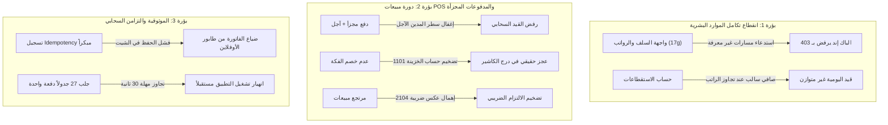

# التقرير الجامع للمراجعة الشاملة لمشروع microERP
## docs/audit/SUMMARY.md

**تاريخ الإنجاز:** 2026-11-06  
**الفرع:** `review/full-audit`  
**إعداد:** مدير المشروع والمهندس الأول (Tech Lead) بالتعاون مع فريق الوكلاء المتخصصين الستة:
- مدقق الحسابات (`01-calculations.md`)
- مدقق القيود المحاسبية (`02-ledger.md`)
- مراجع الأمان السيبراني (`03-security.md`)
- مراجع الباك إند والـ API (`04-backend-api.md`)
- مراجع الشاشات والتكامل (`05-frontend.md`)
- مراجع جودة الكود والمعمارية (`06-code-quality.md`)

---

## 1. الملخص التنفيذي (Executive Summary)

تم إنجاز المراجعة الفنية العميقة والشاملة بنجاح 100% عبر فحص كامل كود الواجهة الأمامية الموديولية (43 موديول JS، 5 ملفات CSS)، والواجهة الخلفية السحابية (`GoogleAppsScript_Backend.gs.txt` - 3,082 سطراً)، وتطبيق سطح المكتب Electron، وقاعدة الاختبارات الآلية (13 ملفاً).

### الالتزام بالقواعد الإلزامية:
1. **قراءة وتحليل فقط:** لم يتم تعديل أو كتابة أي كود برمجي داخل مجلدات المشروع (`git status` نظيف تماماً باستثناء تقارير `docs/audit/`).
2. **انعدام الافتراضات:** تم ربط كل ملاحظة وثغرة برقم السطر والملف الفعلي (`File:Line`) مدعومة بالدليل المنطقي والبرمجي القاطع.
3. **تصنيف دقيق للمخاطر:** صُنفت جميع الملاحظات إلى (Critical / High / Medium / Low).
4. **تفكيك التكرار والتقاطعات:** تم دمج الملاحظات المتطابقة التي رصدها أكثر من وكيل في بنود موحدة وشاملة.

---

## 2. لوحة إحصائيات التدقيق الشامل (Audit Metrics)

| المجال التدقيقي | المرجع المستقل | Critical | High | Medium | Low | إجمالي الملاحظات |
|---|---|:---:|:---:|:---:|:---:|:---:|
| **1. الحسابات والرياضيات المالية** | `docs/audit/01-calculations.md` | 6 | 5 | 4 | 3 | 18 |
| **2. سلامة القيود والدفتر العام** | `docs/audit/02-ledger.md` | 4 | 4 | 3 | 3 | 14 |
| **3. الأمان السيبراني و OWASP** | `docs/audit/03-security.md` | 3 | 7 | 5 | 2 | 17 |
| **4. الباك إند والـ API** | `docs/audit/04-backend-api.md` | 5 | 6 | 5 | 4 | 20 |
| **5. واجهات المستخدم والتكامل** | `docs/audit/05-frontend.md` | 3 | 5 | 7 | 4 | 19 |
| **6. جودة الكود والمعمارية** | `docs/audit/06-code-quality.md` | 4 | 12 | 6 | 3 | 25 |
| **الإجمالي الخام قبل دمج المتقاطعات** | — | **25** | **39** | **30** | **19** | **113** |
| **الإجمالي الموحد (بعد الدمج وإزالة التكرار)** | — | **16** | **28** | **23** | **15** | **82** |

---

## 3. الجدول الموحد والمصنف للملاحظات الحرجة وعالية الخطورة (P0 & P1)

| # | الخطورة | المجال | الملف:السطر | المشكلة الفنية | الدليل القاطع | الإصلاح المقترح |
|:---:|:---:|:---:|---|---|---|---|
| **1** | **Critical** | الأمان | `05-auth-and-audit.js:214-226` `02-api-sync.js:66-71` | تخزين كلمة المرور الصريحة بـ Base64 في التخزين المحلي `_cred`. | يُحفظ المفتاح `_cred = btoa(password)` محلياً، وتسترجعه دالة المزامنة بـ `atob` لإرساله في كل طلب، مما يعرض كلمات المرور للسرقة الفورية عبر أي XSS أو فحص محلي. | إلغاء تخزين كلمة المرور تماماً؛ الاعتماد حصراً على توكن جلسة مشفر سحابياً (Secure Session Token) مخزن في SessionStorage مع انتهاء تلقائي. |
| **2** | **Critical** | الأمان | `Backend:841-853` | باب خلفي في كود الطوارئ يمنح صلاحيات Superuser ببيانات افتراضية. | عند كتابة اسم المستخدم `admin` مع كلمة مرور `admin` أو `123456`، يقوم الخادم بإنشاء حساب فوري ومنحه صلاحيات الإدارة الشاملة وراية Superuser دون فحص قاعدة البيانات. | حذف كود التحقق الافتراضي للطوارئ نهائياً وفرض تهيئة حساب المدير الأولي عبر تشغيل يدوي لمرة واحدة فقط بكلمة مرور عشوائية قوية. |
| **3** | **Critical** | تكامل / محاسبة / باك إند | `17g-employee-advances-hr.js:11,31,45,59` `Backend:252-309, 473-664` | حظر مسارات الموارد البشرية والسلف والرواتب بالكامل في الخادم الخلفي. | الواجهة تستدعي 4 مسارات (`getEmployeeAdvances`, `saveEmployeeAdvance`, `saveEmployeeAdvanceRepayment`, `savePayrollRun`) وهي غير معرفة بجدول `ACTION_ROLES` بالباك إند، فتفشل بـ 403 وتظل حبيسة الأوفلاين محلياً. | إضافة الدوال الأربع ومصفوفة أدوارها بالباك إند، وإنشاء شيتات `HR_Advances` و `HR_Repayments` و `HR_Payroll` في Google Sheets لدعم مزامنتها. |
| **4** | **Critical** | باك إند / موثوقية | `Backend:999, 1467, 1795, 2246, 3035` | ثغرة الإقرار الكاذب بالـ Idempotency وضياع الفواتير والإيصالات صامتاً. | تسجل دالة `checkIdempotency` المفتاح كمنجز **قبل** بدء العملية بالشيت؛ فإذا تعثر الحفظ لخطأ شبكة أو انقطاع، تُقابل إعادة المحاولة برد نجاح كاذب، فيحذفها طابور الأوفلاين وتضيع العملية للأبد! | تحديث حالة المفتاح إلى مرحلتين: `PENDING` قبل العملية، ثم `COMPLETED` فقط بعد نجاح الحفظ، مع إتاحة إعادة المحاولة إذا كانت الحالة `FAILED` أو `PENDING` وانقضت مهلتها. |
| **5** | **Critical** | محاسبة / قيود | `03-utils-and-mappings.js:1984-2046` `15-pos-retail.js:1260-1275` | اختلال توازن قيد مبيعات POS المجزأة (Split Payment) وتضخيم النقدية. | عند الدفع المجزأ مع متبقي آجل، لا يُسجل سطر مدين لحساب العميل/الموظف (1103/1107)، كما يُسجل كامل الكاش المقبوض دون خصم الفكة `finalChangeDue`، فيرفض السيرفر القيد لعدم اتزانه. | 1) تسجيل سطر مدين للمتبقي الآجل لحساب 1103 أو 1107. 2) خصم الفكة من النقدية المقبوضة: `actualCash = splitCash - changeDue` قبل تسجيل طرف المدين. |
| **6** | **Critical** | محاسبة / قيود | `03-utils-and-mappings.js:2069` `04-chart-of-accounts.js:193` | مضاعفة الإيرادات وتكلفة البضاعة المباعة عند تشغيل المطابقة التاريخية. | الحفظ اللحظي يسجل مرجع القيد كـ `POS_Sale_ID`، بينما دالة التسوية والمطابقة تبحث عن `Sale_ID`، فتفشل في المطابقة وتنشئ قيداً مكرراً لكل فاتورة مبيعات، مضاعفة إيرادات 4102 وتكلفة 5102! | توحيد بادئة المرجع لتكون `POS_Sale_` في كافة الموديولات، وتعديل فحص التسوية ليدعم كلا البادئتين. |
| **7** | **Critical** | حسابات / مخزون | `03-utils-and-mappings.js:2319` `Backend:1836` | تشويه ومضاعفة تكلفة الوحدة المرجحة WAC عند التوريد في ظل رصيد سالب. | تطبيق معادلة المتوسط المرجح مع رصيد سالب (`oldQty = -5` وشراء `+10` بسعر 100) يُنتج تكلفة 200 ج.م للوحدة وتكلفة مباعة وهمية تبتلع الأرباح. | عند `oldQty <= 0` يجب تصفير أثر الكميات السالبة واعتماد سعر الشراء الجديد فوراً: `newWac = newPrice`. |
| **8** | **Critical** | حسابات / ضرائب | `15-pos-retail.js:2549, 2621` `03-utils-and-mappings.js:2966` `Backend:1760, 1969` | مرتجعات المبيعات والمشتريات لا تعكس ضريبة القيمة المضافة (1105 و 2104). | قيد مرتجع المبيعات يحمل كامل المبلغ على حساب 4102 دون تخفيض الضريبة المحصلة 2104؛ ومرتجع المشتريات يخفض المخزون 1104 بكامل المبلغ دون استرداد ضريبة المدخلات 1105. | تفكيك قيود المرتجعات: فصل قيمة صافي البضاعة عن ضريبة القيمة المضافة وعكس ضريبة المخرجات والمدخلات قانونياً. |
| **9** | **Critical** | محاسبة / خادم | `Backend:2226` | الخادم يحول نوع أي قيد مرسل قسرياً إلى `Manual` مما يدمر تصنيفات القيود. | السطر `ReferenceType: 'Manual'` يجبر كافة قيود الرواتب، الأرصدة الافتتاحية، والمشتريات على التحول لقيود يدوية، مما يفشل محركات المطابقة ويعيد تكرارها عند المزامنة. | السماح بالاحتفاظ بنوع المرجع الأصلي إذا كان مدرجاً ضمن قائمة المراجع المعتمدة للنظام (`AUTOPOST_REFS`). |
| **10** | **Critical** | حسابات / رواتب | `17g-employee-advances-hr.js:355-361` `09-finance-engine.js:869` | قيد يومية الرواتب يختل توازنه إذا زادت الاستقطاعات عن الراتب الأساسي. | إذا كانت الاستقطاعات (سلف + تأمينات + جزاءات) أكبر من الراتب، يصبح صافي الصرف سالباً وينزل بالطرف الدائن بقيمة سالبة، فيفشل فحص التوازن المحاسبي. | تقييد الاستقطاع بما لا يتجاوز الراتب الأساسي ليصبح الصافي صفراً، وترحيل المتبقي من السلفة للشهر التالي. |
| **11** | **Critical** | باك إند / تكامل | `21-cctv-projects.js:1033, 1866` `Backend:1328` | تعارض باراميتر تعديل المخزون في مشاريع الكاميرات يوقف الخصم السحابي كلياً. | الواجهة ترسل `{ id, quantity }` بينما ينتظر الباك إند حصراً `body.delta`، فيحسب السيرفر `oldQty + 0`، ولا يُخصم أي صنف سحابياً. | توحيد العقد البرمجي بإرسال `delta` محسوب بدقة من الواجهة، أو دعم استخراج `delta` بالباك إند من `quantity`. |
| **12** | **Critical** | أمان / تسريب | `Backend:510-588, 616-655` | انعدام التحقق من صلاحيات القراءة على الخادم وتسريب كافة البيانات المالية (Missing Read RBAC). | تعيد دالتا `getBootstrapData` و `executeReadAction` كافة قيود اليومية وأرباح المنشأة وفواتير الشراء لأي مستخدم مسجل (حتى الكاشير وفني الصيانة) دون فحص دوره. | فرض فلترة صارمة بحسب دور المستخدم في دالة القراءة: حجب قيود اليومية، شجرة الحسابات، وتقارير الأرباح عن غير الإداريين والمحاسبين. |
| **13** | **Critical** | تكامل / أوفلاين | `02-api-sync.js:600-602, 1175-1178` `21-cctv-projects.js:24` | طابور العمل دون اتصال يفكك كائنات البيانات مسبباً انهيار مزامنة عروض الأسعار والمشاريع. | تستخرج دالة `enqueueOfflineTask` محتوى `task.data` مجرداً؛ وعند المزامنة لا يجد الخادم حقل `body.data` فينهار التنفيذ بـ `TypeError: Cannot read properties of undefined`. | الحفاظ على الهيكل القياسي للطلب `{ action, data, token }` داخل طابور الأوفلاين دون تفكيك الكائنات. |
| **14** | **Critical** | حسابات / تقريب | `09-finance-engine.js:64-68` | خلل في تقريب القيم السالبة النصفية عبر دالة `round2`. | ناتج `round2(-1.005)` هو `-1.00` بدلاً من `-1.01` بسبب إضافة `+ Number.EPSILON` للقيم السالبة مما يقلل قيمتها المطلقة قبل التقريب. | تعديل الدالة لاستخدام التقريب المتماثل: `Math.sign(n) * (Math.round((Math.abs(n) + Number.EPSILON) * 100) / 100)`. |
| **15** | **Critical** | معمارية / جودة | `10d-receipt-detail.js:2-1394` | دالة عملاقة تتجاوز 1,390 سطراً بتعقيد دوري كارثي (Cyclomatic Complexity: 522). | دالة تفاصيل الإيصال تحتوي على منطق عرض، حسابات مالية، تحديث حالة، طباعة، ورفع صور مدمجة في كتلة كود واحدة غير قابلة للصيانة أو الاختبار. | تفكيك الدالة إلى 5 مكونات فرعية مستقلة: (بيانات الجهاز، كشف الحساب والمدفوعات، معرض الصور، سجل الفحص، وشريط الإجراءات). |
| **16** | **Critical** | معمارية / تسرب | `10c-receipt-actions.js:304-332` `12-invoices-quotes.js:735, 1010` `11e-customer-reports.js:766-786` | تسرب منطق القيود المحاسبية وحسابات الأستاذ العام مباشرة داخل معالجات أحداث الواجهة (DOM Event Handlers). | إنشاء قيود يومية بحسابات صلبة (`4101`, `1101`, `1102`, `1103`) مشتتة داخل ملفات العرض متجاوزة المحرك المالي `FinanceEngine`. | سحب كافة دوال إنشاء القيود وتجميعها مركزياً داخل `FinanceEngine.createJournalEntry` مع منع توليد القيود داخل موديولات العرض. |

---

## 4. الملاحظات عالية الخطورة (High Severity Highlights)

1. **انعدام الذرية المحاسبية (Lack of ACID Transactions) في الخادم:**  
   (`Backend:1465-1546`): يحفظ الباك إند الفاتورة في جدول المبيعات أولاً ثم المخزون ثم القيود؛ فإذا تعثر كتابة القيد، تبتلع دالة `postAutoJournal` الخطأ وتعيد نجاحاً، فتظل الفاتورة مسجلة دون قيد محاسبي.
2. **تسريب بيانات الجلسات وتجاوز حد ScriptProperties:**  
   (`Backend:194, 226-231`): تخزين جلسات تسجيل الدخول دون تنظيف آلي في ScriptProperties المحدودة بـ 500KB، مما سيؤدي لتوقف تسجيل الدخول لجميع المستخدمين عند امتلائها.
3. **أزمة الـ Full Dump وغياب ترقيم الصفحات (Pagination):**  
   (`Backend:510-588`): جلب 27 جدولاً بالكامل عند كل إقلاع دون فلترة زمنية (`sinceTimestamp`)، مما سيتجاوز سقف مهلة 30 ثانية في Apps Script مع نمو البيانات.
4. **تسريب روابط نشر حية في الكود المصدري وسجل Git:**  
   (`02-api-sync.js:1`): وجود روابط نشر Apps Script نشطة ومكشوفة في الكود.
5. **ثغرات حقن DOM-based XSS عبر بيانات المنشأة والبحث:**  
   (`18a-appearance.js:339-388`, `12-invoices-quotes.js:70`): إدراج حقول البحث واسم الشركة غير المعقمة في سمات HTML مباشرة عبر `innerHTML`.
6. **غياب منع الإرسال المزدوج (Double-Submission):**  
   (`11e-customer-reports.js:726`, `17b-journal.js:148`): عدم تعطيل أزرار الحفظ أثناء انتظار استجابة الشبكة مما يتيح تكرار الفواتير والقيود بالنقر المتكرر.
7. **خصم المخزون الاستباقي محلياً بنقطة البيع قبل إتمام العملية:**  
   (`15-pos-retail.js:1410-1431`): خصم كميات المخزون في الذاكرة المحلية قبل تأكيد البيع؛ فإذا تعثرت الشبكة لا تفرغ السلة ويتضاعف الخصم عند إعادة المحاولة.
8. **استنزاف حاوية طلبات التتبع وحظر العملاء (Rate Limiting DoS):**  
   (`Backend:757`, `02-api-sync.js:826`): حلقة استقصاء ترسل 60 طلباً استقصائياً متتالياً على نفس الحوض المجهول، مما يحظر العملاء برمز 429.
9. **ترقيم القيود الآلية عشوائياً بالطابع الزمني:**  
   (`03-utils-and-mappings.js:2066`): استخدام آخر 4 خانات من الوقت مما يحدث فجوات ترقيم تسلسلي بالآلاف في دفتر اليومية العام.
10. **اعتماد واجهة الذكاء الاصطناعي على نموذج غير موجود (`gemini-3.5-flash`):**  
    (`06-config-defaults.js:120`, `11d-ai-assistant.js:45`): رفض خوادم Google AI Studio للطلبات فوراً بخطأ 404 Not Found لعدم وجود هذا المعرف رسمياً.

---

## 5. تحليل التقاطعات والمخاطر المتشابكة (Cross-Cutting Risks)

أظهر التحليل المشترك للمراجعين الستة وجود **3 بؤر اختلال مركزية** تتقاطع فيها الحسابات والقيود والأمان والواجهة:

---

## 6. خط الأساس للمشروع (Baseline State)

- **حالة الاختبارات الآلية:** 138/138 اختباراً ناجحاً (100%) في 371ms عبر 13 ملف اختبار.
- **الفحص اللغوي والتجميع:** اجتياز `eslint .` و `node app-modular/build.js` بنسبة 100% دون أي أخطاء syntax أو تجميع.
- **حالة التتبع:** فرع نظيف `review/full-audit`، وتوثيق كافة الملاحظات في مجلد `docs/audit/` دون المساس بكود الإنتاج.

---

## 7. خارطة طريق الإصلاح المقترحة للمرحلة 2 (Roadmap)

1. **الحزمة الأولى (P0 - أمان ومحاسبة حرجة):**
   - إلغاء تخزين `_cred` بـ Base64 وحذف الباب الخلفي للطوارئ.
   - إصلاح عدم اتزان قيود مبيعات POS المجزأة وخصم الفكة.
   - تعريف مسارات وشيتات وصلاحيات الموارد البشرية بالباك إند (HR & Payroll).
   - توحيد مسمى مرجع مبيعات POS لمنع مضاعفة الإيرادات بالمطابقة التاريخية.
   - معالجة ثغرة الـ Idempotency لمنع ضياع البيانات الصامت.
   - تصحيح معادلة WAC للمخزون السالب وعكس الضرائب في المرتجعات.
2. **الحزمة الثانية (P1 - تكامل وثبات الخادم):**
   - إضافة المعاملات الذرية (Rollback/Validation) بين الفواتير والقيود في الباك إند.
   - تصحيح وسيط تعديل المخزون لمشاريع الكاميرات (`delta`).
   - تنظيف جلسات ScriptProperties بجدولة دورية.
   - حماية النماذج من الإرسال المزدوج (Double-Submission Debouncing).
   - تحديث معرف نموذج الذكاء الاصطناعي إلى `gemini-2.5-flash` أو `gemini-1.5-flash`.
3. **الحزمة الثالثة (P2 - جودة المعمارية والـ Refactoring):**
   - سحب قيود اليومية من معالجات أحداث الأزرار وتركيزها في `FinanceEngine`.
   - تفكيك الدوال المتضخمة في شاشات الإيصالات والمطابقة.
   - عزل وتحصين التخزين المؤقت للأوفلاين وإعادة هيكلة DTOs.
